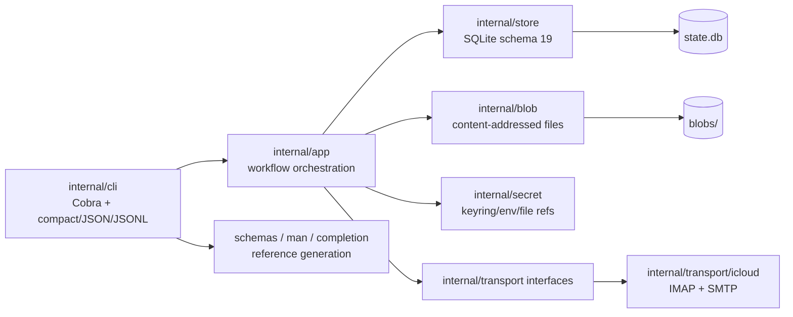

# iCloud Mail Agent Parity Expansion Sweep

## Coordinates and scope

- **Planning date:** 2026-08-10.
- **Destination repository:** `amxv/icloud-cli` at `/workspace/repos/icloud-cli`.
- **Branch / baseline:** `main` at `1c3c9372af516564695e5daed6a766a277062141`; `origin/main` matched when research began. The commit after the Round 2 remediation changes only `src/pages/index.astro`, so the Go mail implementation remains the `c2e88e2` / `799b052` lineage.
- **Workflow artifacts consumed:** the attached `sweep.md`, `blueprint.md`, `plan-doc.md`, and Zodex Go CLI Planning Playbook. `gg/progress.md` was inspected only to reconstruct historical intent and the current completed-track boundary; code, tests, generated public contracts, and Git history were treated as implementation truth.
- **Research mode:** existing-product expansion. There is no separate source repository to port from; the current `icloud-cli` implementation is the behavioral baseline. External Apple documentation was consulted only for provider capability boundaries that cannot be inferred from the repository.
- **Mapped area:** account identity, outbound composition, replies/forwards/drafts, message flags, semantic folders, exact-location mutations, local and remote search, threads, watch, MIME/attachments, mailbox import/export seams, automation/schema/reference generation, release packaging, and the tests/history that constrain those paths.

This document maps the system as it exists. It does not select the implementation architecture or prescribe phases.

## Architecture map



`internal/app/app.go` constructs one `internal/transport/icloud.Client` and passes it through the narrow interfaces recorded on `accountCommands`. The same transport object implements validation, folder discovery/admin, sync, watch, remote reads, flag mutations, location mutations, SMTP send, and IMAP APPEND. There is no hosted service, HTTP API, daemon, second mail store, or Apple web-session client.

Durable mail state is split between one versioned SQLite database and one content-addressed blob root. `openWriteState` takes the shared account-state flock before opening the database; provider-facing write workflows serialize through that boundary. SQLite uses WAL, foreign keys, a busy timeout, and one connection. Large raw MIME and decoded attachments remain outside SQLite and are addressed by content hash/storage key.

## Entrypoints and composition

### Public command tree

`cmd/icloud/main.go` is the only native entrypoint. `internal/cli/root.go` builds the complete Cobra tree and injects `AccountService`, `FolderService`, and `MailService` implementations from `internal/app`.

Current mail leaves cover:

- send, reply, reply-all, forward;
- Inbox/folder listing, reconstructed conversation listing and thread reads;
- message show/raw/export;
- attachment list/save/save-all;
- draft create/update/list/show/sync/send/delete;
- folder list/status/show/enable/disable/create/rename/delete/subscribe/unsubscribe;
- mark-read/mark-unread/flag/unflag;
- move/copy/archive/unarchive/trash/restore/permanent delete;
- local and bounded remote search plus targeted hydration;
- sync, backfill, rebaseline, repair, checkpoints, foreground watch;
- outbound/mutation status.

There are no public identity, signature, VIP/block, mute, Junk/Not-Junk, unsubscribe, outbox, mailbox import/export, attachment-removal, S/MIME, or general mail-settings command groups.

### Application composition

`internal/app/accounts.go` defines `accountCommands`. Its protocol fields are deliberately capability-shaped rather than exposing the concrete iCloud client:

```go
type accountCommands struct {
    keyring       secret.Keyring
    imap          transport.IMAPValidator
    smtp          transport.SMTPValidator
    sender        transport.SMTPSender
    folders       transport.IMAPFolderClient
    folderAdmin   transport.IMAPFolderAdminClient
    mail          transport.IMAPInboxClient
    watch         transport.IMAPWatchClient
    remote        transport.IMAPRemoteClient
    flags         transport.IMAPFlagClient
    locations     transport.IMAPLocationClient
    sent          transport.IMAPSentAppender
    appendMailbox transport.IMAPMailboxAppender
    // blob factories, time, and ID hooks omitted here
}
```

The interface split is used heavily by deterministic app tests. New provider behavior that belongs in IMAP/SMTP is expected to cross this boundary rather than importing protocol packages into `internal/app` or `internal/cli`.

## Persistence and identity shapes

`internal/store/store.go` reports `SchemaVersion = 19`. Embedded goose migrations are the only schema authority. Existing migrations have one responsibility each: accounts/health, folders, sync/raw, content, attachments, location flags, cross-folder message identity, threads, FTS search, outbound attempts, outbound attachment/reconciliation state, reply/forward provenance, exact-location mutation intents, folder-rename recovery, historical backfill, drafts, and Round 2 thread/folder reliability.

### Accounts

`internal/account/account.go` currently models one mail address per profile:

```go
type Account struct {
    ID               string
    Name             string
    Email            string
    IMAPUsername     string
    Status           Status
    Default          bool
    CredentialScheme string
    IMAPCapabilities []string
    SMTPCapabilities []string
    // health timestamps omitted
}
```

`internal/store/accounts.go` persists `email_address` directly on `accounts`, enforces account selection/default rules, and stores only credential references. There is no account-owned collection of alternate send/self addresses, no sender-identity kind, and no per-address default/display-name state.

`AccountRepository.List(ctx, limit)` returns `([]Account, more, error)` with an ordered `LIMIT limit+1`, but no continuation cursor. `Resolve` can match account ID, friendly name, or primary email only.

### Messages and provider locations

`internal/mail/message.go` keeps logical message identity independent from provider location identity. A logical message may have multiple `Location` records, each carrying folder, UID/UIDVALIDITY, flags, mod-sequence, raw evidence, and presence. Schema 19 treats RFC Message-ID as evidence rather than a unique logical key.

Current aggregate message state exposes `Unread` and `Flagged`. The persisted location model also has `Answered`, `Draft`, and `Deleted`, but `Message` has no aggregate answered/replied/forwarded field.

`messages.direction` is persisted as `inbound` or `outbound`. `internal/app/mail_sync.go:messageDirection` classifies a new observation as outbound when it is in Sent/Drafts, has `\\Draft`, or its From address equals `Account.Email`. `internal/store/mail.go` makes outbound promotion monotonic on later merges.

### Threads

`internal/store/threads.go` owns the durable RFC reference graph, aliases, aggregates, and schema-19 deferred projection state. A normal affected rebuild is bounded at 10,000 messages; oversized derived work is durable and repairable without blocking canonical message/location commits.

`Thread` exposes subject/snippet, participants, folder IDs, message/unread/attachment counts, aliases, and projection status. There is no persisted local thread preference such as mute.

### Outbound attempts

`internal/store/outbound.go` stores a durable attempt before SMTP and records terminal `sent`, `failed`, or `unknown` outcome, idempotency identity, exact raw source, attachment metadata, reply parent or forward source provenance, and Sent reconciliation state. Ordinary status intentionally omits recipient/body payload.

A `forward` is represented by non-empty `source_message_id`; replies keep `parent_message_id`. That provenance survives after the child message is accepted and can identify source-message reply/forward history locally.

### Location mutation intents

`internal/mail/location_mutation.go` plus `internal/store/location_mutations.go` model one exact provider-location write per durable mutation: source location, optional destination folder/mapping, action, request hash/idempotency key, provider method, confirmed/failed/unresolved status, and reconciliation requirements.

The model assumes the logical message content/raw representation does not change. Move/copy/delete only update location rows and aggregate/derived state. It is therefore not a content-rewrite record.

## Account authentication and outbound sender behavior

Credential authentication and message sender identity are currently the same concept at the application boundary.

`internal/app/mail_send.go:normalizeAccountSendRequest` unconditionally overwrites the request From address:

```go
func normalizeAccountSendRequest(accountValue account.Account, request maildomain.SendRequest) (maildomain.SendRequest, string, error) {
    request.From = maildomain.Address{DisplayName: accountValue.Name, Email: accountValue.Email}
    normalized, err := maildomain.NormalizeSendRequest(request)
    // ...
}
```

SMTP authentication uses the account email, and the SMTP envelope From also uses `accountValue.Email`. Draft creation/synchronization likewise writes the account primary address as From. The lower mail-domain normalizer accepts a From address, but no current public workflow can preserve or choose a different one because `internal/app` replaces it.

`internal/app/mail_reply.go:resolveReplyPlan` constructs the reply-all self-address set from `accountValue.Email` plus `IMAPUsername` only when that username contains `@`. Alternate iCloud aliases, custom-domain addresses, and Hide My Email addresses are not represented, so they cannot participate in self-exclusion or sender selection.

## Send, reply, forward, and draft flows

### Send

`internal/mail/send.go` normalizes recipients, headers, bodies, and reviewed attachment metadata. It has hard bounds for body, composed RFC message, recipients, custom headers, attachment count, individual source size, and aggregate source size. BCC exists in the SMTP envelope but is omitted from the sent RFC message.

`internal/app/mail_send.go` stages reviewed attachment content, composes one exact RFC message into the content-addressed blob store, reparses it through the canonical MIME parser, persists the pending attempt, performs STARTTLS SMTP, and then persists the terminal outcome with a bounded cancellation-detached local context. Proven acceptance creates the local outbound logical message atomically; a later IMAP APPEND attempts to create/confirm the Sent copy. Unknown SMTP outcomes are non-retryable without explicit duplicate-risk authorization.

There is no durable queued-outbox state separate from `outbound_attempts`; a pre-acceptance failed attempt remains failed until an explicit retry request is issued.

### Reply

`internal/mail/reply.go:BuildReplyPlan` derives Reply-To/From recipients, visible reply-all participants, self-address exclusion, normalized Re: subject, and bounded RFC References. `internal/app/mail_reply.go` selects one exact parent and then delegates to `MailSend`.

No post-send provider state change is made to the parent. Although `\\Answered` is parsed and persisted on locations, a proven reply does not set it.

### Forward

`internal/app/mail_forward.go` selects one exact source and supports quoted text, attached EML, no original body, selected original attachments, and new attachments. It delegates delivery to the same outbound path. The durable `source_message_id` suppresses conservative thread fallback so a forward cannot silently rejoin the source conversation.

No provider “forwarded” keyword/state is mutated. Local forward provenance does exist through `outbound_attempts.source_message_id`.

### Drafts

`internal/app/mail_drafts.go` keeps draft lifecycle metadata separate while reusing the canonical message/content/blob path. Provider synchronization uses IMAP APPEND with `\\Draft`/`\\Seen`, replacement-before-delete, APPENDUID when available, and exact reconciliation otherwise. Draft send reuses the normal outbound path and cleans provider copies only after proven send.

Draft reconstruction currently restores ordinary attachment filename/type/hash/bytes; there is no outbound disposition/content-ID model to preserve inline compose semantics because the outbound attachment type does not have those fields.

## Flags and message-state mutation

`LocationFlags` parses and persists:

```go
type LocationFlags struct {
    Seen     bool
    Flagged  bool
    Answered bool
    Draft    bool
    Deleted  bool
    Unknown  []string
}
```

`FlagMutation` only defines mark-read, mark-unread, flag, and unflag. `internal/transport/icloud/flags.go:mutableFlag` accepts only `\\Seen` and `\\Flagged`. Conditional STORE is used when CONDSTORE/mod-sequence evidence is available, and the provider-returned current state is authoritative.

Unknown provider flags are deliberately retained. No current code interprets a provider-specific colored-flag keyword or forwarded marker.

## Folders, roles, and provider discovery

`internal/folder/folder.go` defines `inbox`, `sent`, `drafts`, `archive`, `trash`, `junk`, `all`, `flagged`, `important`, and `other`. `Folder.Kind` plus `KindSource` represents provider/discovery semantics.

`internal/transport/icloud/folders.go:mailboxKind` maps Inbox and SPECIAL-USE attributes. `applySentFallback` has a narrow compatibility fallback for common Sent mailbox names when no provider Sent role was advertised. There is intentionally no English-name fallback for Archive, Drafts, Trash, or Junk.

`internal/store/folders.go:ResolveKind` is a safety boundary: it resolves the semantic provider-derived kind and intentionally does not treat an ordinary folder whose display name is “Archive” or “Trash” as a special-use role. Current archive/trash/draft shortcuts rely on that distinction.

There is no separate user-owned semantic role binding. `Folder.Kind` is also overwritten during fresh provider reconciliation, so it is not a place where durable user intent can currently live independently of provider evidence.

Provider discovery still has `const maxDiscoveredFolders = 1000` and fails when one LIST snapshot exceeds that count. Schema 19 paged the local persisted inventory and schedulers beyond 1,000; the provider snapshot guard remains a separate limitation.

## Exact-location move/copy/delete

`internal/app/mail_locations.go` resolves one exact eligible source, optional destination, and semantic shortcut. Real writes create the durable mutation before contacting IMAP.

`internal/transport/icloud/locations.go` prefers UID MOVE when supported, otherwise allows only safe COPY plus exact UID EXPUNGE. It never issues a mailbox-wide EXPUNGE. UIDVALIDITY and conditional flag evidence protect against stale targets, and ambiguous post-write outcomes remain unresolved rather than being automatically retried.

The CLI accepts one message per move/copy/archive/unarchive/trash/restore/delete command. There is no JSONL/bulk location operation even though the simpler read/flag state commands already have a bounded bulk contract.

## Local search and reconstructed-conversation reads

`internal/store/search.go` implements account-isolated FTS5 plus structured indexed filters. `SearchOptions` includes free text, folder, unread/read, flagged/unflagged, sender, participant, subject, RFC Message-ID, attachment filename/type, dates, result kind, cursor, and limit.

Local search cursors are opaque `cur_...` values bound to the account, complete query/filter signature, result kind, last rank/time/ID. Message and thread search both return `more` plus `next_cursor`. `mail inbox` is implemented as the same generic folder/search machinery with Inbox as the default folder. `mail latest` is effectively the thread-result search/list surface.

There is no structured answer/reply state filter, sender preference filter, or mute preference filter.

## Remote provider search and targeted hydration

`internal/mail/remote.go` defines stale-safe `rem_...` message references bound to account, stable folder ID, UIDVALIDITY, and UID. It does not define a remote-search continuation cursor.

`internal/transport/icloud/remote.go` searches newest-first UID windows of 256 positions. One folder examines 2,048 candidate UID positions by default, with an internal maximum of 8,192. It stops after `limit+1` exact matches or when the candidate budget is exhausted. Exhaustion is visible as `partial=true`.

`internal/app/mail_remote.go` rejects local search cursors in remote mode. `--all-folders` resolves at most `maxRemoteFolderFanout = 10` current selectable folders and errors when the account has more. Per-folder result pages are merged and sorted by timestamp/folder/UID, but neither the application nor transport returns the next UID/folder frontier, so `more`/`partial` cannot be continued remotely.

Hydration is intentionally separate: one or more `rem_...` references can fetch full raw MIME through canonical ingestion without advancing ordinary sync checkpoints.

## MIME, message bodies, and attachments

`internal/mail/content.go` is richer than the outbound composer. It stores normalized header fields and a MIME part tree with media parameters, transfer encoding, disposition, filename, Content-ID, inline/attachment/embedded-message state, decoded size, diagnostics, and attachment blob identity.

Inbound `Attachment` records therefore know whether content was inline and which Content-ID it used. `internal/mail/send.go:OutboundAttachment` currently contains only filename, media type, hash/size, and a source/open function. `internal/mail/send_compose.go` always emits outbound files as ordinary MIME attachments; it has no inline/CID descriptor.

`internal/cli/message.go:publicHeaders` suppresses BCC from explicit decoded-header output but otherwise preserves normalized headers. `List-Unsubscribe` / `List-Unsubscribe-Post` are therefore present only as generic headers when received; there is no semantic unsubscribe parser or action.

Single message raw export exists. `mail attachments list` can target a message or thread and returns `more`, but has no cursor; the public maximum list page is 100. `save-all` can address a bounded attachment set up to 2,048, so a caller can be allowed to export a set whose complete metadata cannot currently be paged through first.

There is no MIME rewrite/provider-replacement workflow for removing an attachment from an already stored message.

## Mailbox import/export

The transport already has generic `IMAPMailboxAppender.AppendMailbox` because Drafts use it, and canonical raw ingestion can parse/provider-link an appended message after synchronization or targeted ingestion.

There is no public `.eml` import command, no mbox parser/writer, no persisted import frontier, and no mailbox-level export. Per-message `message raw`/`message export` are the only raw backup primitives.

## Threads and local client preferences

Thread reconstruction is derived mail state, not an Apple-native thread ID. Thread merge/split/alias behavior is transactional and may change which canonical `thr_...` owns existing messages while retired aliases continue resolving.

No local per-thread preference table exists. Any future state keyed only to a transient pre-merge thread ID would have to account for canonical redirects/merges/splits to remain meaningful.

There is also no account-owned sender-preference table for VIP or blocked addresses and no signature table.

## Foreground watch

`internal/mail/watch.go` sets `MaxWatchAccounts = 10`. `internal/app/mail_watch.go` calls the bounded account list once and rejects `--all-accounts` when more accounts exist. Each selected account gets an independent long-lived notification worker and account-scoped watch lock, while durable sync commits are serialized through one process-local `syncGate` plus the existing write-state lock.

IDLE/polling events are folder/change/sync lifecycle events. A change-triggered sync summary reports counts and folder state, not a durable event record or complete list of newly created logical message IDs. Compact output intentionally suppresses quiet lifecycle chatter.

There is no persisted watch event log.

## Pagination and bounded-list contract

Existing continuation-capable public reads:

- folders list/status: `fcur_...` cursors;
- drafts list: `dcur_...` cursor;
- local search / Inbox / latest: query-bound `cur_...` cursor;
- thread show: thread-bound chronological cursor.

Current bounded reads that can return `more=true` without a continuation cursor:

- account list;
- attachment list;
- outbound attempt status;
- location mutation status;
- sync checkpoint list.

The repository has several established keyset cursor patterns, but there is no shared generic cursor package; each domain currently owns its opaque encoding and binding rules.

## Automation, schemas, and output

`internal/cli/output.go` establishes compact vertical blocks as the universal default and JSON/JSONL as explicit structured modes. Complete bodies, HTML, raw MIME, verbose diagnostics, headers, and binary bytes are opt-in.

`internal/cli/input.go` provides strict one-object `--input-json` and bounded JSONL parsing. Write commands listed by `internal/cli/schemas.go:automationCommandContracts` publish their input schema IDs through `capabilities --json`. Complex read commands still rely on positional/flag syntax and do not have a parallel strict JSON request contract.

Generated Draft 2020-12 schemas are derived from public request/resource structs. `scripts/schema-gen.go`, `internal/cli/reference.go`, and `scripts/reference-gen.go` keep schemas, exhaustive command reference, man pages, and Bash/Zsh/Fish/PowerShell completions deterministic and drift-checked.

`capabilities --json` is the authoritative machine discovery surface for data schema version, automation contract version, available command/schema contracts, local limits, and cached provider capabilities.

## Release and documentation seams

The Go binary is the sole implementation. The npm package exposes one `icloud` launcher and contains the Go source needed for source fallback plus schemas/man/completions. `Makefile` contains the established reference/check/docs/build-all targets. `scripts/packaging.test.js` protects the six native release target names and installed package shape.

`scripts/docs-contract.test.js` treats the Astro/ZueDocs site as a task-focused product surface. It checks that completed workflows have discoverable reader guides, richer output modes are explained, generated command reference remains exhaustive, and implementation-diary vocabulary does not leak into narrative docs.

## Existing test patterns worth copying

- **Account/schema migration:** `internal/store/store_test.go` exercises sequential upgrades, stable IDs, corruption refusal, and table preservation.
- **Provider capability/failure injection:** `internal/transport/icloud/*_test.go` uses deterministic protocol servers to force cancellation, partial responses, UIDVALIDITY changes, capability absence, and exact command sequences.
- **Application end-to-end CLI paths:** `internal/app/app_test.go`, `mail_send_test.go`, `mail_reply_test.go`, `mail_forward_test.go`, `mail_locations_test.go`, `mail_drafts_test.go`, and `mail_watch_test.go` assemble fake protocol adapters behind the real app/CLI boundary and assert public compact/JSON behavior.
- **Live compatibility:** provider-facing phases have a protected disposable iCloud/AgentMail harness documented in `gg/progress.md`; deterministic tests remain mandatory for destructive failure/race/scale cases.
- **Scale/query plans:** `internal/store/search_test.go`, `threads_test.go`, and folder tests include representative thousands-of-row cases and explicit SQLite plan/index checks.
- **Output privacy/budgets:** CLI/app tests assert compact line/byte ceilings and forbidden BCC/body/credential/private-path markers.
- **Generated contract drift:** `internal/cli/reference_test.go`, `schemas_test.go`, packaging tests, and docs contract tests fail when the command tree/schema/package/docs artifacts diverge.

## Relevant history

- `45aa6c9` established provider folder discovery, semantic kinds, and the 1,000-folder provider snapshot guard.
- `3f49267` introduced structured per-location flags and exact `\\Seen`/`\\Flagged` provider mutation.
- `dbf4145` introduced bounded explicit remote search/hydration, including the 10-folder fanout and bounded candidate scan.
- `19f2e34` introduced safe idempotent SMTP send and the current account-primary From forcing.
- `d03fbdb` added reviewed outbound attachments and Sent/unknown reconciliation.
- `567c778` added exact-parent reply/reply-all with the current primary-account self-address assumption.
- `1d9e6b2` added exact-source forward and durable `source_message_id` provenance.
- `857f51f` added location mutation intents and `ResolveKind`-based special-use safety.
- `1775e9b` added mailbox administration, Unicode mailbox correction, and rename recovery.
- `dc7ad75` added foreground IDLE watch and the 10-account process cap.
- `4ab1f69` added strict write JSON/schema contracts.
- `2451355` and `799b052` are the Round 1/2 Crucible remediations; later work must preserve their row-iteration, cancellation, partial-work, oversized-thread, pagination, identity, and folder-scheduling fixes.

## Subsystems and files this expansion is likely to touch

| Area | Current anchors | Why it is implicated |
| --- | --- | --- |
| Account identity | `internal/account/account.go`, `internal/store/accounts.go`, `internal/app/mail_send.go`, `mail_reply.go`, `mail_sync.go` | One account address currently serves authentication, sender identity, self-exclusion, and direction classification. |
| Folder semantics | `internal/folder/folder.go`, `internal/store/folders.go`, `internal/app/mail_locations.go`, `mail_drafts.go` | Shortcuts trust provider `Kind`; there is no separate user semantic binding. |
| Provider flags | `internal/mail/message.go`, `internal/app/mail_flags.go`, `internal/transport/icloud/flags.go` | `Answered` is stored but only Seen/Flagged can be written. Unknown keywords are preserved. |
| Bulk/provider writes | `internal/mail/location_mutation.go`, `internal/store/location_mutations.go`, `internal/cli/flags.go`, `internal/cli/locations.go` | Exact-location safety exists only for one location per command; read-state bulk behavior is the closest public pattern. |
| Remote search | `internal/mail/remote.go`, `internal/app/mail_remote.go`, `internal/transport/icloud/remote.go` | Bounded scan has no continuation state and all-folder fanout hard-stops at 10. |
| MIME/attachments | `internal/mail/content.go`, `send.go`, `send_compose.go`, `internal/app/mail_attachments.go` | Inbound model has inline/CID metadata not represented by outbound attachments; no rewrite workflow exists. |
| Import/export | `internal/transport/icloud/append.go`, `internal/app/mail_ingest.go`, `internal/blob/store.go` | Generic APPEND and canonical ingestion exist, but no public mailbox import/export/frontier exists. |
| Local preferences | `internal/store/threads.go`, `search.go`, `internal/app/mail_watch.go` | No VIP/block/mute/signature state exists; thread aliases/merges complicate thread-keyed preferences. |
| Outbound recovery | `internal/store/outbound.go`, `internal/app/mail_send.go` | Exact staged raw exists, but failed attempts do not retain a safe queue policy separate from explicit retry. |
| Automation/read APIs | `internal/cli/input.go`, `automation_requests.go`, `schemas.go`, `reference.go` | Strict machine contract covers writes but not rich reads; several bounded lists have no cursors. |
| S/MIME | `internal/mail/content.go`, `send_compose.go`, `internal/secret`, `go.mod` | No S/MIME parser/CMS dependency, certificate model, or private-key reference path exists. |

## Integration points and risks

1. Adding account-owned addresses affects more than compose: reply-all self exclusion, message direction, search/read output, signature selection, S/MIME identity selection, and Hide My Email all depend on the same concept.
2. Changing `messages.direction` for an already indexed mailbox can touch many rows. Any reclassification path must remain bounded/resumable rather than making account open or identity creation scan the whole mailbox.
3. A new folder-role preference cannot be stored by mutating `Folder.Kind`; provider refresh owns that field and Round 1/2 safety depends on distinguishing provider semantics from display names.
4. Provider writes remain non-transactional across multiple IMAP targets. Any bulk surface must retain the existing “validate first, then fail fast or continue, but never claim rollback” contract.
5. A remote search cursor must preserve the current candidate-work bound. Removing the total 10-folder refusal cannot turn one request into an unbounded all-mailbox scan.
6. Content-changing operations are materially different from move/copy. Rewriting raw MIME changes content hash, MIME-part/attachment identity, search projection, representative raw source, and possibly provider UID; treating it as a location move would corrupt current invariants.
7. Any queued outbound retry must distinguish definitely pre-acceptance failure from unknown/post-DATA outcome. Existing duplicate-prevention behavior is intentionally conservative.
8. Thread-local preferences must survive alias redirection and reasonable merges/splits without being silently lost or applied to unrelated messages.
9. S/MIME verification cannot treat successful CMS signature parsing as trusted identity. Certificate-chain validation, email-address binding, key usage, expiration, and explicit trust roots are separate requirements.
10. New public commands/fields propagate into capability JSON, generated schemas, static schemas, man pages, shell completions, command reference, docs contracts, npm fallback source, and cross-platform builds.

## Landmines

1. **`Account.Email` currently means several different things.** It is a profile identity, SMTP authentication username, SMTP envelope sender, RFC From address, reply-all self identity, and one direction-classification signal. Changing only compose would leave the other paths inconsistent.
2. **The mail-domain `SendRequest.From` is deceptively flexible.** `internal/app/mail_send.go` overwrites it before normalization, so exposing a CLI `--from` without changing the app boundary would appear to work in parsing but never reach SMTP/MIME.
3. **Reply-all does not know aliases.** `resolveReplyPlan` currently blocks only primary email and email-shaped IMAP username.
4. **Outbound direction is sticky.** `internal/store/mail.go` promotes to outbound monotonically; a new alias requires deliberate treatment of historical messages rather than assuming future ingestion is enough.
5. **`\\Answered` exists but is not a mutation.** Parsing/persistence support can mislead an implementer into thinking replies already update provider state; `mutableFlag` proves they do not.
6. **Unknown IMAP flags are preserved on purpose.** A generalized keyword write must not normalize away provider-specific state during STORE/reconciliation.
7. **Forward provenance is already durable.** Adding another local “forwarded” store without reconciling `outbound_attempts.source_message_id` would create two truths.
8. **`Folder.Kind` is provider truth, not user preference.** Provider LIST reconciliation owns it; user semantic overrides stored there would be erased or misreported.
9. **`ResolveKind` refusing display-name guesses is a safety fix.** Replacing it with English-name inference would reintroduce the ordinary-folder-named-Archive defect.
10. **Sent is the only deliberate name fallback.** Do not copy that fallback mechanically to Archive/Trash/Drafts/Junk.
11. **Location mutation intents describe location state only.** They do not carry old/new raw hashes or MIME replacement identity and are not sufficient evidence for attachment removal.
12. **IMAP multi-item writes cannot be globally atomic.** The existing bulk vocabulary’s `atomic` mode means validate bounded input then stop on first target/provider failure; prior accepted writes remain durable.
13. **Remote search exposes `more`/`partial` without a cursor.** The transport discards the `end` UID frontier after each invocation.
14. **Remote all-folder search hard-stops at 10.** The local folder repository can page more; the application deliberately does not consume those pages today.
15. **Candidate UIDs are a work budget, not a result count.** A continuation design that resumes by last hit rather than last scanned UID can repeat or skip windows when filters are sparse.
16. **Account list can be incomplete without a next action.** `AccountRepository.List` returns `more` only.
17. **Attachment metadata can be incomplete while batch export still accepts the full set.** `attachments list` tops out at 100 with no cursor while `save-all` can collect up to 2,048.
18. **Operation history can be unreachable.** Outbound attempts, location mutations, and checkpoints return `more` without continuation.
19. **Watch’s 10-account limit is implemented at account enumeration.** The workers themselves are account-isolated, but one shared sync gate intentionally serializes durable commits within the process.
20. **Watch change events do not identify every new message.** Local mute/VIP notification behavior cannot assume the IDLE event already carries logical message IDs.
21. **Inbound MIME is richer than outbound MIME.** Inline disposition and Content-ID are stored on received attachments but dropped from outbound attachment requests and draft reconstruction.
22. **BCC privacy and a resumable outbox pull in opposite directions.** Current attempt status intentionally omits addresses; a queued resend still needs a private exact envelope. That payload cannot be reconstructed from public attempt fields.
23. **An accepted send already has a canonical raw blob.** Any outbox retry path that recomposes from fields instead of replaying reviewed bytes risks changing the idempotency meaning.
24. **Draft provider state is recovery-sensitive.** Round 1 explicitly prevented unresolved provider revisions from being discarded; identity/signature/inline changes must preserve draft revision/reconciliation fencing.
25. **Thread IDs can retire into aliases.** A preference table keyed naively to one thread ID can become orphaned during a late merge unless the same canonicalization boundary owns it.
26. **Decoded headers are private expansion data.** List-unsubscribe endpoints/tokens should not leak into compact/default telemetry merely because headers are already stored.
27. **No current provider-settings authentication exists.** The app-specific-password transport boundary is IMAP/SMTP. There is no Apple Account web session, private endpoint client, or supported API adapter in this repository.
28. **No S/MIME trust model exists.** Adding PKCS#7 parsing alone is insufficient; verification must not silently equate cryptographic validity with a trusted sender identity.
29. **The provider LIST snapshot still has a 1,000-folder hard guard.** This is distinct from schema-19 persisted paging and remains an explicit current limitation.
30. **Dynamic completion reads only one local page.** It is not the same traversal path as the schema-19 schedulers.
31. **Generated references are executable contracts.** Editing committed command-reference/man/completion/schema outputs by hand will be overwritten and fail drift checks.
32. **Historical acceptance documents are not current proof.** Round 1/2 Crucible findings superseded parts of the earlier 90/90 matrix; future acceptance must test the new defect classes independently.

## External provider facts and factual gaps

Apple’s current public documentation confirms that iCloud Mail can expose multiple enabled Send From addresses, including aliases and custom-domain addresses, and lets the user choose a default. Apple also documents that iCloud itself filters junk into the Junk mailbox and that other mail clients mark a legitimate message as not junk by moving it from Junk to Inbox. Apple’s developer-facing Mail transport documentation remains IMAP/extension oriented rather than documenting a general iCloud Mail settings API.

Repository code cannot answer these provider facts and they require implementation-time live evidence where relevant:

- whether iCloud SMTP accepts every enabled alias/custom-domain From address while authenticating with the current app-specific-password account credentials;
- whether explicit UID STORE of `\\Answered` behaves as expected on iCloud;
- whether iCloud persists a provider-specific forwarded or colored-flag keyword visible over IMAP;
- whether a pre-created Hide My Email address can be used as SMTP envelope/header From through this transport;
- whether the selected pure-Go CMS/S/MIME library interoperates with representative Apple Mail signed/encrypted fixtures under explicit trust-chain validation.

No supported third-party interface for iCloud’s Primary/Transactions/Updates/Promotions category assignment was found during planning; this sweep did not treat those views as IMAP state.

## Coverage statement

This sweep traced the current command, app, store, transport, MIME, search, thread, watch, outbound, automation, schema/reference, package, and test seams required by the requested expansion. It inspected the relevant Git history when a safety constraint was non-obvious, especially folder-role resolution, remote search bounds, sender forcing, and Crucible reliability changes.

It deliberately did **not** map Contacts/Calendar/Drive/Notes/Photos/Find My, the docs landing-page implementation unrelated to mail behavior, or unrelated release-site styling. It did not reverse engineer iCloud.com, Apple Account web sessions, or private Apple APIs. It did not inspect an external reference repository because none is part of this expansion.

Two known adjacent limitations were mapped only to establish their seam: the provider LIST guard above 1,000 folders and the one-page dynamic completion lookup. Whether they are changed is a scope decision for the following Blueprint, not a Sweep conclusion.

The Apple-side representation of forwarded state, colored flags, and Hide My Email SMTP sending cannot be determined from this repository or the public IMAP extension documentation. Those remain explicit factual gaps to be resolved by safe provider probes rather than guessed here.
