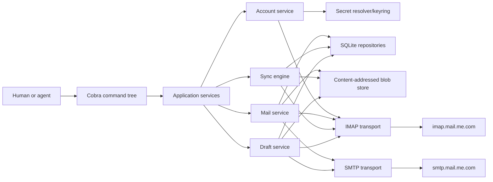

# Standalone iCloud Mail CLI Implementation Plan

> **Execution documents:** [current-state sweep](./icloud-mail-sweep-2026-08-05.md) · [progress ledger](./progress.md) · [agent prompts](./icloud-mail-agent-prompts.md)

## Planning Basis

- **Plan date:** 2026-08-05
- **Destination research baseline:** `amxv/icloud-cli`, `main` at `2bf55d1a4f68c8d49391fa32bd59f2c1447120c8`
- **Publication base preserved during planning:** `69e77c711a96d6ba8cd97d882aa010f0b2752687`; intervening commits set `https://icloud.ashray.xyz` as canonical and added `scripts/should-build-docs.mjs`/`vercel.json.ignoreCommand` for docs-only Vercel builds
- **Reference branch and commit:** `amxv/gg-ama`, `main` at `d5c15aff9b7cab98ef6e4ad9b360eab96b20420b`
- **Zodex reference checkout:** `/tmp/icloud-cli-recon/gg-ama`; treat it as read-only, inspect it in place, and recreate it at the same path only if the temporary checkout is absent
- **Artifacts consumed:** user-supplied `sweep.md`, `blueprint.md`, and `plan-doc.md`; repository research recorded in [`icloud-mail-sweep-2026-08-05.md`](./icloud-mail-sweep-2026-08-05.md)
- **Code inspected:** the complete iCloud provider package and tests; generic mail contracts and normalization; mail account/sync/send/reply/read-model paths in `cases.Service`; mail storage schema; mail CLI and tests; destination CLI, release, npm, and docs wiring.
- **External references used to settle dependency and protocol choices:** [Apple iCloud Mail server settings](https://support.apple.com/en-in/102525), [Apple app-specific passwords](https://support.apple.com/en-in/102654), [Cobra](https://github.com/spf13/cobra), [go-imap v2 client](https://pkg.go.dev/github.com/emersion/go-imap/v2/imapclient), [go-message](https://pkg.go.dev/github.com/emersion/go-message), [go-smtp](https://pkg.go.dev/github.com/emersion/go-smtp), [go-keyring](https://pkg.go.dev/github.com/zalando/go-keyring), [modernc SQLite](https://pkg.go.dev/modernc.org/sqlite), [goose](https://pkg.go.dev/github.com/pressly/goose/v3), and [gofrs/flock](https://pkg.go.dev/github.com/gofrs/flock).
- **Unverified input:** no real iCloud account was contacted during planning, so actual server capabilities, localized folders, mailbox volume, and provider edge responses remain live-validation assumptions.
- **Current disposable live harness:** after planning, the user provisioned `amxv_agents@icloud.com` and `amxv@agentmail.to`, completed a synthetic two-way fixture corpus, installed the iCloud app-specific password outside Git on the Zodex machine, and connected the AgentMail tools in ChatGPT. Amendment 2026-08-06 makes this harness the preferred provider-facing integration and smoke-test path for all remaining phases.

## State of Current System

The destination repository is a distribution-ready but functionally empty Go CLI template. `internal/app/app.go` manually dispatches only `hello`; the Go entrypoint is `cmd/icloud-cli`, the built native asset is already named `icloud`, and the npm executable remains `icloud-cli`. There is no storage, account, secret, protocol, MIME, message, or agent-output layer.

The reference implementation is operational but spread across AMAOS. `apps/amaos/internal/mailprovider/icloud` implements direct IMAP/SMTP transport; `internal/mailnorm` provides identity and dedupe helpers; `cases.Service` performs persistence, sync, reply construction, send-attempt recording, and read models; `internal/cli/app.go` exposes account, sync, inbox, search, message, state, send, and reply commands. The [sweep](./icloud-mail-sweep-2026-08-05.md) carries the complete current map and exact landmines.

The reference is intentionally an Inbox/Sent orchestration layer for a legal operating system, not a standalone mail client. Its reusable behavior is interwoven with AMA cases, document requests, R2, events, projections, Gmail, and remote API contracts. Several protocol and data-shape defects must be corrected rather than copied: unsafe UID cursor advancement, absent flags, unreliable unread aggregation, fragmented RFC threads, unsafe thread-wide unarchive, metadata-only folder observations, whole-mailbox in-memory search, conditional SMTP TLS, and ambiguous send retries.

## State of Ideal System

### Product end state

The repository ships one public executable, `icloud`, focused on iCloud services. The first complete service namespace is Mail:

```text
icloud account ...
icloud mail ...
icloud doctor
icloud completion ...
icloud man ...
```

A user can securely connect multiple iCloud Mail accounts, assign friendly names and a default account, inspect discovered folders, synchronize recent and historical mail, watch for changes, read full bodies and raw MIME, search locally or explicitly remotely, export attachments, manage message flags and locations, send/reply/reply-all/forward, work with iCloud Drafts, and diagnose account or sync problems.

The CLI is designed for agents first without becoming hostile to humans:

- every command defaults to compact, clean plain text optimized for low context/token cost;
- the default renderer is operation-aware: bounded summaries for lists/sync/status, essential headers plus bounded decoded-text excerpts for messages/threads, concise lifecycle lines for streams, and status plus stable IDs for writes;
- default output never emits JSON, JSONL, HTML, raw MIME, full headers, decorative tables, ANSI decoration, or repeated request payloads unless the caller explicitly asks for that representation;
- `--full`, `--format text|html|raw`, `--headers`, `--body-only`, and `--verbose` expose richer human/content views where supported;
- every non-streaming command retains stable `--json` output and streaming/bulk commands retain explicit `--jsonl` output;
- noninteractive commands never prompt implicitly;
- dangerous or externally visible writes require explicit authorization;
- errors have stable machine codes and retryability metadata;
- help is grouped, example-rich, and generated from the same command definitions as shell completions, man pages, and docs.

This slice remains local-first. There is no hosted proxy, daemon requirement, AMAOS server, Gmail provider, or legal-case model.

### Documentation cadence and audience contract

The documentation site evolves with the usable CLI rather than appearing only at the end of the track, but documentation work is editorial rather than mechanical. A phase does not earn a new page merely because it added a package, table, protocol step, or command. At each substantial public slice, inspect the reader journey and make the smallest change that genuinely helps: improve an existing setup or workflow guide, add a concise cross-link, clarify a safety boundary, update navigation, or create a new page only when the product now supports a distinct user goal that deserves one.

Write as a polished product-documentation author who deeply values the reader's time. The audience is a human or agent evaluating or using `icloud`, not a contributor studying its implementation. Lead with what the reader can accomplish, when they should use the capability, the shortest safe path, and what result to expect. Use progressive disclosure: keep the main path concise and move exhaustive syntax to generated reference material. Prefer scannable headings, direct language, small examples, and task-oriented explanations over inventories of fields or a narration of how the code executes.

Explain high-level concepts only when they help the reader predict product behavior or make a decision. Do not translate source code into prose. Omit package layout, database tables, schema/migration versions, internal types, lock/transaction mechanics, protocol command sequences, test fixtures, implementation trade-offs, planning history, and AMAOS ancestry unless one specific detail is necessary for safe setup, correct use, or actionable troubleshooting. Technical accuracy remains mandatory, but technical depth must serve a user need rather than demonstrate implementation completeness.

Narrative pages should not duplicate the command reference or enumerate every supported flag and stored field. Generated command references, schemas, man pages, and completions remain derived from the command tree and own exhaustive syntax. Hand-authored pages under `src/content/docs` explain coherent user journeys, capability boundaries, useful mental models, and next actions. They describe only behavior present and validated on the current branch; future commands are not presented as shipped. Examples use sanitized fictional accounts and messages.

Every documentation checkpoint runs the repository's docs validation/build scope and is recorded in `gg/progress.md`. Record which reader journey improved, not merely which files changed. When no narrative change would help a reader, documentation may be `not applicable` even for internal work; state the concrete reason. When touching an existing guide, remove or simplify nearby implementation-centric prose rather than layering more detail on top.

### Target architecture



### Module vocabulary that crosses phase boundaries

- **`AppPaths`** — resolves the durable application root, SQLite path, blob root, and lock root, with `ICLOUD_HOME` as the deterministic override.
- **`Account`** — one configured iCloud Mail identity, including friendly name, email, IMAP username, credential reference, status, and discovered capabilities.
- **`Folder`** — one remote mailbox with decoded name, wire name, delimiter, attributes, special-use kind, and sync policy.
- **`Message`** — one logical RFC message independent of any mailbox location.
- **`MessageLocation`** — one observation of a logical message in a specific account/folder/UIDVALIDITY/UID, carrying flags, internal date, size, and optional mod-sequence.
- **`Thread`** — a local RFC reference-graph conversation whose identity does not depend on the immediate parent changing.
- **`Attachment`** — one MIME part with metadata and content-addressed blob reference.
- **`SyncCheckpoint`** — the per-account/per-folder contiguous committed frontier and provider validity metadata.
- **`OutboundAttempt`** — a pre-send durable record with `pending`, `sent`, `failed`, or `unknown` outcome and optional idempotency key.
- **`Draft`** — a message in local or remote draft state, optionally carrying a Drafts-folder location.
- **`AppError`** — a typed error with stable code, message, retryability, and structured details.
- **`CompactTextRenderer`** — the universal default output boundary, producing bounded operation-specific plain text without JSON/HTML/raw payload expansion or decorative noise.
- **`OutputEnvelope`** — the stable opt-in JSON success/error boundary used by all non-streaming commands.

Local implementation names may vary. These names and responsibilities do not: later phases and public contracts depend on them.

### Durable state contract

SQLite is the canonical local index. Embedded migrations create at least these normalized areas:

```text
accounts
credential_refs
folders
messages
message_locations
message_recipients
message_references
attachments
threads
thread_messages
sync_checkpoints
outbound_attempts
idempotency_records
drafts
mail_search_fts
```

Required shape invariants:

1. A message is not a folder row. `message_locations` owns account, folder, UIDVALIDITY, UID, flags, and provider observation state.
2. `(account_id, folder_id, uid_validity, uid)` is unique.
3. A logical message may have several locations without duplicating bodies or attachments.
4. RFC Message-ID and provider observations are indexed dedupe evidence, not primary-key generators.
5. User-facing IDs are immutable prefixed UUIDv7-style values; dedupe or rethreading never changes them.
6. `sync_checkpoints` advance only to the highest contiguous UID whose fetched state and blobs committed successfully in the same logical page transaction.
7. Raw MIME and decoded attachment bytes live in a content-addressed blob tree. SQLite stores hashes, lengths, MIME metadata, and paths; it does not become an unbounded binary container.
8. Search uses SQLite indexes/FTS and keyset pagination. List commands never load an entire mailbox to return a small page.
9. Foreign keys are enabled. Migrations are embedded, versioned, and applied under a cross-process migration lock.
10. Plaintext app-specific passwords are never stored in SQLite, config, logs, progress notes, command output, or shell arguments.

### Application data root

`ICLOUD_HOME` overrides all application paths and is mandatory in tests. Without it, `AppPaths` uses the platform data directory convention:

- macOS: `~/Library/Application Support/icloud-cli`;
- Linux/BSD: `${XDG_DATA_HOME:-~/.local/share}/icloud-cli`;
- Windows: the user application-data directory.

The root contains `mail.db`, `blobs/`, and `locks/`. Account defaults and user mail settings live in SQLite rather than an additional general-purpose config framework.

### Protocol and dependency boundary

- IMAP uses pinned `github.com/emersion/go-imap/v2` behind a narrow internal client interface. Its beta API must not leak into application services or persisted models.
- MIME parsing/composition uses `github.com/emersion/go-message` and charset support rather than extending the custom parser.
- SMTP uses `github.com/emersion/go-smtp` with explicit STARTTLS/TLS enforcement and SASL authentication.
- Keychain storage uses `github.com/zalando/go-keyring`; environment and file references remain available for headless agents.
- SQLite uses `modernc.org/sqlite` so the existing `CGO_ENABLED=0` cross-platform release contract remains viable.
- Embedded migrations use `github.com/pressly/goose/v3`.
- Cross-process operation locks use `github.com/gofrs/flock` behind an internal lock interface.
- CLI parsing/help/completion/man generation uses `github.com/spf13/cobra`. Viper is not part of the design.

### Command surface contract

The final command tree is grouped by user intent:

```text
icloud account add|list|show|test|default|rename|credential|remove

icloud mail folders list|show|status|enable|disable|create|rename|delete
icloud mail sync|watch|status|checkpoints|rebaseline|backfill|repair
icloud mail inbox|latest|search
icloud mail thread show
icloud mail message show|raw|export
icloud mail attachments list|save|save-all
icloud mail mark-read|mark-unread|flag|unflag
icloud mail move|copy|archive|unarchive|trash|restore|delete
icloud mail send|reply|reply-all|forward
icloud mail draft create|list|show|update|sync|send|delete

icloud doctor
icloud capabilities
icloud completion bash|zsh|fish|powershell
icloud man
```

Command names are stable; shallow aliases may be added only when they do not create two documented ways to perform the same operation. No AMA command or case concept remains.

### Output contract

- Compact plain text is the default for every command, whether stdout is a TTY or redirected to an agent. Normal execution must not require an agent to pass a flag merely to avoid JSON, HTML, raw MIME, or verbose prose.
- The compact renderer uses stable field order, omits empty/default fields, avoids borders and repeated labels, keeps pages bounded, prints stable IDs needed for follow-up actions, and never repeats a body or request value the caller already supplied unless review is the command's purpose. Each result is a small vertical block: result kind on the first line, stable identity plus the first field on the next line when an identity exists, then one remaining field per line. Consecutive blocks are separated by one blank line.
- List/search/inbox/latest output emits one concise vertical block per result plus a minimal next-cursor/more block. Sync/status/doctor output emits one block per account/folder and only actionable warnings or failures; per-message/per-stage detail requires `--verbose`.
- Message and thread reads default to essential identity/routing fields and a bounded decoded plain-text excerpt. `--full` returns complete decoded text; `--format text|html|raw`, `--headers`, and `--body-only` select explicit richer representations. HTML and raw MIME are never selected implicitly.
- Successful write output defaults to outcome plus stable attempt/message/thread/draft/location IDs and any next action. It does not echo submitted bodies, HTML, headers, recipient lists, or attachment paths unless required to explain a failure. `--dry-run` is the deliberate review exception: it renders the normalized envelope and clean text body once, compactly, with richer header/HTML/raw detail only when requested.
- Streaming/watch commands default to concise plain-text lifecycle lines; `--jsonl` opts into typed JSONL events. Bulk commands likewise use compact per-item text unless `--jsonl` is requested.
- Plain-text success output goes to stdout; warnings and errors go to stderr.
- `--json` opts into exactly one `OutputEnvelope`:

```json
{"ok":true,"data":{},"meta":{"request_id":"..."}}
```

or:

```json
{"ok":false,"error":{"code":"...","message":"...","retryable":false,"details":{}},"meta":{"request_id":"..."}}
```

- With `--jsonl`, watch and other streaming/bulk operations emit one JSON object per line with `event`, `sequence`, `account_id`, timestamp, and typed payload or error.
- `--json`, `--jsonl`, `--full`, `--verbose`, `--headers`, `--body-only`, and content-format flags are orthogonal opt-ins where meaningful; help must state when combinations are invalid or when JSON intentionally omits body data unless a content-bearing mode was also requested.
- Secrets and body content are omitted from diagnostics unless the command explicitly requests that content.
- Stable exit-code classes distinguish usage, configuration, authentication, unavailable/timeout, conflict/lock, not-found, safety confirmation, and internal failure.
- Compact-output golden fixtures carry byte/line budgets for representative commands so later phases cannot silently bloat the default agent context. Tokenizer-specific counts may be sampled, but correctness must not depend on one model tokenizer.
- `NO_COLOR` is honored; the compact default contains no ANSI decoration or box-drawing output even on a TTY.

Representative compact shapes establish the intended information density. Empty fields are omitted, parent context appears once, excerpts are bounded, and `next=` appears only when another page exists:

```text
sync
account=personal
folder=INBOX
fetched=12
new=10
updated=2
flags=4
more=false

msg
msg_01 at=2026-08-05T18:42Z
state=unread
from=alice@example.com
subject="Launch notes"
excerpt="Can you review the final…"

thread
th_01 messages=3
unread=1
subject="Launch notes"

sent
attempt=send_01
message=msg_03
thread=th_01
state=sent
```

Commands may use a command-specific compact shape, but they must preserve the same rules: sufficient information to decide the next action, stable IDs for that action, no repeated parent/request data, and a clear `more`/`next`/warning marker whenever omitted information changes what the caller should do.

### Send-safety contract

- `--dry-run` contacts no SMTP server and defaults to one compact review: normalized envelope, safety-relevant headers, clean decoded text body once, body-part summary, and attachment metadata. `--verbose`, `--headers`, `--format html|raw`, and `--json` explicitly expand that review.
- In an interactive TTY, a real externally visible send may ask for confirmation unless `--yes` is supplied.
- In noninteractive mode, send, draft-send, permanent delete, destructive folder deletion, and similarly dangerous operations fail with a safety error unless `--yes` is supplied.
- `--idempotency-key` is accepted on externally visible writes. Reusing it with the same normalized request returns the original attempt; reusing it with a different request is a conflict.
- `OutboundAttempt` is written before SMTP. A connection outcome that cannot prove acceptance becomes `unknown`, never `failed`; retry requires Sent reconciliation or an explicit operator decision.

## Decisions and Assumptions

### Synthesis and alignment check

The requested outcome is not a thin wrapper around the five files in `internal/mailprovider/icloud`. It is a complete local mail control plane for agents, using the working AMAOS behavior as evidence while removing its case/document/event dependencies. The target must preserve the mature parts—account profiles, resumable sync, normalized messages, attachments, search, reply policy, safe previews, diagnostics, and JSON output—while making compact token-efficient plain text the universal default and changing the data/protocol shapes that made the current defects representable.

The plan interprets “full-feature mail API through the command line” as broad iCloud Mail coverage: all folders, message bodies/raw MIME/attachments, flags and moves, send/reply/forward, drafts, sync/backfill/watch/repair, search, and agent-safe machine contracts. It does not interpret the request as pixel-level parity with Apple Mail, a hosted synchronization service, or work on non-Mail iCloud services in this track.

### What the specification does not settle

- The reference code calls itself provider-neutral, but its core provider signatures import AMAOS storage records. The standalone implementation cannot retain that boundary unchanged without importing legal-system data shapes. The plan introduces standalone mail-domain and transport boundaries instead.
- The reference stores folder membership in message metadata. A full mailbox client needs one logical message to exist in several folders with independent UIDs and flags. The plan normalizes message locations before broad sync or mutation commands are added.
- The current `--confirm` UX is advisory: sends proceed when neither `--confirm` nor `--dry-run` is present. Because agents are a primary caller, the plan changes this to a real noninteractive safety boundary.
- SMTP can return an error after the server may have accepted DATA. Treating every error as retryable failure can send duplicates. The plan adds an `unknown` attempt state and Sent reconciliation.
- The source's custom IMAP parser made a small V1 possible, but full folders, flags, IDLE, MOVE fallback, streaming fetch, and mailbox encoding would require turning it into a general IMAP implementation. The plan selects a maintained library behind an internal boundary rather than expanding the hand-written parser.
- The repository's public identity is inconsistent: release assets are `icloud`, npm exposes `icloud-cli`, and the Go command directory is `cmd/icloud-cli`. The plan selects one user-facing command and cuts over every distribution surface together.
- The source has no existing standalone users or database to migrate, but the npm package already has a `0.1.0` scaffold release. The plan treats the template command as disposable while preserving release asset compatibility only where it serves the selected `icloud` command.

### Factual unknowns

The plan proceeds on the following falsifiable assumptions.

- **Existing users of the scaffold's `icloud-cli` executable.**
  Assume there are no meaningful users relying on the `hello` command or the `icloud-cli` npm executable. If false, Phase 1 requires an explicit deprecation/release decision before removing that executable name.

- **Existing standalone mail state.**
  Assume no production SQLite/config/keyring state exists because the repository contains no mail implementation. If false, the schema and account phases require migration/import criteria before implementation.

- **iCloud IMAP feature set.**
  Planning assumed baseline IMAP4rev1 commands, SPECIAL-USE where available, and IDLE on the accounts used for validation. Phases 4-5 have since proven real direct-TLS login, capability discovery, LIST, STATUS, nested/Unicode mailbox handling, and secure SMTP submission against the disposable account. Every remaining optional capability still requires an explicit fallback or unsupported result, and later phases must continue to prove their own provider behavior live.

- **Mailbox scale.**
  Assume accounts may contain hundreds of thousands of messages and multi-gigabyte history, so every list/search/sync path requires bounded pages and streaming blobs. If actual scale is tiny, the architecture remains valid; the reverse assumption would not.

- **Cross-platform release target.**
  Assume the current macOS, Linux, and Windows amd64/arm64 matrix remains a release requirement. If Windows is dropped, credential and lock implementations may simplify, but no phase depends on dropping it.

- **Authorization method.**
  Assume app-specific passwords are the generally available authentication method for this standalone CLI. Any future Apple authorization mechanism is a separate credential provider, not a reason to put plaintext Apple Account passwords into this design.

- **Local-first ownership.**
  Assume no hosted service, multi-device synchronization service, or always-on server is required in this track. If a shared service becomes a requirement, the SQLite ownership and direct-credential trust boundary must be re-planned rather than stretched into a network server.

### Decision ledger

#### 1. Public executable identity

**One-way door once released.**

- **A. Expose `icloud` everywhere; retain repository/npm package names only.** — **Recommended**
- **B. Keep `icloud-cli` as the executable and native asset mismatch.**
- **C. Ship both executable names permanently.**

**Why A:** the release workflow and native asset already use `icloud`, and the future service namespace reads naturally as `icloud mail`. B preserves an accidental template mismatch. C creates two public command contracts and doubles documentation/completion/man surfaces.

**Selected:** A.

---

#### 2. Where canonical mail state lives

**One-way door because every later feature depends on the shape.**

- **A. Local SQLite index plus content-addressed filesystem blobs.** — **Recommended**
- **B. JSON state file like local AMAOS.**
- **C. Require a hosted Postgres/API service.**

**Why A:** the destination is a standalone CLI, but mailbox search, folder observations, flags, dedupe, pagination, and concurrent agent processes need relational constraints and indexed queries. B reproduces whole-state loads and lost-update risk. C violates the local standalone goal and adds deployment/auth scope.

**Selected:** A.

---

#### 3. Logical messages versus provider locations

**One-way persisted-data decision.**

- **A. Separate `Message` from one-or-many `MessageLocation` rows.** — **Recommended**
- **B. Store mailbox/UID directly on the message as AMAOS does.**
- **C. Duplicate the message for every folder observation.**

**Why A:** IMAP assigns identity and flags per mailbox location, while RFC body/thread identity is logical. B cannot truthfully represent copied/moved/multi-folder messages. C duplicates bodies, attachments, search results, and threads.

**Selected:** A.

---

#### 4. Public ID strategy

**One-way once JSON output is consumed.**

- **A. Immutable prefixed UUIDv7-style IDs; store dedupe identities separately.** — **Recommended**
- **B. Hash provider/dedupe identity into the public primary key.**
- **C. Sequential IDs derived from row count.**

**Why A:** a message can gain better RFC/provider evidence or move between threads without changing the ID agents saved. B couples correction/rethreading to identity changes. C repeats the AMAOS collision class after deletion or concurrency.

**Selected:** A.

---

#### 5. IMAP client implementation

**Reversible behind the transport interface, expensive after broad protocol use.**

- **A. Pin `go-imap/v2` and isolate it behind an internal client interface.** — **Recommended**
- **B. Copy and extend the hand-written AMAOS IMAP session.**
- **C. Use the stable but older go-imap v1 API.**

**Why A:** the target requires streaming fetch, structured flags, special-use mailboxes, MOVE fallback, IDLE, and modern mailbox handling, all present in the actively developed v2 client. Its beta status is contained by a narrow adapter and an early live compatibility gate. B makes this project responsible for a general IMAP parser; C starts on an older API last released in 2022 and makes a later v2 migration likely.

**Selected:** A. Phase 3 is the stop/go proof; failure requires a documented amendment, not a hidden second transport.

---

#### 6. MIME and SMTP implementation

**Reversible behind internal interfaces.**

- **A. Use `go-message` for streaming MIME/charset handling and `go-smtp` for enforced secure submission.** — **Recommended**
- **B. Copy the custom MIME parser/composer and continue `net/smtp`.**

**Why A:** the current bugs include missing charset handling, whole-buffer processing, and an implicit STARTTLS invariant. The selected libraries provide streaming message APIs and a maintained SMTP client while preserving the current BCC and RFC-header behavior. B expands frozen/custom protocol code to meet full-client requirements.

**Selected:** A.

---

#### 7. Secret storage and headless operation

**One-way trust-boundary decision.**

- **A. Native keyring by default; persisted `env:`/`file:` references for headless agents; password stdin only as setup input.** — **Recommended**
- **B. Store app passwords encrypted in SQLite with a locally stored key.**
- **C. Require environment variables for every account.**

**Why A:** it preserves convenient interactive setup without putting the app password in the database, config, argv, or shell history, while still supporting servers and agents that lack a desktop keyring. B merely relocates the key-management problem. C makes multi-account setup fragile and exposes secret naming as global process configuration.

**Selected:** A.

---

#### 8. Sync checkpoint semantics

**One-way correctness invariant.**

- **A. Commit only the highest contiguous successfully persisted UID, transactionally with page ingestion.** — **Recommended**
- **B. Preserve the current remote-tail cursor plus `more_available`.**
- **C. Advance after each individual message outside a page transaction.**

**Why A:** it makes the current skipped-message defect unrepresentable and permits safe retry after any fetch/parse/blob/database failure. B is the existing data-loss bug. C is correct but creates excessive transaction overhead and complicated partial-page behavior.

**Selected:** A.

---

#### 9. First-sync and historical coverage

**Reversible product behavior, persisted through checkpoints.**

- **A. Current-tail/recent bootstrap by default, explicit resumable backfill.** — **Recommended**
- **B. Full historical backfill during account setup.**
- **C. Never support historical backfill.**

**Why A:** it preserves the working AMAOS safety property—an account becomes useful quickly—without making history permanently inaccessible. B can turn setup into an unbounded operation; C conflicts with the full standalone mailbox goal.

**Selected:** A.

---

#### 10. Folder scope

**Reversible policy on top of a one-way all-folder data model.**

- **A. Discover and model every folder; default automatic sync to Inbox and Sent; allow per-folder/all-folder enablement.** — **Recommended**
- **B. Permanently support only Inbox and Sent.**
- **C. Automatically sync every folder immediately.**

**Why A:** the data model and operations remain complete, while default resource use stays bounded and familiar. B preserves the source's archive/trash/thread blind spots. C can unexpectedly backfill large Junk/Trash/custom histories.

**Selected:** A.

---

#### 11. Thread reconstruction

**One-way logical-model decision, although memberships can be rebuilt.**

- **A. Build an RFC Message-ID reference graph, choose a stable root, and store rethreadable membership.** — **Recommended**
- **B. Use immediate `In-Reply-To` as the provider thread ID.**
- **C. Thread only by normalized subject and participants.**

**Why A:** it keeps A -> B -> C together and allows later messages with better References evidence to merge memberships without changing message IDs. B is the current fragmentation bug. C over-merges unrelated repeated subjects.

**Selected:** A.

---

#### 12. Provider mutation granularity

**One-way command-semantics decision.**

- **A. Mutate explicit message locations; thread convenience commands expand to reviewed eligible locations only.** — **Recommended**
- **B. Search Inbox and Sent by thread reference and mutate every match.**

**Why A:** archive/unarchive/read operations need source folder and UID to avoid copying Sent mail into Inbox or mutating unrelated observations. B reproduces the current unarchive and broad-thread defects.

**Selected:** A.

---

#### 13. Outbound confirmation and idempotency

**One-way agent-safety contract.**

- **A. Require `--yes` for noninteractive external/destructive writes, support exact dry-run previews and durable idempotency.** — **Recommended**
- **B. Preserve AMAOS behavior where omitting both safety flags sends immediately.**
- **C. Always require an interactive prompt.**

**Why A:** agents can operate deliberately and unattended without accidental sends, while humans retain a normal prompt path. B is unsafe for the stated primary caller. C makes automation impossible.

**Selected:** A.

---

#### 14. Ambiguous SMTP outcomes

**One-way attempt-state contract.**

- **A. Record `unknown`, reconcile Sent, and block automatic retry until resolved.** — **Recommended**
- **B. Record every error as `failed` and allow immediate retry.**
- **C. Record every post-DATA error as `sent`.**

**Why A:** it distinguishes “not accepted” from “acceptance cannot be proven,” preventing duplicate mail without falsely claiming delivery. B can duplicate sends; C can hide a real failure.

**Selected:** A.

---

#### 15. Search ownership

**One-way performance/data-index decision.**

- **A. SQLite FTS-backed local search by default; explicit IMAP remote search for unsynced history.** — **Recommended**
- **B. Filter a fully materialized local mailbox view in Go.**
- **C. Use IMAP search for every query.**

**Why A:** agents receive fast, deterministic, paginated results while still having a deliberate path to old unsynced mail. B repeats the current O(mailbox) read path. C is network-dependent and cannot search normalized attachment/body state consistently.

**Selected:** A.

---

#### 16. Default output, expansion modes, and error format

**One-way public contract.**

- **A. Universal compact plain-text default; explicit full/text/HTML/raw/verbose modes; stable `--json` envelopes and opt-in `--jsonl`; typed exit classes.** — **Recommended**
- **B. Default to JSON/JSONL because agents are primary callers.**
- **C. Let every command invent its own human and machine output shape.**

**Why A:** agents usually need the smallest sufficient answer, not a schema-sized response. Compact text avoids context bloat for ordinary reads and writes, while explicit JSON/JSONL remains available when structural parsing matters and full/HTML/raw modes remain available when content fidelity matters. B spends tokens on keys, braces, null/default fields, and duplicated structure on every call; C creates command-specific scraping and uncontrolled output growth.

**Selected:** A.

---

#### 17. Draft ownership

**Reversible implementation over a persisted public behavior.**

- **A. Model drafts locally and synchronize them to the discovered iCloud Drafts mailbox.** — **Recommended**
- **B. Support only local temporary compose files.**
- **C. Omit drafts from the full mail slice.**

**Why A:** the standalone CLI should coexist with native iCloud clients and let an agent prepare, inspect, edit, and later send the same draft. B creates a second non-iCloud draft system. C leaves a major mail workflow absent.

**Selected:** A.

---

#### 18. Documentation generation and cadence

**Reversible tooling decision, public docs become a contract.**

- **A. Define commands once in Cobra; generate reference artifacts from that tree; maintain user-oriented task guides progressively after substantial public slices.** — **Recommended**
- **B. Defer the docs site until the implementation is otherwise complete.**
- **C. Hand-maintain help, man pages, command references, and narrative guides independently.**

**Why A:** generated references keep syntax, flags, schemas, man pages, and completions testably aligned, while a small set of polished hand-authored journeys helps a new user or agent accomplish real work quickly. Progressive does not mean one guide per phase: agents update the smallest useful surface and create a page only for a distinct reader goal. B makes the site misleading for most of the implementation track. C repeats the drift problem across too many public surfaces and encourages implementation-shaped prose.

**Selected:** A.

---

#### 19. AMAOS compatibility and import

**Reversible future feature.**

- **A. Do not import AMAOS state or retain AMA-shaped compatibility paths in this track.** — **Recommended**
- **B. Add an AMAOS state importer while building the first standalone release.**
- **C. Make the standalone CLI call AMAOS remotely.**

**Why A:** the user asked for the working behavior as a reference, not legal-state migration. There is no existing standalone state to preserve, and AMAOS folder/message metadata contains the defects this design removes. B expands scope before the target schema is proven; C defeats separation.

**Selected:** A.

---

#### 20. Progress and amendment discipline

**Reversible process decision, mandatory for this multi-agent track.**

- **A. Every phase updates `gg/progress.md`; plan-invalidating discoveries also append an Amendment before the same push.** — **Recommended**
- **B. Rely on Git history and chat handoffs only.**

**Why A:** each implementation agent starts without the previous agent's full context. The progress ledger records completed evidence, current SHA, unresolved risks, and the exact next boundary; Amendments prevent later phases from following an invalid plan. B forces repeated archaeology.

**Selected:** A.

---

#### 21. Disposable live integration harness and testing authority

**Reversible testing-process decision, mandatory for the remaining multi-agent track.**

- **A. Prefer the real disposable iCloud/AgentMail loop for provider-facing integration, smoke, and acceptance evidence; retain deterministic fakes for failure injection, edge invariants, scale bounds, races, and offline CI.** — **Recommended**
- **B. Continue fake-first and treat the real loop as optional evidence.**
- **C. Use only the live accounts and remove deterministic protocol fixtures.**

**Why A:** the user created both mailboxes specifically for autonomous agent development, the iCloud credential is already protected on Zodex, and AgentMail is connected in ChatGPT. Live testing can now prove real delivery, threading, folders, flags, mutations, drafts, search, reconciliation, and provider behavior without exposing personal data. B leaves provider-facing defects undiscovered until late acceptance. C cannot deterministically reproduce fetch/parse/blob/transaction failures, cursor gaps, race conditions, large bounded pages, malformed wire responses, ambiguous SMTP outcomes, or offline release checks.

**Selected:** A.

The authorized harness is:

- iCloud Mail: `amxv_agents@icloud.com`, proven IMAP username `amxv_agents`;
- AgentMail: `amxv@agentmail.to`, with the same value as its connector inbox ID;
- Zodex credential file: `$HOME/.config/icloud-cli/amxv-agents-app-password`, outside Git and mode `0600`;
- isolated CLI state: `$HOME/.local/share/icloud-cli-live-test`;
- fixture and round-trip record: AgentBox thread `thr_44ae4377-89df-4099-843f-e21f12967888`.

The user explicitly authorizes agents to perform the full set of mail operations needed for development and smoke testing on **these two disposable accounts only**, without requesting separate confirmation for each action. This includes creating and reading synthetic messages, sending, replying, reply-all, forwarding, attachments, drafts, folder creation/rename/delete, subscription tests, flags/read state, move/copy/archive/trash/restore/permanent delete, search, backfill, repair, IDLE-trigger generation, reconciliation, and cleanup. Agents may create new synthetic fixtures through either side of the loop as needed.

This authorization does not weaken the product contract. Agents must still exercise required `--yes`, confirmation, dry-run, idempotency, and destructive-operation safeguards when testing the CLI, must never use a personal account, and must never commit credentials, raw live mailbox data, local state, blobs, or private paths. Future sessions must discover the currently exposed AgentMail connector functions before invoking them rather than assuming static tool names.

## Acceptance Criteria

An independent reviewer can mark this track complete only when all applicable items are demonstrably true.

### Installation, identity, and help

1. Installing `@amxv/icloud-cli` exposes the command `icloud`; the release assets, npm wrapper, local build, version output, examples, and docs use the same name.
2. `icloud --help` presents grouped account, mail, diagnostics, and documentation commands without template or AMA wording.
3. Every command and subcommand has command-local help, required-argument validation, meaningful examples, and no hidden dependency on the current working directory.
4. Bash, zsh, fish, and PowerShell completion generation works from the shipped binary.
5. Man pages are generated from the command tree and are included in the release/npm package or can be emitted deterministically by `icloud man`.
6. `icloud capabilities --json` describes the installed version, command capabilities, data-schema version, and optional provider features without exposing credentials.

### Accounts and credentials

7. A first run with no existing state creates or migrates the application data root safely and returns an empty account list rather than an error.
8. A user can add, list, show, rename, select as default, test, rotate credentials for, and remove multiple iCloud accounts using a friendly name, email, or stable account ID.
9. Interactive setup can accept an app-specific password without placing it in argv or terminal history and stores it in the operating-system keyring by default.
10. Headless setup can persist an `env:` or `file:` credential reference and resolve it only when needed.
11. Plaintext app-specific passwords never appear in SQLite, generated docs, logs, JSON output, error details, `gg/progress.md`, or Git history.
12. Account validation tests IMAP and SMTP separately and reports which stage failed with a typed, redacted error.
13. An account is not reported healthy/connected merely because its record was inserted; health reflects successful current credential/network validation.
14. A revoked or missing credential produces an authentication-class error and degraded account health without deleting synchronized mail.

### Folders and remote status

15. Folder discovery returns decoded names, special-use classification, delimiter, selectable/subscribed attributes, message/unseen counts where available, and per-folder sync policy.
16. Inbox, Sent, Drafts, Archive, Trash, and Junk are resolved through special-use attributes when advertised rather than literal English names.
17. International/custom folder names round-trip correctly through list, select, search, move, create, rename, and delete operations.
18. Users can enable or disable automatic synchronization per folder, while Inbox and Sent are enabled by default.
19. Folder create, rename, and delete reject invalid or dangerous operations, including deleting protected system folders, with typed errors.

### Synchronization and persistence

20. Initial account sync becomes useful quickly by ingesting a bounded recent Inbox window and establishing a current-tail Sent checkpoint without attempting an implicit full-history crawl.
21. A page containing more UIDs than the fetch limit commits only the highest contiguous UID actually fetched, parsed, blob-staged, and persisted; the next run ingests every remaining UID exactly once.
22. Failure while fetching, parsing, writing a blob, or committing a page does not advance the checkpoint past the failed message.
23. A UIDVALIDITY change is detected, surfaced, and repaired/rebaselined without silently associating old UIDs with new messages.
24. Multiple observations of the same logical RFC message in different folders produce one message and distinct `MessageLocation` rows.
25. Message flags and location changes synchronize from the server, including seen, flagged, answered, draft, and deleted state where provided.
26. Thread unread counts derive from current eligible message-location flags and remain correct after sync, local mutation, or move.
27. Sync work is bounded by pages and streams; requesting a small page does not materialize all pending remote UIDs or all local messages.
28. Two CLI processes cannot concurrently migrate the same database or run conflicting sync/write operations for the same account without a deterministic lock/conflict result.
29. Interrupted processes leave a valid SQLite database, valid content-addressed blobs, and retryable checkpoints; temporary blobs are cleaned or repairable.
30. `sync status`, `checkpoints`, `rebaseline`, `backfill`, and `repair` describe what will change and never delete stored messages merely to move a cursor.
31. Historical backfill can be resumed by folder and bounded by date/count/page controls without disturbing the forward incremental checkpoint.
32. `sync watch` uses IDLE when supported, falls back explicitly when not, survives reconnects with bounded backoff, and defaults to concise ordered plain-text lifecycle lines; `--jsonl` emits the documented typed event stream.

### Reading, bodies, raw mail, and attachments

33. Inbox/latest/list commands are paginated with stable cursors, use indexed store queries rather than whole-mailbox in-memory filtering, and default to one compact record per result with only stable identity, sender/subject/time/state, a bounded snippet, and the next-cursor/more marker.
34. A message can be shown as compact metadata plus a bounded decoded plain-text excerpt, complete decoded text, decoded HTML, headers, body-only content, or raw RFC822/EML; only the compact plain-text representation is selected by default.
35. MIME-word and body charset decoding correctly normalizes supported non-UTF-8 subjects, names, filenames, and bodies to UTF-8 while preserving raw bytes.
36. Multipart/alternative, multipart/mixed, nested multipart, inline resources, and `message/rfc822` attachments are represented without losing MIME metadata.
37. Raw MIME and large attachment data are streamed to/from the content-addressed blob store under configurable size limits rather than held wholly in SQLite.
38. Attachments can be listed, saved individually, saved in bulk, or streamed to stdout with explicit binary-output intent; filenames are sanitized against path traversal and collision.
39. Re-fetching a malformed message with no valid Date does not assign a new identity or reorder it based on the current wall clock.

### Search and threading

40. Local search supports body/snippet, sender, recipients, subject, RFC Message-ID, folder, flags, date range, attachment filename/type, account, and result limit with keyset pagination; default results are compact bounded text rather than full matched bodies or JSON.
41. Local FTS results update transactionally when messages, bodies, folders, or deletions change.
42. Explicit remote search can find unsynchronized provider messages, identify its remote nature in output, and optionally hydrate selected results into the local index without changing unrelated checkpoints.
43. A normal A -> B -> C RFC References chain appears as one thread even though B and C have different immediate `In-Reply-To` values.
44. Later evidence can merge/rethread memberships without changing stable message IDs, losing locations, or duplicating attachments.
45. Thread views order messages deterministically and expose participants, unread state, folders, and attachments without claiming iCloud has a native Gmail-style thread ID.

### Message state and folder mutation

46. Mark-read, mark-unread, flag, and unflag target explicit stored message locations and reconcile returned/server flags locally.
47. Archive resolves the actual Archive mailbox and moves the selected eligible source location; it never copies matching Sent messages into Inbox or Archive.
48. Unarchive operates on an Archive location and restores it to Inbox without leaving an unexplained duplicate source location.
49. Move, copy, trash, restore, and delete expose source/destination effects, new provider UIDs when available, and local reconciliation state.
50. Permanent delete and destructive folder operations require explicit noninteractive authorization and cannot be triggered accidentally by an ambiguous thread reference.

### Sending, replying, forwarding, and drafts

51. `mail send --dry-run` performs no SMTP connection and defaults to a compact review containing the normalized envelope, clean decoded text body once, body-part/attachment summary, and safety-relevant headers; verbose/HTML/raw/header detail remains explicit.
52. A noninteractive real send fails without `--yes`; an interactive send can be reviewed and confirmed.
53. New sends support display-name From, To/CC/BCC, Reply-To, custom safe headers, text and HTML alternatives, stdin/file bodies, and filesystem attachments.
54. BCC recipients are included in the SMTP envelope and absent from message headers and non-authorized logs/output.
55. SMTP refuses plaintext authentication and requires the documented secure iCloud submission path.
56. The same idempotency key and normalized request never produce two sends; a conflicting request with that key fails.
57. A proven accepted send becomes `sent`, a proven rejection becomes `failed`, and an indeterminate post-DATA outcome becomes `unknown` and is not automatically retried.
58. Sent-folder reconciliation links the remote provider copy/location to the existing local outbound message and resolves matching unknown attempts when evidence is sufficient.
59. Reply uses Reply-To before From, preserves/extends `In-Reply-To` and `References`, avoids repeated `Re:`, and targets the selected parent message.
60. Reply-all excludes the acting account, removes To/CC duplicates, preserves intended participants, and never invents prior BCC recipients.
61. Forward produces a new thread, supports selected original attachments, and does not reuse reply headers.
62. Draft create/list/show/update/sync/send/delete works with the discovered iCloud Drafts mailbox, and a draft remains recoverable after interruption.
63. Sending a synchronized draft removes or marks the remote draft appropriately and records one outbound attempt/message.

### Agent and operational contract

64. Every command defaults to compact plain text with stable field order, bounded pages/excerpts, no decorative table borders or ANSI sequences, no empty/default-field noise, and no implicit JSON, JSONL, HTML, raw MIME, full headers, or verbose diagnostics.
65. Default list/search/inbox/latest output emits one concise result record plus the minimum pagination marker; default sync/status/doctor output emits compact account/folder summaries and only actionable warnings, while per-item/per-stage details require `--verbose`.
66. Default message/thread output includes stable IDs, essential routing/time/state fields, and bounded decoded plain-text excerpts; `--full`, `--format text|html|raw`, `--headers`, and `--body-only` expose the retained complete representations explicitly.
67. Default successful write output reports outcome, stable IDs, and required next action without echoing supplied bodies, HTML, headers, recipient lists, or attachment paths; dry-run presents review content exactly once in compact text unless richer modes are requested.
68. Streaming/watch and bulk commands default to concise plain-text lines; every streaming/bulk command has documented opt-in `--jsonl` event/item types.
69. Every non-streaming command has a stable opt-in `--json` success/error envelope, and JSON/body expansion follows documented redaction and size rules rather than dumping every stored field by default.
70. Representative compact outputs have golden fixtures and explicit byte/line budgets that fail when default output gains repeated labels, duplicated payloads, unbounded bodies, verbose diagnostics, or schema-like noise without an approved contract change.
71. Machine errors include stable code and retryability without leaking secret values, raw authentication responses, or unintended message body content.
72. Non-TTY execution never waits for an implicit prompt; missing required authorization returns a safety error immediately.
73. Global account selection is deterministic: explicit flag, then configured default, otherwise a typed ambiguity/no-account error.
74. Long operations honor cancellation and timeouts; cancellation does not convert an unknown provider outcome into a safe retry.
75. Diagnostics distinguish configuration, secret resolution, DNS/connectivity, TLS, IMAP auth, SMTP auth, folder discovery, database, blob, checkpoint, lock, and send-attempt health while keeping the default summary bounded.
76. Compact text honors `NO_COLOR` and remains undecorated when stdout is redirected; JSON/JSONL remains parseable and decoration-free.

### Quality, release, and scope

77. Protocol behavior has deterministic fake-server/fixture coverage for cursor paging, injected failures, flags, special-use folders, IDLE, MOVE fallback, UIDVALIDITY, MIME charsets, archive/unarchive, bounded scale, races, and ambiguous SMTP outcomes.
78. Parser and identity boundaries have fuzz/property coverage for malformed RFC822, headers, MIME trees, mailbox names, references, and dedupe/rethread invariants.
79. Every provider-facing phase prefers and, when technically applicable, records end-to-end evidence through the documented disposable iCloud/AgentMail harness. Fake-only completion is acceptable only for behavior that cannot be induced safely or deterministically live, and the reason must be recorded. Credentials remain external and live evidence is scrubbed.
80. Large-mailbox query plans and representative large-message/attachment tests demonstrate bounded memory and responsive paginated reads.
81. The release matrix continues to build without CGO for supported macOS, Linux, and Windows architectures, and release assets/npm installation invoke `icloud` successfully.
82. Checksums and release metadata cover every native artifact; package contents include required man/completion/docs assets.
83. Every substantial user-visible slice reviews the affected reader journey before completion. Update an existing guide, navigation, or concise explanation when that helps; create a new page only for a distinct user goal. Do not mirror phase or package boundaries in the docs. Internal-only work may record documentation as not applicable with a concrete reason.
84. Progressive guides are self-contained, concise, and task-oriented for first-time humans and agents. They lead with the outcome, shortest safe workflow, useful choices, expected result, common failure recovery, and next action without assuming repository knowledge.
85. Narrative documentation values the reader's time and uses progressive disclosure. It does not restate the command reference, narrate source code, or expose package layout, database tables, schemas/migrations, locks, transactions, protocol command sequences, internal types, test infrastructure, planning history, or AMAOS ancestry unless required for safe use or actionable troubleshooting.
86. Documentation describes only behavior validated on the current branch, uses sanitized examples, passes the docs validation/build scope, and records the reader-facing improvement and evidence in `gg/progress.md`.
87. The completed docs site contains setup, app-specific-password safety, compact-default/full-text/HTML/raw/JSON/JSONL output guidance, command reference, agent usage, JSON schemas, sync semantics, troubleshooting, privacy/storage, and changelog content matching the shipped CLI.
88. No production code, command, persisted schema, help text, or documentation refers to AMA, AMAOS, cases, immigration, document requests, or Gmail.
89. No permanent copy of the hand-written AMAOS IMAP path, JSON whole-state store, template `hello` command, or dual `icloud-cli` executable remains after cutover.
90. iCloud Contacts, Calendar, Drive, Notes, Photos, Find My, and a hosted mail service are explicitly outside this implementation track.

## Plan Phases

### Execution protocol for every phase

1. Start from the current `main`, inspect Git status/log, read this plan, and reconcile [`gg/progress.md`](./progress.md) against code before changing anything.
2. Read only the phase-scoped sweep sections and source regions listed below; do not reload the entire reference repository by habit.
3. Use the existing Zodex checkout `/tmp/icloud-cli-recon/gg-ama` and keep `gg-ama` read-only. Port behavior and tests deliberately; do not copy AMA storage/contracts/case/event dependencies.
4. Read the `Disposable live integration harness` section in `gg/progress.md`, discover the current AgentMail connector schema, and prefer the real two-way harness for provider-facing integration, smoke, and acceptance evidence. Use deterministic fakes in addition for failure injection, edge invariants, scale bounds, races, and offline CI—not as a substitute for live behavior that can be exercised safely.
5. Every phase that introduces or changes a command must define and test its compact plain-text default, including field omission, page/excerpt bounds, byte/line budget, and absence of implicit JSON/JSONL/HTML/raw/verbose content; it must also preserve every applicable explicit expansion mode.
6. At each substantial user-visible slice, review the affected reader journey under `src/content/docs`. Prefer improving an existing guide or navigation; create a new page only for a distinct user goal, never simply to mirror the phase. Internal-only or partial commits may skip narrative docs, but the progress entry must say why documentation was not applicable.
7. Write polished product documentation that helps a human or agent move faster: outcome first, shortest safe workflow, useful choices, expected result, common recovery, and next action. Keep exhaustive syntax in generated reference material. Omit implementation mechanics that do not change how the product is used. Run the relevant docs validation/build scope for every documentation checkpoint.
8. A phase is complete only when its positive evidence exists, the relevant regression scope passes, command-local help and the applicable progressive docs are current, and the branch is usable at the boundary.
9. Update `gg/progress.md` in the same commit or final commit for the phase. Record current SHA, files, deterministic and live validation evidence, documentation pages/evidence, decisions, risks, and the exact next handoff.
10. If evidence invalidates this plan, append an entry under Amendments immediately and identify every affected later phase. Do not silently reinterpret an acceptance criterion.
11. Push coherent commits directly to `main`; never leave generated secrets, mailbox fixtures containing private mail, local databases, or blob data tracked.
12. The session goal is to complete all remaining phases, one phase at a time. After a phase is fully researched, implemented, validated, documented appropriately, committed, pushed, and recorded, immediately reconstruct the next phase and continue. Do not stop merely because one phase finished, the work is lengthy, or a convenient handoff exists. Stop only when every phase is complete, a genuine user-decision blocker exists, or the execution environment/tools have become unreliable enough that further edits, validation, or pushes cannot be trusted. Never trade quality, phase research, validation depth, or clean boundaries for phase count; long-session continuation is a persistence requirement, not permission to rush or combine phases.

### Live disposable harness policy for all remaining phases

The live harness is the default provider test bed from Phase 6 onward. Agents should use the iCloud side through the CLI/transport under test and use the AgentMail connector as the independent sender, receiver, reply endpoint, and delivery/threading verifier. The AgentBox fixture thread is existing evidence, not a limit: agents may add new synthetic messages, attachments, threads, folders, drafts, and state transitions whenever a phase needs them.

Examples of the expected live loop:

- sync/read/MIME/attachment/search phases: create or identify synthetic mail through AgentMail, synchronize/read it through the iCloud CLI, and compare stable markers and metadata;
- flag/move/folder/draft/delete phases: perform the operation through the CLI against the disposable iCloud mailbox, inspect the resulting provider state, and restore or clean up fixtures when useful;
- Sent/send/reply/reply-all/forward phases: send from the iCloud CLI to AgentMail, verify delivery and RFC metadata with the connector, and send/reply back through AgentMail to close the loop;
- watch/IDLE phases: generate a new AgentMail delivery while the CLI watches and verify the event and subsequent durable state;
- reconciliation/repair/backfill phases: create controlled provider/local divergence in the disposable state and prove convergence without using personal data.

Live evidence does not replace deterministic coverage. Fake servers, repositories, clocks, blob failures, killed transactions, and large synthetic pages remain required whenever the acceptance criterion depends on exact timing, failure location, malformed input, ambiguity, scale, or reproducibility.

Future-phase reading entries marked **phase output** name files that an earlier phase is required to create. They do not exist at the planning SHA; the implementation agent must verify their current path and public contract on the live branch before proceeding. A rename is acceptable only when recorded in `gg/progress.md` or Amendments so later agents can resolve it.

### Phase 1 — Cut over the public command and establish the CLI contract

#### Files to read before starting

**Destination command and release identity:**

- `cmd/icloud-cli/main.go` (read in full) — current process/error/exit boundary to replace.
- `internal/app/app.go` (read in full) — current manual help/version/hello dispatcher.
- `internal/app/app_test.go` (read in full) — current executable behavior and output tests.
- `internal/buildinfo/buildinfo.go` (read in full) — linker-injected version contract to preserve.
- `Makefile` (`BIN_NAME`, `CMD_NAME`, build/check targets) — current native output and command directory mismatch.
- `package.json` (`bin`, `files`, `config`, scripts) — npm executable contract.
- `project.config.json` (read in full) — repeated identity fields used by project tooling.
- `bin/icloud-cli.js` and `scripts/postinstall.js` (read in full) — npm shim and release-asset lookup.
- `.github/workflows/release.yml` (build matrix, asset names, npm publish path) — release contract that must remain working.
- `astro.config.mjs`, `vercel.json`, and `scripts/should-build-docs.mjs` (read in full) — canonical docs URL and docs-only deployment filter added after the research baseline.

**Research:**

- `gg/icloud-mail-sweep-2026-08-05.md` (Destination repository, Existing CLI behavior, Destination release seams, and Landmine 18) — current scaffold and agent-output gaps.

#### What to do

Replace the template dispatcher with a Cobra command tree whose displayed and installed command is `icloud`. Move the process entrypoint to the final command path, align Makefile, npm bin mapping, wrapper names, postinstall fallback, project identity, release workflow, and version output, and remove the `hello` command and template help.

Create the shared CLI boundary for later phases: global home/account/timeout/output/no-input controls, grouped help, typed `AppError`, stable exit-code classes, `CompactTextRenderer`, opt-in `OutputEnvelope`, opt-in JSONL event primitives, request IDs, `NO_COLOR`, and deterministic stdout/stderr behavior. Compact plain text is the universal default, not a TTY-only presentation layer. Define reusable compact record/summary/event primitives, omission rules, excerpt/page limits, and global or command-local `--full`, `--verbose`, `--format`, `--headers`, `--body-only`, `--json`, and `--jsonl` precedence without making unsupported combinations appear valid. Add `version`, initial `capabilities`, completion generation, and a man-generation command capable of rendering the current tree even though most mail commands do not exist yet.

Expected decomposition:

- `internal/cli` owns Cobra definitions, help, global options, rendering, and exit mapping.
- `internal/app` owns dependency composition and command execution, not command-specific parsing.
- `cmd/icloud` owns only process startup and final exit behavior.

Do not add storage, account configuration, or network behavior in this phase.

#### Validation strategy

Positive evidence must show that the branch now builds and exercises `icloud --help`, compact `icloud version`/`icloud capabilities`, `icloud capabilities --json`, each completion shell, man generation, JSON success/error envelopes, opt-in JSONL primitives, typed usage exits, redirected output, and `NO_COLOR`. Golden tests must prove the default is undecorated compact text, omits empty/default fields and JSON punctuation, and stays inside explicit byte/line budgets. At least one test must fail against the current scaffold because it expects the `icloud` identity and grouped command/output contract.

Regression scope includes linker version injection, every release target's expected native asset name, npm wrapper fallback, unknown-command suggestions, help on stdout, errors on stderr, and non-zero process exits.

#### What must not break

- Existing tag-driven release asset naming (`icloud_<goos>_<goarch>[.exe]`).
- CGO-disabled cross-platform compilation.
- Build-time `buildinfo.Version` injection.
- npm postinstall's ability to locate or build the native binary.
- Vercel docs deployments continuing to build when docs-relevant paths change and skip only when the current ignore-command contract says they should.

---

### Phase 2 — Create durable local state and an observable zero-account system

#### Files to read before starting

**Destination:**

- `internal/app/app.go` and the Phase 1 `internal/cli` root/output/error contracts (**phase output**) — dependency composition and public output boundary.
- `go.mod` (read in full) — add only the selected storage/migration/lock/ID dependencies required by this slice.
- `.gitignore` (read in full) — local database/blob/fixture exclusions.

**Reference patterns:**

- `apps/amaos/internal/storage/migrations.go` (`migrationsFS`, `Migrate`) — embedded goose pattern, not its Postgres dialect.
- `apps/amaos/internal/storage/migrations/00004_mail_foundation.sql` (tables `mailbox_accounts` through `mail_outbound_attempts`) — conceptual mail schema evidence; do not copy AMA tables or JSONB shape.
- `apps/amaos/internal/storage/store.go` (`MailboxAccountRecord`, `MailboxCredentialRecord`, `MailboxFolderRecord`, `MailMessageRecord`, `MailSyncCheckpointRecord`) — current field inventory.
- `apps/amaos/internal/storage/store_file.go` (`fileStore.Update`, `save`) — the whole-state and single-process pattern this phase must not reproduce.
- `gg/icloud-mail-sweep-2026-08-05.md` (Persistence model and Landmines 21-23, 28-29) — required class-level corrections.

#### What to do

Introduce `AppPaths`, the local application root, content-addressed blob/lock directory placeholders, a SQLite connection factory, embedded migrations, cross-process migration locking, database pragmas, immutable ID generation, and repository transaction helpers. Build only the schema needed to make account zero-state and account reads real, but establish the migration discipline and foreign-key/ID conventions that every later table follows.

Expose `icloud account list` and `icloud account show` through the real repository. A first run creates/migrates state and returns a valid empty result. `--home`/`ICLOUD_HOME` must fully isolate tests and permit agents to operate against an explicit state root.

The first migration should create `accounts`, `credential_refs`, and schema metadata, with statuses capable of representing at least pending validation, connected, degraded, and disabled. Do not store a secret value. Do not create the full mail schema horizontally; later vertical phases add their required tables through migrations.

#### Validation strategy

Positive evidence must demonstrate a clean first run, idempotent reopen, embedded migration version reporting, an empty compact-text account list and the equivalent opt-in JSON envelope, a not-found account error, deterministic isolated `ICLOUD_HOME`, stable immutable IDs, and two processes contending for the migration lock without corrupting the database.

Regression scope includes every Phase 1 help/output/release check and CGO-disabled builds with the SQLite driver.

#### What must not break

- JSON success/error envelopes and exit classes from Phase 1.
- Existing state after a successful migration when the CLI is reopened.
- Cross-platform release builds; no dependency may silently require a system SQLite library.

---

### Phase 3 — Add secure multi-account profiles and credential lifecycle

#### Files to read before starting

**Phase output:**

- `internal/config` or equivalent `AppPaths` implementation from Phase 2 (read in full) — secret references and keyring service names depend on stable paths/account IDs.
- `internal/store` account and credential repositories from Phase 2 (read public contracts and tests in full) — the only persistence boundary this phase may use.
- Phase 1 CLI account command group and output/error types — public parsing and redaction rules.

**Reference behavior:**

- `apps/amaos/internal/mailprovider/icloud/secrets.go` (read in full) — current `env:`/`file:` schemes and redacted failures.
- `apps/amaos/internal/cases/service.go` (`RegisterMailboxAccount`, `findMailboxAccountByEmail`, `toMailboxAccountSummary`) — upsert/list semantics and fields worth retaining.
- `apps/amaos/internal/cli/app.go` (`runMailAccount` account list/connect/status parsing) — current text/JSON ergonomics, not command names.
- `apps/amaos/internal/mailprovider/icloud/adapter_test.go` (`TestEnvFileSecretResolverReadsEnvReferences`, `TestEnvFileSecretResolverRejectsUnsupportedRefs`) — minimum portable tests.
- `gg/icloud-mail-sweep-2026-08-05.md` (Authentication, Account registration, Landmines 22, 25-27) — current limits.

#### What to do

Implement the standalone secret abstraction and complete offline account lifecycle:

- native keyring storage and deletion;
- persisted `keyring:`, `env:`, and `file:` references;
- secure password-stdin setup that writes to keyring without echoing or retaining the bytes;
- account add/list/show/rename/default/remove;
- credential show-metadata/replace/delete behavior without secret disclosure;
- friendly-name, email, and stable-ID account resolution;
- deterministic explicit/default/ambiguous account-selection rules.

An account added in this phase is `pending_validation`; it must not be presented as connected until Phase 4 proves both protocols. Duplicate email/friendly-name conflicts, removal of the default account, missing keyring services, noninteractive input, and cleanup after failed account creation must have explicit behavior.

Do not add IMAP/SMTP calls. Do not accept a plaintext `--password` flag.

#### Validation strategy

Positive evidence must demonstrate adding two accounts, selecting a default, resolving by ID/name/email, renaming, replacing a keyring credential, using env/file references in an isolated test, removing an account and its keyring entry, handling a missing secret, and proving that database/config/JSON/error output contains only the reference—not the plaintext value.

Regression scope includes first-run migrations, account zero-state, process locks, JSON envelopes, non-TTY no-prompt behavior, and package/release builds on every target OS through keyring build constraints.

#### What must not break

- Existing accounts and stable IDs across credential rotation or rename.
- Headless agents that choose env/file references.
- Keyring cleanup must never delete another account's credential.
- Error text must not reveal the secret reference tail when it could itself be sensitive.

---

### Phase 4 — Prove live iCloud transport compatibility and account health

#### Files to read before starting

**Phase output:**

- Account/credential/secret contracts from Phases 2-3 — authentication inputs and health persistence.
- CLI output/error/timeout contracts from Phase 1 — every network stage must map to typed results.

**Reference iCloud path:**

- `apps/amaos/internal/mailprovider/icloud/imap.go` (`NetworkConfig`, `resolveAuth`, `openIMAP`, `imapSession`, `RemoteMailboxStatus`) — working server defaults, username split, and status behavior.
- `apps/amaos/internal/mailprovider/icloud/smtp.go` (`smtpClient`, authentication portion of `Send`) — working iCloud submission path and its TLS weakness.
- `apps/amaos/internal/mailprovider/icloud/imap_test.go` (`newTestIMAPSession` and fetch/list fixtures) — existing fake-wire style.
- `apps/amaos/internal/mailprovider/icloud/adapter_test.go` (`TestAdapterRemoteStatusReturnsScopedMailboxCounts`) — status contract.
- `gg/icloud-mail-sweep-2026-08-05.md` (IMAP transport, SMTP transport, Landmines 12-15, 25) — compatibility and timeout risks.

#### What to do

Introduce narrow internal IMAP and SMTP transport interfaces and concrete iCloud clients. Pin `go-imap/v2`, `go-message` charset support needed by address/envelope parsing, `go-smtp`, and SASL dependencies without exposing their types above the transport package.

Implement:

- direct TLS IMAP connection to the configurable/default host and port;
- documented short/full iCloud IMAP username fallback with the successful form persisted as account metadata;
- SMTP STARTTLS connection that fails closed if secure submission cannot be established;
- per-stage context deadlines and cancellation;
- capability collection/redaction;
- `icloud account test` for one or all accounts;
- account health and last-error/last-healthy updates;
- account-scoped diagnostics in `icloud doctor`.

Tests use deterministic in-process fake IMAP/SMTP servers for failure and wire invariants. The disposable live harness is the preferred compatibility evidence and is expected whenever its credential is available. This phase is the compatibility gate: do not begin mailbox persistence features if the selected IMAP client cannot log in, list, status, and log out against real iCloud.

#### Validation strategy

Positive evidence must distinguish secret-resolution, DNS/dial, TLS, IMAP authentication, SMTP STARTTLS, SMTP authentication, and timeout failures; demonstrate successful separate IMAP and SMTP validation; persist the successful IMAP username form and health; cancel a stalled fake server; and pass a real disposable-account smoke test when the documented harness is available.

Regression scope includes secret redaction, account status transitions, no plaintext storage, cross-platform compilation, and all previous CLI/storage behavior.

#### What must not break

- No account test may send a message or mutate a mailbox.
- Failed validation must preserve existing synchronized state and credential references.
- The IMAP library beta API must remain confined to the transport package.
- SMTP authentication must never occur on an unencrypted connection.

---

### Phase 5 — Discover every folder and expose truthful status/sync policy

#### Files to read before starting

**Phase output:**

- IMAP client interface and capability types from Phase 4 — LIST/STATUS operations and provider-independent outputs.
- Account repository and AppPaths/locks — folder discovery updates are account-scoped writes.

**Reference behavior:**

- `apps/amaos/internal/mailprovider/icloud/imap.go` (`mailboxTargets`, `resolveMailbox`, `listMailboxes`, `parseListMailbox`, `mailboxStatus`) — working Sent discovery and current limited parser.
- `apps/amaos/internal/mailprovider/icloud/adapter.go` (`DefaultFolders`, `normalizeRemoteStatusScopes`, `mailboxForScope`) — current Inbox/Sent logical scopes.
- `apps/amaos/internal/mailprovider/icloud/imap_test.go` (all Sent discovery tests) — preserve special-use precedence and optional-folder behavior.
- `apps/amaos/internal/storage/store.go` (`MailboxFolderRecord`) and migration `mailbox_folders` table — current fields, not current metadata shape.
- `gg/icloud-mail-sweep-2026-08-05.md` (Sent mailbox discovery, Folder observations, Landmines 7-13) — all-folder requirements.

#### What to do

Add the `folders` schema/repository and an end-to-end folder discovery/status slice. Persist decoded and wire names, delimiter, attributes, special-use classification, selectable/subscribed state, provider counts, discovery time, and sync-enabled policy. Resolve Inbox, Sent, Drafts, Archive, Trash, and Junk from special-use data when available; never substitute literal English names merely because a command expects a system folder.

Expose:

```text
icloud mail folders list
icloud mail folders show
icloud mail folders status
icloud mail folders enable
icloud mail folders disable
```

Inbox and Sent default to enabled; all others default disabled. Rediscovery updates provider metadata without losing a user's sync policy. Removed/renamed remote folders become explicit missing/stale state rather than disappearing silently.

Do not fetch message bodies or create mailbox-management commands yet.

#### Validation strategy

Positive evidence must cover special-use discovery, common Sent fallback only when special-use is absent, localized/modified UTF-7 names, nested folders and delimiters, non-selectable containers, missing optional folders, policy preservation across rediscovery, remote status counts, and compact-default/opt-in-JSON folder output.

Regression scope includes account validation, timeouts, locks, stable account IDs, and zero-account/no-default behavior.

#### What must not break

- A folder rename or rediscovery must not create a second logical folder merely because its display name changed when provider identity can be reconciled.
- User-enabled sync policy must survive status refresh.
- Folder names from the provider are data, never filesystem paths.

---

### Phase 6 — Deliver correct bounded recent Inbox sync and local inbox reads

#### Files to read before starting

**Phase output:**

- `Folder`, IMAP fetch/search interfaces, account locks, and repositories from Phases 2-5.
- `CompactTextRenderer`, opt-in `OutputEnvelope`, and pagination conventions from Phase 1.

**Reference behavior and defects:**

- `apps/amaos/internal/mailprovider/provider.go` (`NormalizedMessage`, `Address`, `Attachment`, `SyncRequest`, `SyncBatch`, `CheckpointUpdate`) — field inventory to retain in standalone types.
- `apps/amaos/internal/mailprovider/icloud/adapter.go` (`Sync`, `MailboxPage`, `Message`, `normalizeMessage`) — current adapter flow.
- `apps/amaos/internal/mailprovider/icloud/imap.go` (`SyncMailbox`, `selectSyncUIDs`, `fetchRFC822`) — working bootstrap/fetch logic and unsafe cursor.
- `apps/amaos/internal/mailprovider/icloud/message.go` (`parseRFC822Message`, `parseMessageBody`) — current minimal parser behavior.
- `apps/amaos/internal/mailnorm/normalize.go` (`BuildMessageDedupeKey`, `BuildMessageContentFingerprint`) — dedupe evidence inventory.
- `apps/amaos/internal/cases/service.go` (`SyncMailboxAccount`, `ingestNormalizedMessage`, `upsertCheckpoint`) — current transaction boundary and AMA coupling.
- `apps/amaos/internal/mailprovider/icloud/imap_test.go` (`TestSelectSyncUIDsBootstrapUsesInboxTail`, `TestSelectSyncUIDsIncrementalPreservesForwardPaging`) — retain bootstrap intent, replace the defective incremental expectation.
- `gg/icloud-mail-sweep-2026-08-05.md` (Sync selection, Persistence model, Landmines 1-5, 17, 20-23, 29-30) — required invariants.

#### What to do

Add the minimum normalized mail schema required for a truthful recent Inbox:

- messages;
- message locations;
- recipients and references;
- sync checkpoints;
- raw-message blob metadata sufficient for the fetched message;
- indexes for account/folder/time/RFC/provider lookup.

Implement a bounded current-tail Inbox bootstrap and forward incremental page. Fetch structured envelope/flags/internal date/size plus a streamed raw body, parse enough MIME to persist normalized sender/recipients/subject/text preview, stage raw bytes, and commit a page and its contiguous checkpoint atomically. The page frontier must be the last successfully committed selected UID, not the remote search tail. A failed message leaves that UID and every later UID pending.

Expose:

```text
icloud mail sync
icloud mail inbox
icloud mail sync status
icloud mail sync checkpoints
```

Inbox reads use repository pagination and return stable cursors. Default `mail sync` prints one compact account/folder summary containing fetched/new/updated/flag/location counts, warning/failure state, `more`, and the next cursor only when applicable; it does not enumerate every synchronized message. Default `mail inbox` prints one bounded record per message with stable ID, time, unread/flag state, sender, subject, bounded snippet, attachment count only when nonzero, and a minimal next-cursor marker. The default sync operates only enabled folders, but this phase implements Inbox content only; Sent is handled in Phase 10.

#### Validation strategy

Positive evidence must reproduce the current skipped-UID scenario and show that the second run ingests the remaining UID; demonstrate no checkpoint advance on fetch, parse, blob, or transaction failure; preserve malformed-date identity without `time.Now`; handle UIDVALIDITY mismatch as a visible repair-required state; paginate Inbox without loading all rows; and retry a killed/interrupted page safely.

Use fake IMAP pages large enough to prove the fetch page is bounded and that the implementation does not require sorting/materializing an unlimited UID result before choosing work.

Also use the disposable live harness to synchronize the existing synthetic iCloud Inbox, verify known fixture markers and bounded counts through local reads, create an additional message from AgentMail, and prove a second incremental sync ingests it without duplication or skipped UIDs. Treat the connector as independent delivery evidence; do not record raw bodies or credentials in Git/progress.

Regression scope includes account/folder health, locks, migrations, JSON envelopes, cancellation, and previous live compatibility tests.

#### What must not break

- A sync retry must not duplicate a message or skip a UID.
- Raw/blob staging and database commit must not leave the checkpoint ahead of durable data.
- Existing account/folder IDs and policies remain stable.
- Inbox list latency must scale with requested page size and indexes, not total mailbox rows.

---

### Phase 7 — Expose complete decoded bodies, headers, and raw MIME

#### Files to read before starting

**Phase output:**

- Message/raw-blob schema and sync ingestion from Phase 6 — this phase widens the existing slice rather than creating a second parser path.
- Current `internal/mail` models and message repository queries (**phase output**) — public fields and pagination must stay stable.

**Reference parser:**

- `apps/amaos/internal/mailprovider/icloud/message.go` (read in full) — bodies, nested multipart, transfer encoding, addresses, snippets, and missing charset behavior.
- `apps/amaos/internal/mailprovider/icloud/adapter_test.go` (`TestParseRFC822MessageExtractsBodiesAndAttachments`) — baseline fixture to port and expand.
- `apps/amaos/internal/storage/store.go` (`MailMessageRecord`) — full body/header fields currently durable.
- `apps/amaos/internal/contracts/contracts.go` (`MailMessageSummary`) and `internal/cli/app.go` (`writeMailMessageText`) — current body fields lost at the outward boundary.
- `gg/icloud-mail-sweep-2026-08-05.md` (RFC822 and MIME parsing, Read model, Landmines 16-18, 20) — exact gaps.

#### What to do

Complete the streaming MIME normalization path using `go-message` and charset support. Preserve raw RFC822 unchanged in the blob store while deriving:

- canonical header collection;
- text and HTML alternatives;
- MIME tree/part metadata;
- decoded addresses and encoded words;
- deterministic snippet;
- provider internal date versus RFC Date provenance;
- malformed/unknown encoding diagnostics that do not make the whole mailbox unusable.

Expose:

```text
icloud mail message show <id>
icloud mail message raw <id>
icloud mail message export <id> --output <path|->
```

`message show` defaults to a compact block containing stable message/thread/account IDs, From/To/CC only when present, subject, timestamp, state/location summary, attachment count, and a bounded best decoded plain-text excerpt. It supports explicit complete decoded text (`--full` with text format), HTML, headers, body-only, metadata-only, and raw modes. Raw/export commands stream bytes. Default output must never dump complete long bodies, HTML, headers, MIME trees, or raw MIME accidentally. JSON output remains opt-in and identifies whether body/raw/parts are locally present or require explicit remote hydration later; body-bearing JSON requires the same explicit content request rather than including full bodies automatically.

Do not implement attachment saving yet; attachment parts may be indexed in this phase but byte export lands in Phase 8.

#### Validation strategy

Positive evidence must cover UTF-8 and non-UTF-8 encoded subjects/names/bodies, multipart/alternative selection, nested multipart, inline content metadata, malformed Date without wall-clock substitution, unknown encodings with preserved raw bytes, `message/rfc822`, exact raw round-trip, large-body streaming, compact excerpt truncation with an explicit continuation/full hint, and each requested full-text/HTML/headers/body-only/raw/JSON output mode. A golden compact fixture must stay bounded even for a very large message.

Regression scope includes Phase 6 cursor/transaction tests, Inbox pagination, blob integrity, JSON redaction, and migration upgrade from a Phase 6 database.

#### What must not break

- Parser improvements must not change stable message IDs or provider location identities.
- Raw MIME must remain byte-for-byte exportable even when normalized parsing is partial.
- Content-bearing commands must not leak bodies into ordinary list/status/doctor output.

---

### Phase 8 — Make inbound attachments first-class and safely exportable

#### Files to read before starting

**Phase output:**

- MIME part model/raw blob reader from Phase 7 — attachment extraction must share the one parser.
- Content-addressed blob store and message repositories from Phases 6-7 — no parallel attachment storage path.

**Reference behavior:**

- `apps/amaos/internal/mailprovider/icloud/message.go` (`parseMultipart`, attachment construction) — filename/type/disposition/content-ID behavior.
- `apps/amaos/internal/mailprovider/icloud/adapter.go` (`RawAttachment`, `storageKey`, `hashBytes`, `attachmentSize`) — current hashes and metadata.
- `apps/amaos/internal/cases/service.go` (`stageNormalizedMessageBlobs`, attachment loop in `ingestNormalizedMessage`, `attachmentsForThread`) — staging and deterministic association.
- `apps/amaos/internal/cli/app.go` (`runMailAttachments`, `writeMailAttachmentsText`) — current inspect-only CLI.
- `apps/amaos/internal/cases/service_test.go` (`TestSendCaseMailWithPromotedAttachmentIncludesStoredBytes`, `TestPromoteMailAttachmentsRejectsUnknownAttachmentIDs`) — byte durability and selection errors, excluding AMA promotion.
- `gg/icloud-mail-sweep-2026-08-05.md` (Attachment ingestion, Existing CLI behavior, Landmines 19-20) — portability gap.

#### What to do

Add normalized attachment records linked to messages and MIME part positions. Stream decoded attachment content into the content-addressed blob store while computing hash and size; preserve original encoded/raw part provenance where needed for EML round-trip. Record filename, media type/parameters, disposition, content ID, inline flag, content hash, and availability/error state.

Expose:

```text
icloud mail attachments list <message-or-thread>
icloud mail attachments save <attachment-id> --output <path|->
icloud mail attachments save-all <message-or-thread> --dir <directory>
```

Implement path-safe filename sanitization, deterministic collision handling, atomic file writes, overwrite policy, binary stdout opt-in, content-hash verification, and missing/corrupt blob errors. Thread attachment listing aggregates messages without confusing duplicate attachment IDs.

Do not implement outbound attachments in this phase.

#### Validation strategy

Positive evidence must extract and save regular, inline, unnamed, duplicate-name, Unicode-name, nested-message, zero-byte, and large streamed attachments; reject `../`/absolute/control-character filenames; prove hash verification and atomic collision behavior; and save all attachments without loading every byte at once.

Regression scope includes raw-message round-trip, MIME body output, Inbox sync transactions, blob cleanup, and stable message IDs.

#### What must not break

- Attachment filenames must never escape the requested directory.
- Blob dedupe must not merge records whose metadata differs, even when content hashes match.
- Deleting or overwriting an exported filesystem file must not mutate the canonical cached blob.

---

### Phase 9 — Synchronize flags and make read/flag mutations truthful

#### Files to read before starting

**Phase output:**

- `MessageLocation`, folder, checkpoint, and IMAP fetch contracts from Phases 5-6.
- Message/inbox repository pagination from Phase 6.

**Reference behavior and defects:**

- `apps/amaos/internal/mailprovider/icloud/imap.go` (`fetchRFC822`, `store`, `UpdateThreadState`) — current body-only fetch and UID STORE operations.
- `apps/amaos/internal/cases/service.go` (`UpdateMailThreadState`, `recomputeThread`) — current local update and unread reset.
- `apps/amaos/internal/storage/store.go` (`MailThreadRecord.UnreadCount`, message metadata) — current aggregate/metadata representation.
- `apps/amaos/internal/cases/service_test.go` (`TestMailThreadStateAndAttachmentPromotionUseCaseReadModel`, mark-read portion) — orchestration expectation currently proven only with a fake adapter.
- `gg/icloud-mail-sweep-2026-08-05.md` (Thread state mutation, Landmines 4-7, 28) — required correction.

#### What to do

Widen IMAP fetch and sync to persist structured location flags, internal date, size, and mod-sequence when available. Define canonical flag values and preserve unknown provider flags separately. Recompute message/thread unread and flagged summaries from eligible current locations rather than mutable counters or metadata labels.

Expose explicit location-aware operations:

```text
icloud mail mark-read <message-id> [--folder ...]
icloud mail mark-unread <message-id> [--folder ...]
icloud mail flag <message-id> [--folder ...]
icloud mail unflag <message-id> [--folder ...]
```

The default resolves an unambiguous active location; several eligible locations require explicit selection or a documented `--all-locations`. Use server-returned flags when possible and schedule targeted reconciliation otherwise. Thread-level convenience may be read-only in this phase; do not revive a provider “search all mailboxes by thread and mutate” operation.

#### Validation strategy

Positive evidence must ingest Seen/Unseen/Flagged/Answered/Draft/Deleted and unknown flags, derive correct unread counts, preserve local state across later sync, detect server-side flag changes, update one selected location without touching Sent, handle concurrent flag changes deterministically, and return ambiguity when a message has multiple eligible locations.

Regression scope includes checkpoint correctness, Inbox filters/pagination, folder status, message output, JSON errors, and cancellation/timeouts.

#### What must not break

- Sync must never reset unread state to zero by default.
- A mutation must not target a location solely from an RFC thread reference.
- Unknown flags must survive round-trip/reconciliation even when the CLI does not expose a dedicated command.

---

### Phase 10 — Synchronize Sent and reconcile multi-location message identity

#### Files to read before starting

**Phase output:**

- Message/location/dedupe/checkpoint repositories and Inbox sync engine from Phases 6-9.
- Folder special-use resolution and enabled policy from Phase 5.

**Reference behavior:**

- `apps/amaos/internal/mailprovider/icloud/adapter.go` (`Sync` Inbox/Sent loop, `normalizeMessage`, `buildThreadRef`) — current direction and scopes.
- `apps/amaos/internal/mailprovider/icloud/imap.go` (`selectSyncUIDs` Sent bootstrap and `mailboxTargets`) — current-tail Sent intent.
- `apps/amaos/internal/mailnorm/normalize.go` (`BuildMessageDedupeKey`, `BuildMessageContentFingerprint`) — identity evidence.
- `apps/amaos/internal/cases/service.go` (`ingestNormalizedMessage`, `resolveExistingMessageID`, `outboundAttachmentsToInbound`) — local/provider observation merge.
- `apps/amaos/internal/cases/service_test.go` (`TestAliasIngestDedupeMatchesLaterMailboxSyncCopyWithoutRFCMessageID`, `TestProviderMessagesWithDistinctRefsDoNotCollapseOnContentFingerprint`) — useful dedupe boundaries, excluding alias/case logic.
- `gg/icloud-mail-sweep-2026-08-05.md` (Sync scopes, Dedupe, Persistence model, Landmines 1, 10, 24, 28-29) — current behavior and hazards.

#### What to do

Enable Sent synchronization using the same page/checkpoint transaction discipline as Inbox. First setup establishes the current Sent tail without crawling history; subsequent runs ingest new provider Sent copies. Direction is derived from location special-use/account sender evidence, not a literal folder display name.

Implement robust logical-message matching across locations using ranked evidence:

- exact normalized RFC Message-ID;
- known outbound attempt/generated Message-ID;
- provider location identity;
- guarded content fingerprint only when stronger evidence is absent and collision checks pass.

One message may now have Inbox, Sent, Archive, or other locations. Re-fetching a location updates it without replacing other locations. Dedupe decisions are recorded as provenance and conflict telemetry, not hidden overwrites.

Expose Sent through existing list/search filters and add `--folder sent`/folder IDs consistently. Do not add new SMTP send behavior yet.

#### Validation strategy

Positive evidence must show current-tail Sent bootstrap, new Sent ingestion, one message with multiple folder locations, no collapse of two distinct messages with identical body/attachment/time but distinct RFC/provider identity, guarded merge when a known local outbound Message-ID appears remotely, and independent flags/UIDs per location.

Regression scope includes Inbox checkpoints, unread derivation, body/raw/attachment access, folder policies, and migration of existing Phase 9 databases.

#### What must not break

- Enabling Sent must not trigger an implicit historical crawl.
- Sent observations must not make outbound mail unread or cause inbound Inbox copies to disappear.
- Dedupe conflicts must preserve both records for repair rather than destructively choosing one.

---

### Phase 11 — Build stable RFC reference-graph threads

#### Files to read before starting

**Phase output:**

- Message/reference/location repositories and dedupe provenance from Phases 6-10.
- Current message list queries and IDs — rethreading must not replace messages.

**Reference behavior and defect:**

- `apps/amaos/internal/mailprovider/icloud/adapter.go` (`buildThreadRef`, `normalizeMessage`) — current immediate-parent choice.
- `apps/amaos/internal/mailprovider/icloud/imap.go` (`FetchThread`, `threadSearchQuery`) — current header search behavior.
- `apps/amaos/internal/mailnorm/normalize.go` (`BuildThreadIdentity`) — current provider-reference preference.
- `apps/amaos/internal/cases/service.go` (`ingestNormalizedMessage` thread creation, `recomputeThread`, `messagesForThread`, `normalizedParticipantEmails`) — aggregate fields and ordering.
- `apps/amaos/internal/cases/service_test.go` (`TestReplyAllReconstructsRecipientsAndThreadingHeaders`) — realistic References chain fixture.
- `gg/icloud-mail-sweep-2026-08-05.md` (Thread reconstruction, Thread/reply behavior, Landmine 10) — fragmentation evidence.

#### What to do

Add `threads` and `thread_messages` if not already present and implement a standalone RFC reference graph. Normalize Message-ID tokens, store ordered References/In-Reply-To edges, select a stable root from the earliest known chain evidence, and use conservative subject/participant fallback only when RFC evidence is absent. Keep merge provenance and detect impossible/cyclic/malformed relationships.

When later evidence joins two provisional threads, merge memberships transactionally while retaining one canonical thread ID, an alias/redirect for the retired ID, and all immutable message IDs. Recompute subject, snippet, participants, first/last time, folders, message count, unread count, and attachment summary from indexed message/location data.

Expose:

```text
icloud mail thread show <thread-id|message-id>
icloud mail latest
```

Thread display and JSON make clear that this is a local reconstructed conversation, not an Apple native thread identifier. Default thread output prints thread ID/subject/count/unread/participants/folders once, then one compact chronological message entry with message ID, relative or absolute time, sender, state, attachment count when nonzero, and bounded decoded-text excerpt. It does not repeat the thread/account/participant block for every message; `--full` expands complete decoded text for every selected message and the existing HTML/headers/raw/JSON modes remain explicit.

#### Validation strategy

Positive evidence must keep A -> B -> C in one thread, merge a provisional thread when a late root/reference arrives, preserve message/location/attachment IDs during merge, avoid merging repeated unrelated subjects, handle malformed/cyclic References safely, redirect a retired thread ID, and paginate messages in deterministic chronological order.

Regression scope includes dedupe, Inbox/Sent filters, unread counts, raw/body/attachment access, and database upgrades.

#### What must not break

- Rethreading must never delete or duplicate a message/location/blob.
- A saved message ID remains valid regardless of thread changes.
- Subject fallback must not override contradictory RFC evidence.

---

### Phase 12 — Replace in-memory filtering with indexed local search

#### Files to read before starting

**Phase output:**

- Message, location, recipient, attachment, and thread repositories from Phases 6-11.
- Output/pagination cursor contracts from Phase 1 and Inbox list implementation from Phase 6.

**Reference current search:**

- `apps/amaos/internal/cli/app.go` (`runMailInbox`, `runMailSearch`, `mailViewFilter`, `filterCaseMailboxView`, `matchesMail*`) — supported user filters and current in-memory implementation.
- `apps/amaos/internal/cases/service.go` (`GetMailboxAccountView`) — full-view materialization to eliminate.
- `apps/amaos/internal/contracts/contracts.go` (`MailMessageSummary`, `MailThreadSummary`) — response fields useful to retain.
- `apps/amaos/internal/cli/app_test.go` (`TestRunMailSearchWithoutCaseUsesMailboxScope`, `TestRunMailLocalSearchJSON`) — baseline query/JSON expectations.
- `gg/icloud-mail-sweep-2026-08-05.md` (Read model and CLI search, Landmine 21) — scaling problem.

#### What to do

Add/complete FTS-backed local search and indexed structured filters. Keep FTS rows transactionally aligned with message body/subject/sender/recipient updates and remove them when a message is purged. Search must support account, folder, unread/flagged, sender, participant, subject, RFC ID, attachment filename/type, date range, and free text without first materializing the mailbox.

Expose:

```text
icloud mail search <query>
icloud mail inbox [filters]
icloud mail latest [filters]
```

Define opaque keyset page cursors, deterministic tie-breaking, query metadata, result-kind selection (messages or threads), and bounded snippets/highlights. Default output is one compact line/block per hit with stable ID, sender/participants, subject, time/state, matched-field cue, and bounded excerpt; it does not repeat the query, dump full matched bodies, print every metadata field, or render JSON/table scaffolding. Empty query with structured filters is valid; a remote query is not part of this phase.

#### Validation strategy

Positive evidence must show body/subject/participant/attachment matches, combined structured filters, stable pagination through equal timestamps, FTS updates after reparse/rethread/delete, SQL query plans using expected indexes, and bounded memory/latency on a representative large synthetic mailbox.

Regression scope includes all prior Inbox/thread/message output, Unicode text, unread/folder summaries, migrations, and JSON envelope stability.

#### What must not break

- Search must never return another account's message without an explicit all-account query.
- Pagination must not duplicate or skip results when many rows share a timestamp.
- Search indexing errors must be repairable without advancing remote sync checkpoints incorrectly.

---

### Phase 13 — Add explicit remote search and targeted hydration

#### Files to read before starting

**Phase output:**

- Indexed local search and result contracts from Phase 12.
- IMAP search/fetch interface, folders, message parser, blob store, and dedupe repositories from Phases 4-10.

**Reference behavior:**

- `apps/amaos/internal/mailprovider/icloud/imap.go` (`searchUIDs`, `FetchMessage`, `FetchThread`, `threadSearchQuery`) — current remote search/fetch primitives.
- `apps/amaos/internal/mailprovider/icloud/adapter.go` (`splitMessageRef`, `FetchMessage`, `FetchThread`) — mailbox/UID addressing.
- `apps/amaos/internal/mailprovider/provider.go` (`FetchMessageRequest`, `FetchThreadRequest`) — generic fetch intent.
- `gg/icloud-mail-sweep-2026-08-05.md` (Thread fetch, Provider fetch methods are not used, Landmines 3, 11, 27) — current unused/limited capability.

#### What to do

Add an explicit `--remote` search path that translates supported filters into IMAP criteria per selected folder and returns bounded provider-location summaries clearly marked as remote/uncached. Remote search must not masquerade as local FTS parity: unsupported full-text or attachment-content criteria return a typed unsupported-filter error or require local hydration.

Expose targeted operations to hydrate selected remote results into the normal parser/blob/store transaction without moving the forward sync checkpoint:

```text
icloud mail search <query> --remote [--folder ...]
icloud mail message show <remote-ref> --remote [--cache]
icloud mail sync --hydrate <remote-ref,...>
```

Remote references carry account, folder, UIDVALIDITY, and UID. Hydration uses the same dedupe/message-location path as sync, records provenance, and leaves normal backfill/incremental frontiers unchanged. Bound result count and folder fan-out; require explicit all-folder intent. Default remote-search output is a compact uncached-location summary with the minimum stable remote reference, folder, date, sender, subject, flags, and bounded provider snippet; it never fetches or prints full bodies as a side effect. Full message text, HTML, raw MIME, headers, and JSON require the same explicit content/output flags as local reads.

#### Validation strategy

Positive evidence must search a fake remote mailbox by header/date/flags, return bounded uncached references, hydrate one result into local search, dedupe an already cached result, reject unsupported criteria honestly, handle UIDVALIDITY change between search and fetch, and prove forward checkpoints do not move.

Regression scope includes local search performance/pagination, message parsing/blobs, account selection, cancellation, and folder policies.

#### What must not break

- Remote search must never scan every folder or fetch every body without explicit bounded intent.
- Hydration must not create a second ingestion implementation or bypass dedupe/threading.
- A stale remote reference must fail rather than fetch an unrelated message at a reused UID.

---

### Phase 14 — Send new text/HTML mail with real safety and idempotency

#### Files to read before starting

**Phase output:**

- Account/secret/SMTP transport from Phases 3-4.
- Message/thread/location store, parser/composer boundary, output/error/safety primitives from Phases 6-13.

**Reference send behavior:**

- `apps/amaos/internal/mailprovider/provider.go` (`SendRequest`, `SendResult`, recipient and body fields) — portable send contract.
- `apps/amaos/internal/mailprovider/icloud/smtp.go` (`Send`, `buildSMTPMessage`, `writeTextAlternative`, `writeAlternativeParts`, `smtpRecipients`, `generateMessageID`) — working composition/BCC behavior and memory/TLS gaps.
- `apps/amaos/internal/cases/service.go` (`SendCaseMail`, `sendCommand`, start of `executeOutboundSend`, `dedupeRecipientEmails`) — validation, canonicalization, and attempt orchestration.
- `apps/amaos/internal/cli/app.go` (`runMailSend`, `readBodyInput`, `writeMailSendPreviewText`) — body-file/stdin and preview ergonomics.
- `apps/amaos/internal/mailprovider/icloud/adapter_test.go` (`TestBuildSMTPMessageOmitsBccHeaderButKeepsRecipients`) — mandatory privacy fixture.
- `apps/amaos/internal/cli/app_test.go` (`TestRunMailSendDryRunSkipsSendAndPrintsPreview`) — dry-run contract to strengthen.
- `gg/icloud-mail-sweep-2026-08-05.md` (SMTP transport, Send orchestration, Existing CLI behavior, Landmines 15, 24-26) — exact behavior and defects.

#### What to do

Add the first externally visible write end to end:

```text
icloud mail send --to ... --subject ... [body options]
```

Use `go-message` to stream a standards-compliant message and `go-smtp` over enforced STARTTLS. Support account display name, To/CC/BCC, Reply-To, text and HTML alternatives, safe custom headers, body/body-file/stdin, and generated RFC Message-ID. Validate and canonicalize addresses while preserving user display names where supplied.

Create `outbound_attempts` and `idempotency_records`. Normalize the complete request before preview/idempotency comparison. Write a `pending` attempt before contacting SMTP. Implement dry-run and TTY/non-TTY confirmation behavior from the hard contract. Compact dry-run prints recipients and safety-relevant headers once, the clean text body once, and body-part/attachment counts; full headers, HTML, raw MIME, and JSON remain explicit. A successful real send prints only outcome plus attempt/message/thread IDs and reconciliation state, not the submitted body or duplicated recipient payload. For this phase, messages have no filesystem attachments; Phase 15 adds them.

After a proven SMTP acceptance, create the local outbound logical message and attempt state in one transaction. A proven pre-DATA/provider rejection is `failed`; an outcome that cannot prove acceptance is already represented as `unknown`, even though full Sent reconciliation lands next phase.

#### Validation strategy

Positive evidence must show dry-run makes no network call, non-TTY send without `--yes` fails, interactive review can confirm/cancel, To/CC/BCC and display-name From are correct, BCC is absent from headers, text/HTML MIME parses back, STARTTLS is mandatory, same idempotency key/request returns the original result, conflicting reuse fails, and post-DATA disconnect records `unknown` rather than `failed`.

Regression scope includes account health/redaction, message/body/thread identities, JSON/exit contracts, no-CGO release builds, and local search seeing a proven sent message once.

#### What must not break

- Dry-run and cancellation must create no SMTP transaction or sent message.
- Secrets and BCC must not appear in logs, attempt summaries intended for ordinary output, or error details.
- Unknown attempts must not be automatically retried.
- Send composition must be streamable; body size controls must be enforced before unbounded allocation.

---

### Phase 15 — Add outbound attachments and Sent/unknown reconciliation

#### Files to read before starting

**Phase output:**

- Attachment blob/export model from Phase 8.
- Outbound attempt/idempotency/send service and SMTP composer from Phase 14.
- Sent sync/dedupe/location logic from Phase 10.

**Reference behavior:**

- `apps/amaos/internal/mailprovider/icloud/smtp.go` (`writeAttachment`, multipart/mixed composition) — working base64/BCC behavior.
- `apps/amaos/internal/mailprovider/provider.go` (`OutboundAttachment`) — current attachment fields.
- `apps/amaos/internal/cases/service.go` (`loadDocumentContent`, attachment portion of `executeOutboundSend`, `outboundAttachmentsToInbound`) — byte loading and immediate local normalization, minus AMA documents.
- `apps/amaos/internal/cases/service_test.go` (`TestSendCaseMailWithPromotedAttachmentIncludesStoredBytes`, `TestReplyToMailThreadWithAttachmentIncludesStoredBytes`, `TestSendCaseMailRejectsAttachmentDocumentWithoutStoredBytes`) — durable byte/error expectations.
- `gg/icloud-mail-sweep-2026-08-05.md` (Attachment ingestion, Send result, Landmines 20 and 24) — streaming and ambiguity concerns.

#### What to do

Extend `mail send` to accept repeated filesystem `--attach` paths and optional filename/media-type overrides. Validate regular files, size/count/total limits, readability, sanitized MIME metadata, and stable normalized attachment hashes before confirmation and idempotency comparison. Stream attachment encoding from files/blobs through MIME to SMTP; do not assemble the whole message in memory.

Persist outbound attachment records/blobs so the local sent message remains complete even before provider reconciliation. Extend Sent sync to match generated RFC Message-ID and associate the remote Sent location with the existing local message/attempt. Add a reconciliation service and command that examines recent Sent evidence for `unknown` attempts, resolves only unambiguous matches, and explains unresolved/conflicting evidence:

```text
icloud mail send ... --attach <path>
icloud mail status --outbound
icloud mail sync --reconcile-outbound
```

Define explicit retry behavior for failed and unknown attempts; retrying unknown requires operator authorization and a new/linked attempt, never silent reuse.

#### Validation strategy

Positive evidence must send/round-trip small and large streamed attachments, reject missing/special/oversize files before SMTP, preserve filename/media type/hash, make attachment bytes available locally, reconcile a normal Sent copy to one logical message/location, resolve an unknown attempt from unique Sent evidence, keep ambiguous evidence unknown, and prevent duplicate idempotent sends.

Regression scope includes inbound attachment export, raw MIME, body alternatives, BCC privacy, cursor correctness, Sent multi-location dedupe, and noninteractive safety.

#### What must not break

- Attachment files must be read from the reviewed normalized request; a changed file between preview and send must be detected.
- Reconciliation must never merge two distinct sends solely because subject/body match.
- Failure to cache an outbound attachment must prevent send rather than create a locally incomplete successful attempt.

---

### Phase 16 — Implement reply and reply-all from selected messages

#### Files to read before starting

**Phase output:**

- Thread graph, message/recipient/reference repositories, send service, attachments, and outbound attempt contracts from Phases 11 and 14-15.

**Reference reply behavior:**

- `apps/amaos/internal/cases/service.go` (`ReplyToMailThread`, `loadReplyContext`, `reconstructReplyRecipients`, `replySubject`, `replyHeaders`, `recipientsForMessage`) — portable algorithm and current latest-thread-parent assumption.
- `apps/amaos/internal/mailprovider/icloud/smtp.go` (`buildSMTPMessage` reply headers) — provider composition.
- `apps/amaos/internal/cli/app.go` (`runMailReply`, `writeMailReplyPreviewText`) — body/recipient override/dry-run UX.
- `apps/amaos/internal/cases/service_test.go` (`TestReplyAllReconstructsRecipientsAndThreadingHeaders`) — key recipient/reference fixture.
- `apps/amaos/internal/cli/app_test.go` (`TestRunMailReplyWithoutCaseUsesMailboxScope`, `TestRunMailReplyDryRunResolvesThreadWithoutSending`) — message-to-thread resolution and preview behavior.
- `gg/icloud-mail-sweep-2026-08-05.md` (Thread/reply behavior, Reply orchestration) — reusable logic and coupling boundary.

#### What to do

Expose:

```text
icloud mail reply <message-id>
icloud mail reply-all <message-id>
```

Replies target an explicit parent message, not merely “the latest thread message,” though `--latest-in-thread` may be a deliberate convenience. Reuse the Phase 14-15 send/safety/idempotency/attachment pipeline. Build To/CC from Reply-To/From and original recipients, exclude all configured identities/aliases of the acting account, remove cross-list duplicates, never infer prior BCC, preserve display names where safe, normalize `Re:`, and extend References without duplicate IDs.

Permit explicit recipient additions/overrides with preview output that distinguishes derived and caller-supplied recipients. Associate the outbound message with the existing local thread immediately and reconcile its Sent location later.

#### Validation strategy

Positive evidence must cover Reply-To preference, From fallback, reply-all participant reconstruction, acting-account aliases exclusion, To/CC dedupe, absent prior BCC, existing `Re:`, long/duplicate/malformed References, explicit parent versus latest convenience, attachments, dry-run, idempotency, and Sent reconciliation into the same thread.

Regression scope includes generic send, thread graph stability, local search, BCC privacy, unknown attempt handling, and multiple accounts participating in the same external thread.

#### What must not break

- Reply-all must not send to the acting account or resurrect BCC recipients.
- Explicit parent selection must remain visible in preview and attempt metadata.
- A malformed parent RFC Message-ID may require a new thread; the CLI must not fabricate invalid reply headers silently.

---

### Phase 17 — Implement forwarding as a distinct new-message workflow

#### Files to read before starting

**Phase output:**

- Send and attachment pipeline from Phases 14-15.
- Message/MIME/raw/attachment access from Phases 7-8.
- Reply/thread contracts from Phase 16, specifically to avoid reusing reply headers.

**Reference anchors:**

- `apps/amaos/internal/mailprovider/icloud/smtp.go` (MIME composition and custom-header filtering) — base composer only.
- `apps/amaos/internal/cases/service.go` (`executeOutboundSend`, `outboundAttachmentsToInbound`) — local send ingestion.
- `gg/icloud-mail-sweep-2026-08-05.md` (SMTP composition, Thread/reply behavior) — current feature boundary; AMAOS has no forward command to copy.

#### What to do

Expose:

```text
icloud mail forward <message-id>
```

Forwarding is a new outbound thread: omit `In-Reply-To` and `References`, derive an `Fwd:` subject without repeated prefixes, include a configurable quoted/attached original-message representation, and permit selection of original attachments. Preview must state exactly which body representation and attachments will be included.

Reuse all send safety, file/blob streaming, idempotency, attempt-state, and Sent reconciliation behavior. Preserve provenance linking the local forward attempt to the source message without using that link as RFC thread identity.

#### Validation strategy

Positive evidence must demonstrate no reply headers, correct subject normalization, quoted text and attached-EML modes, selective original attachments, large raw-message streaming, dry-run/non-TTY safety, idempotency, and a new local thread whose provenance still identifies the source.

Regression scope includes raw export, attachment saving, send/reply MIME correctness, search indexing, and Sent reconciliation.

#### What must not break

- Forward must never mutate or relocate the source message.
- Source BCC/header privacy rules must be reviewed; forwarding raw EML is explicit and never the silent default.
- Provenance links must not cause thread merging.

---

### Phase 18 — Add safe location-aware move, copy, archive, trash, restore, and delete

#### Files to read before starting

**Phase output:**

- `MessageLocation`, flags, folders/special-use, locks, and sync reconciliation from Phases 5-10.
- Message/thread repositories and CLI safety/error contract.

**Reference behavior and defects:**

- `apps/amaos/internal/mailprovider/icloud/imap.go` (`UpdateThreadState`, `store`, `copy`, `expunge`, `mailboxTargets`) — current mutation commands.
- `apps/amaos/internal/cases/service.go` (`UpdateMailThreadState`, `mailThreadStateAction`) — provider-first/local-second orchestration.
- `apps/amaos/internal/cases/service_test.go` (`TestMailThreadStateAndAttachmentPromotionUseCaseReadModel`, state section) — current fake-adapter expectation.
- `gg/icloud-mail-sweep-2026-08-05.md` (Thread state mutation and Landmines 6-9, 11-13) — unsafe thread-wide behavior.

#### What to do

Expose explicit location-aware commands:

```text
icloud mail move <message-id> --from <folder> --to <folder>
icloud mail copy <message-id> --from <folder> --to <folder>
icloud mail archive <message-id>
icloud mail unarchive <message-id>
icloud mail trash <message-id>
icloud mail restore <message-id>
icloud mail delete <message-id> --from <folder>
```

Use discovered folder identities. Prefer UID MOVE when supported; otherwise perform the library's safe COPY/STORE/EXPUNGE fallback and capture COPYUID/UIDPLUS mappings when available. Persist operation intent, reconcile returned/new locations and flags, and mark unresolved provider state for targeted sync. Archive only eligible non-Sent source locations; unarchive requires an Archive location and restores to Inbox; restore requires a Trash location and a deliberate destination rule.

Permanent delete and ambiguous multi-location operations require explicit selection and noninteractive `--yes`. Thread convenience may expand to a previewed set of eligible locations, never remote header search across Sent. Default mutation output reports only operation outcome, message ID, source/destination folder/location IDs, new provider UID when known, unresolved reconciliation state, and required next action; it does not reprint message bodies, full headers, or the entire thread.

#### Validation strategy

Positive evidence must cover MOVE support and fallback, COPY creating a second location, discovered localized Archive/Trash, archive not touching Sent, unarchive removing/reconciling Archive and adding Inbox, restore, UID mapping present/absent, partial provider failure, ambiguity errors, permanent-delete authorization, and follow-up sync convergence.

Regression scope includes flags/unread aggregation, multi-location dedupe, thread membership, raw/body/blob retention, Sent synchronization, and account locking.

#### What must not break

- No mutation may copy a Sent location into Inbox merely because it shares a thread reference.
- Message body/thread identity remains stable across moves and copies.
- A failed fallback must not mark the local source deleted unless provider evidence confirms it.
- Permanent deletion of one location must not purge the logical message while other locations remain.

---

### Phase 19 — Add mailbox administration and arbitrary-folder synchronization

#### Files to read before starting

**Phase output:**

- Folder model/discovery/policy from Phase 5.
- Correct sync/location engine from Phases 6-10.
- Location mutation and special-use protections from Phase 18.
- IMAP capability interface from Phase 4.

**Reference behavior:**

- `apps/amaos/internal/mailprovider/icloud/imap.go` (`listMailboxes`, `resolveMailbox`, `selectMailbox`) — current read-only folder coverage.
- `apps/amaos/internal/mailprovider/provider.go` (`Folder`) and `apps/amaos/internal/cases/service.go` (`ensureMailboxFolders`, `linkedMailFolders`) — current folder record fields and read summaries.
- `gg/icloud-mail-sweep-2026-08-05.md` (Mailbox discovery, Folder scope, Landmines 8, 11-13, 28) — missing folder administration and metadata conventions.

#### What to do

Complete the folder surface:

```text
icloud mail folders create <name>
icloud mail folders rename <folder> <new-name>
icloud mail folders delete <folder>
icloud mail folders subscribe <folder>
icloud mail folders unsubscribe <folder>
icloud mail folders enable|disable <folder>
```

Use provider delimiter/namespace rules and structured mailbox names from the IMAP library. Protect Inbox and discovered system/special-use folders from destructive operations unless the server and an explicit future contract allow it. Renaming updates provider identity/location references transactionally or marks them for targeted reconciliation; it must not orphan messages.

Generalize the sync scheduler so any enabled selectable folder uses the same location/checkpoint/page transaction as Inbox/Sent, with folder-specific current-tail/recent bootstrap policy. `--all-folders` is explicit. Junk/Trash/Drafts retain their semantic flags and retention risks in output.

#### Validation strategy

Positive evidence must create/rename/subscribe/unsubscribe/delete custom nested and international folders, reject protected-folder deletion, preserve user sync policies, reconcile locations across rename, enable a custom folder, ingest a bounded recent page from it, and prevent automatic all-folder history ingestion.

Regression scope includes special-use resolution, archive/trash operations, Inbox/Sent checkpoints, UTF-7/UTF-8 names, account locks, and local search folder filters.

#### What must not break

- Renaming a folder must not silently duplicate or lose its message locations.
- Deleting a non-empty folder requires explicit provider-aware behavior and safety authorization.
- Enabling one folder must not reset another folder's checkpoint.

---

### Phase 20 — Deliver resumable backfill, rebaseline, and repair tooling

#### Files to read before starting

**Phase output:**

- Per-folder sync/checkpoint engine, arbitrary folders, raw/blob store, FTS, thread/dedupe, and locks from Phases 6-19.

**Reference operations:**

- `apps/amaos/internal/cases/service.go` (`GetMailboxOpsStatus`, `RebaselineMailbox`, `rebaselineCursorFromRemoteStatus`, `summarizeMailSyncCheckpoints`, `mailboxHasMorePending`) — useful status and current-tail semantics.
- `apps/amaos/internal/cli/app.go` (`runMailSync` checkpoints/rebaseline, `writeMailOpsStatusText`, `writeMailRebaselineText`) — explicit safety wording.
- `apps/amaos/internal/cases/service_test.go` (`TestMailboxOpsStatusIncludesRemoteStatusAndCheckpoints`, `TestRebaselineMailboxMovesCheckpointToCurrentTail`) — stored-message preservation.
- `gg/icloud-mail-sweep-2026-08-05.md` (Health and operations, Tests, Landmines 1-5, 17, 20-23, 29) — repair needs.

#### What to do

Expose bounded operational controls:

```text
icloud mail sync status
icloud mail sync checkpoints
icloud mail sync backfill --folder ... [--before/--after/--limit]
icloud mail sync rebaseline --folder ... --current-tail
icloud mail sync repair [--account ...] [--check|--apply]
```

Maintain separate forward and historical-backfill frontiers so older work cannot move or corrupt the new-mail checkpoint. Backfill is page-resumable, cancellation-safe, and reports progress/cursors. Rebaseline changes only the selected frontier and includes before/after evidence; it never deletes cached messages.

`repair --check` audits database foreign keys, location uniqueness, missing/corrupt blobs, orphan temporary files, stale FTS rows, checkpoint/frontier consistency, thread redirects, unresolved dedupe conflicts, and outbound unknown attempts. `--apply` performs only deterministic repairs and requires explicit authorization for destructive cache cleanup. Provider truth recovery is targeted by account/folder/location and does not launch an uncontrolled full crawl. Default status/backfill/rebaseline/repair output is a compact summary of checked/changed/pending counts, before/after frontiers where relevant, actionable warnings, and required next action. Per-row findings, query plans, and diagnostic traces require `--verbose` or structured JSON.

#### Validation strategy

Positive evidence must resume a cancelled historical page, run forward sync while backfill remains incomplete, preserve stored messages on rebaseline, detect/repair stale FTS and orphan temp blobs, report but not guess at missing canonical blobs or dedupe conflicts, handle UIDVALIDITY repair, and show dry-run before/after repair plans.

Regression scope includes all checkpoint no-skip tests, arbitrary folder policies, search/thread/body output, locks, and database migration upgrades.

#### What must not break

- Backfill and forward checkpoints remain independent.
- Repair must not silently delete canonical message/blob data.
- Rebaseline must never be presented as proof that the local cache contains complete history.

---

### Phase 21 — Add IDLE watch, reconnect, and multi-account freshness

#### Files to read before starting

**Phase output:**

- IMAP capability/client, per-account locks, sync engine, status/checkpoints, and JSONL events from Phases 1, 4, 6, and 20.

**Reference behavior:**

- `apps/amaos/internal/cli/app.go` (`runMailSyncWatch`, `mailSyncWatchEvent`) — current repeated-sync JSONL/cancellation UX.
- `apps/amaos/internal/cli/app_test.go` (`TestRunMailSyncWatchRepeatsBoundedRuns`) — bounded event sequence.
- `apps/amaos/internal/cases/service.go` (`SweepMailboxAccounts`) — oldest/never-synced multi-account ordering.
- `gg/icloud-mail-sweep-2026-08-05.md` (Sync watch, Session command set, Landmines 13-14) — polling-only source behavior.

#### What to do

Expose:

```text
icloud mail watch [--account ...] [--all-accounts]
```

Use IMAP IDLE for enabled high-priority folders when supported. On a notification, stop IDLE cleanly, run the ordinary bounded sync engine, emit result events, and resume. When IDLE is unsupported, use an explicit configurable polling fallback reported in status/output. Implement reconnect with bounded exponential backoff and jitter, periodic full reconciliation, credential/UIDVALIDITY/folder-change handling, and SIGINT/context cancellation.

For all-account watch, coordinate one account worker per selected account within documented limits, preserving per-account locks and ordered per-account event sequences. The command is foreground and does not introduce a hidden daemon/service. Default output uses concise plain-text lifecycle lines, suppresses repeated idle/no-change chatter, and summarizes bounded sync results; `--verbose` expands operational detail. With `--jsonl`, typed events include startup, capability/mode, idle, change, sync result, reconnect, degraded, stopped, and completed.

#### Validation strategy

Positive evidence must process fake IDLE updates, stop IDLE before issuing sync commands, fall back to polling, reconnect after dropped connections, avoid a hot loop on auth failure, cancel promptly, serialize conflicting account operations, produce bounded compact text without repeated idle/no-change spam, and emit valid ordered JSONL only when requested for one and several accounts.

Regression scope includes ordinary `mail sync`, checkpoint correctness, account health, no implicit prompts, timeout handling, and `NO_COLOR`/redirected output.

#### What must not break

- Watch notifications must never bypass the normal sync transaction/checkpoint path.
- Reconnect must not duplicate concurrent workers for one account.
- Cancellation during an SMTP/outbound operation is outside watch; watch must not initiate sends.

---

### Phase 22 — Implement iCloud-backed draft lifecycle

#### Files to read before starting

**Phase output:**

- Drafts special-use folder, all-folder sync, message/location/flags/MIME/blob model, send/attachments, and location mutations from Phases 5-19.

**Reference anchors:**

- `apps/amaos/internal/mailprovider/provider.go` (`NormalizedMessage`, `SendRequest`) — bodies/recipients/attachments shared with drafts.
- `apps/amaos/internal/mailprovider/icloud/smtp.go` (composer) — RFC message generation reused for APPEND, not SMTP submission itself.
- `gg/icloud-mail-sweep-2026-08-05.md` (Folder scope, MIME, Persistence model) — source has Draft flag fields only indirectly and no draft workflow.

#### What to do

Expose:

```text
icloud mail draft create
icloud mail draft list
icloud mail draft show
icloud mail draft update
icloud mail draft sync
icloud mail draft send
icloud mail draft delete
```

Model a draft as a stable local message/draft record that may or may not yet have a remote Drafts-folder location. Compose with the same MIME builder as send. Synchronize through IMAP APPEND with `\Draft`/`\Seen`, capture APPENDUID when available, and reconcile by generated Message-ID when it is not. Updating a remote draft appends the replacement then removes/reconciles the previous location safely; interruption leaves at least one recoverable version and repair metadata.

`draft send` uses the normal preview/safety/idempotency/outbound-attempt pipeline, then removes or marks the remote draft only after a proven/appropriately reconciled send. Draft attachments use the existing blob model. Native iCloud-created drafts sync into the same draft list.

#### Validation strategy

Positive evidence must create an offline draft, sync it to Drafts, ingest a provider-created draft, update with APPENDUID and without it, preserve recoverability across interrupted replacement, list/show bodies and attachments, delete safely, send once through idempotency, and reconcile/remove the remote draft after success.

Regression scope includes ordinary send/reply, MIME/raw export, folder mutations, Sent reconciliation, flags, locks, and unknown attempts.

#### What must not break

- Updating a draft must never delete the last recoverable copy before the replacement is durable.
- Draft messages must not appear as sent or unread Inbox mail.
- Unknown send outcome must preserve the draft until reconciliation or explicit operator action.

---

### Phase 23 — Finalize the agent automation and bulk-operation contract

#### Files to read before starting

**Phase output:**

- Cobra/output/error/capabilities foundation from Phase 1.
- All account/mail command definitions and request types from Phases 3-22.
- Progress ledger and current generated command/man data — public automation shape must match reality.

**Reference CLI behavior:**

- `apps/amaos/internal/cli/app.go` (`writeJSON`, body stdin/file handling, command flag parsing, sync-watch JSONL) — useful ergonomics and command-specific JSON drift.
- `apps/amaos/internal/cli/app_test.go` (mail JSON/dry-run/watch tests) — existing machine usage examples.
- `gg/icloud-mail-sweep-2026-08-05.md` (Existing CLI behavior, Read model, Destination release seams) — agent-facing baseline.

#### What to do

Make the complete command tree predictable for agents without adding a second RPC-style product:

- every write command accepts one documented JSON input shape via `--input-json <path|->`, mutually exclusive with equivalent write flags;
- repeated/bulk message operations accept bounded ID lists or JSONL input and default to compact per-item text; `--jsonl` emits typed per-item results with explicit atomic versus continue-on-error mode;
- `--request-id`, `--idempotency-key`, `--timeout`, `--account`, `--home`, `--no-input`, `--full`, `--verbose`, `--format`, `--headers`, `--body-only`, `--json`, and `--jsonl` have consistent precedence and help;
- `icloud capabilities --json` includes command/version/schema/optional IMAP capability information and links request/response schema identifiers;
- generated JSON Schemas describe stable account, folder, message, thread, attachment, checkpoint, attempt, draft, event, and error shapes;
- dynamic completion resolves local account/folder IDs without network access or secret resolution;
- the compact renderer remains the default even for non-TTY agent execution; output redaction, pagination, excerpt limits, omitted-empty-field rules, and byte/line budgets prevent accidental body/raw/schema dumps or repeated payloads in ordinary and bulk output;
- JSON/JSONL remains an explicit structural mode, while complete decoded text, HTML, raw MIME, headers, and verbose diagnostics remain explicit content/detail modes rather than being removed or silently folded into compact output.

Do not add an embedded LLM, natural-language command parser, MCP server, HTTP daemon, or generic arbitrary-command JSON RPC in this phase.

#### Validation strategy

Positive evidence must run representative account, sync, search, message/thread read, send, reply, move, and draft operations in the compact default; run representative writes from JSON stdin; reject mixed flag/JSON inputs; process bounded bulk state operations in compact text and in atomic/continue JSONL modes; validate emitted envelopes against generated schemas; demonstrate every retained full-text/HTML/raw/headers/verbose mode; enforce compact byte/line budgets; and show noninteractive execution never waits for a prompt.

Regression scope includes every existing human command, dry-run/safety/idempotency, command help/completion, exit codes, body/secret redaction, and cancellation.

#### What must not break

- JSON input cannot bypass the same validation, confirmation, or idempotency path as flags.
- Bulk mode cannot make a nominally atomic operation partially succeed without saying so.
- Generated schemas and capabilities are public contracts and must be versioned when changed.

---

### Phase 24 — Consolidate progressive docs, generate reference assets, and finalize release packaging

#### Files to read before starting

**Destination distribution/docs:**

- `package.json`, `project.config.json`, `bin/icloud-cli.js` or its Phase 1 replacement, `scripts/postinstall.js`, `Makefile`, and `.github/workflows/release.yml` (read packaging/build sections in full) — install/release contract.
- `astro.config.mjs`, `vercel.json`, `scripts/should-build-docs.mjs`, `src/content.config.ts`, `src/data/docs.ts`, `src/pages/index.astro`, `src/pages/docs/index.astro`, `src/pages/docs/[...slug].astro`, `src/pages/docs/[...slug].md.ts`, and `src/pages/docs.md.ts` (read in full) — current ZueDocs wiring, canonical URL, and deploy-skip boundary.
- Phase 1 command/man/completion generators and Phase 23 schemas/capabilities (**phase output**) — single source for reference docs.
- `internal/buildinfo/buildinfo.go` — release version metadata.
- `gg/icloud-mail-sweep-2026-08-05.md` (Destination repository and Destination release seams) — template mismatch to eliminate.

#### What to do

Audit and consolidate the documentation that earlier phases maintained progressively. Phase 24 is not the first documentation pass: it closes navigation, coverage, consistency, generated-reference, and packaging gaps across the already-shipped command surface. Remove any remaining template product copy and ensure the complete public documentation set covers:

- installation and first account setup;
- Apple app-specific-password and keyring safety;
- account/folder/sync/search/read/attachment/state/send/reply/forward/draft workflows;
- token-efficient compact plain-text defaults for every command family, including the exact fields/excerpts/summaries shown and the flags that expand them;
- agent/noninteractive compact, JSON, and JSONL usage;
- full decoded text, HTML, raw MIME, headers, body-only, verbose diagnostics, pagination, and output-size controls;
- output/error/schema reference;
- sync checkpoint, backfill, rebaseline, IDLE, and repair semantics;
- local privacy/data paths, backup, cache/blob, removal, and credential rotation;
- troubleshooting and `doctor` interpretation;
- command reference generated from Cobra;
- current changelog and supported installation, update, and version-check workflows.

Generate and package man pages and completion assets deterministically. Update npm `bin`, `man`, `files`, keywords, description, wrapper names, postinstall logic, release assets, and installer tests for `icloud`. Add release checksums and machine-readable release metadata without changing the native asset name contract selected in Phase 1. Keep `scripts/should-build-docs.mjs` aligned with every generated or narrative docs path so Vercel does not skip a real docs change or rebuild for unrelated Go-only work.

Docs checks must detect command/help/schema drift. Generated references are build outputs with a documented regeneration path; narrative guides remain hand-authored. Reorganize or merge progressive pages only when it improves the user journey, preserving useful links or adding redirects where the site supports them. No page should read like a phase report, implementation diary, or code-architecture note.

#### Validation strategy

Positive evidence must install the packed npm tarball on supported runner classes, invoke `icloud`, open a man page, generate/use each completion, verify release asset/checksum names, build/check the docs site serially, compare generated command reference/schema to the live command tree, verify every completed command family has a discoverable user-oriented workflow page, verify the docs explain compact defaults and every retained full-text/HTML/raw/headers/verbose/JSON/JSONL expansion, and find no template/AMA, phase-report, or unnecessary implementation-internal wording.

Regression scope includes the full Go check suite, CGO-disabled cross builds, version injection, postinstall fallback, tag-driven publishing, and links/raw Markdown endpoints in the docs site.

#### What must not break

- The npm package and GitHub release must install the same versioned native binary.
- Generated docs must never contain real credentials, mailbox content, or local absolute paths from tests.
- Narrative docs must not promise unsupported Apple APIs or other iCloud services.
- Phase 24 must not replace progressively useful user guides with a code-centric architecture manual or a generated-reference-only site.

---

### Phase 25 — Harden, prove, and complete the cutover

#### Files to read before starting

**Whole-track evidence:**

- `gg/icloud-mail-implementation-plan-2026-08-05.md` (Acceptance Criteria, Decisions, and Amendments) — final contract.
- `gg/progress.md` (read in full) — phase evidence, unresolved risks, and deferred defects.
- `gg/icloud-mail-sweep-2026-08-05.md` (Landmines and Coverage statement) — every source defect that must be absent or explicitly covered.
- All current package boundaries under `internal/` (read public types and package docs, then only hot paths/tests in depth) — verify final architecture matches the cross-phase vocabulary.
- `.github/workflows/release.yml`, `Makefile`, `package.json`, docs configuration, and generated artifacts — production/release boundary.

**Reference tests to reverify conceptually:**

- Every iCloud provider, mail normalization, service, storage, and CLI test named in the sweep — ensure useful behavior was ported or superseded, not silently dropped.

#### What to do

Perform the terminal exhaustive hardening and cutover pass:

- add missing deterministic protocol fixtures for all acceptance paths;
- add fuzz/property tests around RFC822/MIME/mailbox/reference/address/ID/dedupe boundaries;
- measure and fix query plans, memory bounds, blob streaming, and lock behavior at representative scale;
- run race/concurrency/interruption/partial-failure suites;
- run authorized live receive/send/reply/move/draft/IDLE smoke tests through the documented disposable iCloud/AgentMail loop and scrub generated artifacts;
- review secret/BCC/body/log redaction and filesystem permissions;
- measure representative default outputs for account/folder/inbox/search/message/thread/sync/watch/send/reply/move/doctor commands against their compact golden byte/line budgets, and reject duplicated payloads, decorative noise, unbounded excerpts, or accidental JSON/HTML/raw output;
- verify database migration/repair from every released schema in this track;
- review dependency licenses and pinning;
- resolve or explicitly escalate every open progress item that affects acceptance;
- remove temporary shims, duplicate implementations, unused provider abstractions, old `cmd/icloud-cli`, old npm wrapper names, template `hello`, generated drift, and any copied AMA names or dead compatibility path;
- update changelog and progress with the acceptance verdict and final implementation coordinates.

This phase may fix defects discovered by exhaustive validation, but it must not quietly reduce scope or acceptance criteria. A blocker that requires product change is reported to the user.

#### Validation strategy

Positive evidence is a final acceptance matrix mapping every numbered criterion to code/tests/manual or live evidence, with no unexplained “not tested” for a gating item. The old skipped-UID, unread-reset, thread-fragmentation, Sent-to-Inbox unarchive, plaintext SMTP, full-view search, and duplicate-unknown-send scenarios must each have a failing-against-old/passing-now regression. The matrix must also include representative compact-output snapshots and byte/line budgets alongside explicit full-text, HTML, raw, headers, verbose, JSON, and JSONL expansion tests.

Regression scope is the entire repository: Go formatting/vet/test/race/fuzz where supported, npm package/install, cross-platform binaries, docs checks/build, generated-reference drift, release workflow validation, clean Git status, and live disposable-harness evidence for every provider-facing capability that can be exercised safely.

#### What must not break

- No acceptance fix may reintroduce a second transport, second store, second public executable, or AMA compatibility path.
- Live-test credentials and mailbox data must not be committed or retained in artifacts.
- The final branch must remain buildable and usable at the phase boundary; no “follow-up cleanup” is part of completion.

## Amendments

### 2026-08-07 — Bind historical backfill progress to the exact requested selection

- **Trigger:** Phase 20 exposes optional `--after`/`--before` historical windows. A single account/folder reverse cursor would let a narrow run acknowledge provider history that a later wider run never examined, while starting every historical run from provider tail would unnecessarily revisit mail already covered by the safe forward checkpoint.
- **Change:** a durable historical frontier is keyed by account, folder, and the exact normalized date selection. Different windows therefore resume independently and may safely refetch overlap through canonical idempotent ingestion. When a forward checkpoint exists, a new historical run begins immediately below its saved `last_scanned_uid` boundary; when no forward checkpoint exists, it starts from the freshly selected provider tail. Historical commits can never update the forward checkpoint.
- **Repair boundary:** if iCloud reports a changed UID namespace while backfill resumes, the existing reverse cursor is retained as failed evidence until targeted repair reads fresh STATUS for that exact mailbox. Repair then resets the historical namespace/cursor to the verified provider boundary rather than combining reused UIDs or inferring a position from local cache.
- **Affected phases:** Phase 20 backfill/rebaseline/repair, Phase 24 documentation/reference consolidation, and Phase 25 cursor/UIDVALIDITY/migration/scale acceptance.


### 2026-08-06 — Enforce the provider message-size bound before outbound SMTP

- **Trigger:** Phase 15’s planned per-file/count/total attachment bounds permit a normalized request whose MIME/base64 expansion is larger than iCloud Mail’s ordinary 20 MB message limit. Waiting for SMTP to reject that request would violate the preflight/safety contract and could leave a needless failed attempt after all attachment bytes had already been reviewed and cached.
- **Change:** every outbound message is streamed through the canonical raw-message stager with a 20 MiB composed-message limit before SMTP begins. The bound includes headers, text/HTML parts, multipart framing, and base64 expansion rather than only source-file sizes. A message that crosses the bound fails with the safety class before SMTP; the CLI does not invoke Mail Drop.
- **Streaming boundary:** the limit is enforced by the existing bounded streaming blob path, not by buffering the composed message. Per-file/count/decoded-total attachment limits remain defense-in-depth and still reject impossible sources before composition.
- **Affected phases:** Phase 15 attachment send/reconciliation, Phase 16-17 reply/forward attachments, Phase 22 drafts, Phase 23 JSON input, Phase 24 public reference/docs, and Phase 25 provider-limit acceptance.

### 2026-08-06 — Bound remote search before metadata fetch and keep targeted hydration outside sync frontiers

- **Trigger:** the reference implementation issues one unbounded UID SEARCH and then fetches every match. Phase 13 must expose current provider search without reproducing Landmine 3, scanning every folder implicitly, or acknowledging any message through the ordinary bootstrap/incremental checkpoint.
- **Change:** explicit remote search walks newest-first UID ranges of at most 256 positions and stops after at most 2,048 candidate UID positions per selected folder. Results remain capped at 20 by default and 100 maximum. Inbox is the default single folder; `--all-folders` is explicit and capped at 10 current selectable folders. Remote output reports `more` when matches exceed the result limit and `partial` when older UID space was intentionally not examined; remote search has no cursor and callers narrow provider criteria instead.
- **Remote identity:** every `rem_…` reference carries the selected account ID, stable local folder ID, observed UIDVALIDITY, and UID. The application validates account/folder scope and current discovered UIDVALIDITY before the transport reselects the mailbox and verifies UIDVALIDITY again. A stale reference fails before an unrelated message at a reused UID can be fetched.
- **Hydration boundary:** targeted hydration reuses the existing streamed raw-message staging, MIME normalization, attachment staging, ranked identity reconciliation, indexed search update, and affected-thread rebuild transaction. It commits no `sync_checkpoints` row and cannot create, advance, reset, or repair the ordinary folder frontier. An already cached provider location short-circuits without another provider fetch.
- **Privacy and output:** uncached remote results expose only the opaque reference, folder/UID identity, sanitized envelope fields excluding BCC, flags, size, bounded decoded provider preview, and optional cached stable message ID. Hydration output omits the submitted remote reference and returns stable local message/location IDs plus created/updated/cached status.
- **Affected phases:** Phase 13 remote search/hydration, Phase 20 repair/rebaseline, Phase 24 documentation/reference consolidation, and Phase 25 bounded-provider/failure/privacy acceptance.

### 2026-08-06 — Bound local decoded-body indexing and repair legacy rows from saved raw mail

- **Trigger:** schema 9 stores bounded previews and MIME selection metadata, but it does not persist a complete decoded-text projection that schema 10 can backfill transactionally without reopening the saved raw message. Search also needs an explicit memory/disk bound independent of the smaller default display preview.
- **Change:** Phase 12 indexes at most 1 MiB of normalized decoded non-attachment text per message, while retaining the existing 256 KiB per-part display preview bound. Schema-10 migration rows immediately index safe metadata plus the existing bounded snippet and report body state as `pending`; `icloud mail search repair` reparses a bounded batch from verified local raw blobs and records `complete` or visible `error` state. Newly ingested or explicitly reparsed content updates the search document in the same SQLite transaction as the canonical message/content/attachment/thread/checkpoint mutation.
- **Consistency boundary:** search body text changes only when the representative canonical content row changes. A strongly deduplicated second provider location with different MIME content may update logical metadata under the existing identity rules, but it cannot silently replace indexed body or attachment text while the canonical content source remains unchanged.
- **Privacy and network boundary:** the index excludes BCC and private blob coordinates. Repair is local-only, bounded to 100 records per invocation, verifies saved bytes before parsing, does not contact iCloud, and preserves every stable message/location/content/part/attachment/thread ID.
- **Affected phases:** Phase 12 local search and repair, Phase 13 explicit remote hydration status, Phase 24 documentation/reference consolidation, and Phase 25 migration/repair/scale acceptance.

### 2026-08-06 — Prefer the authorized disposable live mail loop for all remaining phases

- **Trigger:** the user provisioned `amxv_agents@icloud.com` and `amxv@agentmail.to`, completed a synthetic round-trip corpus, stored the app-specific password securely on Zodex, connected AgentMail tools in ChatGPT, and explicitly authorized full live testing on both disposable accounts.
- **Change:** Decision 21, the quality criteria, the execution protocol, Phase 4/6 validation language, and the reusable agent prompts now make live provider-facing integration/smoke evidence the preferred path. Agents may perform any mail lifecycle operation required for development on these two accounts without asking for per-operation confirmation.
- **Safety boundary:** authorization is limited to the two disposable accounts and synthetic test data. It does not waive the CLI's own confirmation, `--yes`, dry-run, idempotency, or destructive-operation contracts, and it does not permit credential or mailbox-data leakage into Git, logs, artifacts, or progress notes.
- **Deterministic coverage retained:** fake servers/fixtures remain required for injected failures, cursor gaps, malformed protocol/MIME, transaction/blob errors, races, bounded scale, ambiguity, and offline CI. Live testing complements rather than replaces those proofs.
- **Affected phases:** all remaining provider-facing phases, especially 6-23 and final acceptance in Phase 25.

### 2026-08-06 — Continue methodically until completion and write reader-first product documentation

- **Trigger:** the user clarified that a long-running implementation agent should not stop after one or several phases merely because a convenient handoff exists. The same user also found the progressive guides too implementation-shaped and too detailed for a polished product site.
- **Execution change:** a session's goal is all remaining phases. Agents proceed strictly one phase at a time and start the next phase immediately after the previous phase is fully researched, implemented, validated, documented appropriately, committed, pushed, and recorded. They stop only when all phases are complete, a genuine user-decision blocker exists, or the external environment/tools become unreliable enough that further edits, validation, or pushes cannot be trusted.
- **Reliability boundary:** there is no arbitrary one-phase or fixed-time stopping point. Long sessions are expected. Evidence of an unreliable environment includes repeated connector/remote execution failures, inability to confirm current Git or remote state, commands returning inconsistent/incomplete results, or inability to complete validation and push verification. A transient failure should be retried; persistent unreliability requires a clean pushed handoff rather than speculative continuation.
- **Quality safeguard:** this is a persistence requirement, not a throughput target. Agents must not combine phases prematurely, skip phase-scoped reading, reduce test depth, leave cleanup for later, weaken acceptance, or write shallow documentation to maximize phase count. One fully complete phase remains the atomic unit of progress.
- **Documentation change:** hand-authored docs are a concise, polished product guide for humans and agent users, not a prose rendering of the repository. Every paragraph must help the reader accomplish, understand, choose, or troubleshoot something. Agents improve coherent reader journeys and create new pages only for distinct user goals; exhaustive syntax stays in generated references. Implementation mechanics are omitted unless required for safe use or actionable troubleshooting.
- **Affected phases:** all remaining phases, progressive documentation checkpoints, Phase 24 consolidation, Phase 25 acceptance, and both reusable agent prompts.

### 2026-08-06 — Separate compact records with a blank line

- **Trigger:** the user liked the dense one-line compact records but clarified that adjacent records and summaries were visually cramped for human readers.
- **Change:** every compact record keeps its stable fields on one line, while the shared renderer inserts exactly one blank separator line before each subsequent record or summary. Single-record output and one-line errors remain unchanged; JSON, JSONL, raw, completion, and man output are unaffected.
- **Quality boundary:** the separator is whitespace only. It must not add headings, tables, repeated parent context, decorative borders, unbounded prose, or body content. Golden line budgets must account for the deliberate separator lines while retaining byte and record-count bounds.
- **Affected phases:** the universal output contract, all existing and future compact multi-record commands, progressive docs examples, Phase 23 bulk output, Phase 24 reference consolidation, and Phase 25 compact-output acceptance.

### 2026-08-06 — Render compact output as vertical blocks

- **Trigger:** the user clarified that “use a new line separator” applied to the fields inside each compact result, not only to the space between adjacent records. The intended `sync-status` shape places the result kind on its own line, the checkpoint ID and account together on the next line, and every remaining field on its own line.
- **Change:** the shared compact renderer now emits a vertical block for every result. The first line is the result kind. When a stable ID exists, the second line contains that ID plus the first non-empty field; otherwise the first field starts the second line. Every remaining non-empty field occupies one line. One blank line separates consecutive blocks or a final summary. Errors use the same block shape on stderr.
- **Supersedes:** this corrects and supersedes the immediately preceding “Separate compact records with a blank line” interpretation. That earlier amendment remains in history as the reason for the follow-up correction, but it is no longer the active output contract.
- **Quality boundary:** vertical layout changes whitespace, not information volume. It adds no table borders, prose labels, indentation hierarchy, duplicated context, implicit body content, ANSI decoration, or JSON punctuation. Existing page, excerpt, record-count, privacy, and byte bounds remain in force; golden line budgets explicitly cover the new field-per-line shape.
- **Unaffected modes:** JSON, JSONL, raw MIME/export bytes, completion scripts, generated man content, and other native non-compact formats are unchanged.
- **Affected phases:** every existing and future compact command, all progressive examples, Phase 23 agent/bulk output, Phase 24 generated/narrative reference consolidation, and Phase 25 compact-output acceptance.

### 2026-08-07 — Separate foreground watch lifetime from bounded provider attempts

- **Trigger:** the universal root `--timeout` previously bounded the lifetime of every command, which would terminate a foreground watch after the default 30 seconds. Phase 21 also needs long-lived notification sessions without holding the existing account write-state lock while idle, while still guaranteeing that all durable mail/checkpoint changes use the ordinary synchronization transaction.
- **Change:** `mail watch` is the sole long-running command exempt from the root whole-command deadline. Its process lifetime is cancellation/SIGINT driven, while the configured `--timeout` bounds setup, provider, and synchronization attempts. One scoped watch-owner lock prevents duplicate workers for each selected account; notification workers release/close IDLE before entering the existing `MailSync` path, and a process-local sync gate serializes those durable calls through the current write-state lock instead of creating a watch-specific store or checkpoint path.
- **Output/cancellation boundary:** foreground compact output remains concise and suppresses repeated idle/no-change events; `--verbose` expands those events and `--jsonl` is the typed stream. Cancellation closes active IDLE commands cleanly and terminates workers without turning a normal Ctrl-C into a retry loop.
- **Affected phases:** Phase 21 watch/reconnect, Phase 23 JSONL/schema capability contracts, Phase 24 command/reference documentation, and Phase 25 lock/cancellation/final acceptance.
