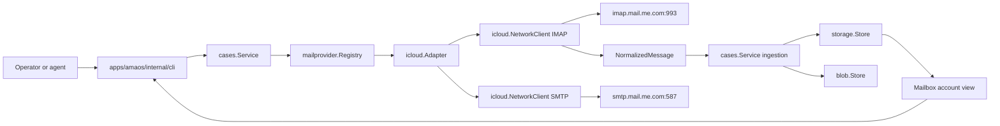
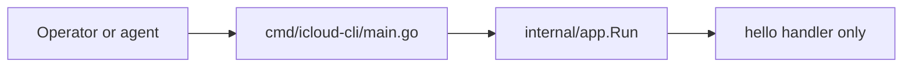
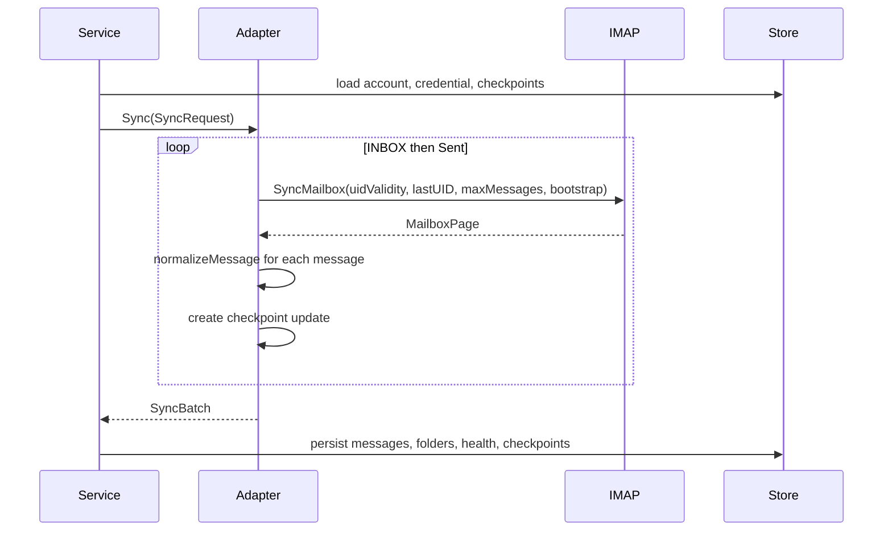

# iCloud Mail Portability Sweep

## Research basis

- **Sweep date:** 2026-08-05
- **Source repository:** `amxv/gg-ama`, branch `main`, commit `d5c15aff9b7cab98ef6e4ad9b360eab96b20420b`
- **Zodex source checkout:** `/tmp/icloud-cli-recon/gg-ama` (read-only research clone)
- **Destination research baseline:** `amxv/icloud-cli`, branch `main`, commit `2bf55d1a4f68c8d49391fa32bd59f2c1447120c8`
- **Publication base preserved before this report landed:** `69e77c711a96d6ba8cd97d882aa010f0b2752687` (canonical docs URL and docs-only Vercel deployment filter)
- **Named workflow artifact consumed:** user-supplied `sweep.md`
- **Inspection rule:** `gg-ama` was treated as read-only. No Rust build, Go build, test, migration, network mailbox operation, or repository mutation was performed.
- **Markdown boundary:** repository Markdown was not used as research input for this sweep; the map below follows Go, SQL, JavaScript, TypeScript/Astro wiring, tests, and Git history.

## Scope

This report maps the existing iCloud Mail implementation in `apps/amaos`, the generic mail orchestration around it, and the empty `icloud-cli` scaffold that is intended to receive a standalone implementation. It records current behavior only. It does not prescribe the standalone architecture or implementation order; those decisions belong to the linked blueprint.

The source implementation is not a single package. `apps/amaos/internal/mailprovider/icloud` owns iCloud protocol behavior, but working mail flows cross provider contracts, normalization, orchestration, persistence, blob storage, CLI presentation, and tests.

## Architecture map



The current destination repository has no equivalent mail path:



## Repository coordinates and size

### `gg-ama`

The inspected Zodex checkout is `/tmp/icloud-cli-recon/gg-ama`. The mail-relevant Go implementation is concentrated in these areas:

| Area | Files | Current responsibility |
| --- | --- | --- |
| Provider contract | `apps/amaos/internal/mailprovider/provider.go` | Provider registry and normalized cross-provider request/result types |
| iCloud provider | `apps/amaos/internal/mailprovider/icloud/*.go` | IMAP sync/read/state, SMTP send, RFC822/MIME parsing, secret resolution |
| Normalization | `apps/amaos/internal/mailnorm/normalize.go` | Address canonicalization, thread identity, message dedupe keys |
| Orchestration | `apps/amaos/internal/cases/service.go` | Account lifecycle, sync, ingestion, reply policy, local read model, send attempts |
| Persistence | `apps/amaos/internal/storage/*` | Accounts, credentials, folders, messages, recipients, attachments, checkpoints, attempts |
| Blob storage | `apps/amaos/internal/blob/r2.go` | External attachment bytes in deployed service |
| Contracts | `apps/amaos/internal/contracts/contracts.go` | API/CLI response and request shapes |
| CLI | `apps/amaos/internal/cli/app.go` | Human/JSON command parsing, filtering, rendering, dry-run output, sync watch |
| Tests | corresponding `*_test.go` files | Provider, service, CLI, and backend behavioral contracts |

Line counts at the inspected source commit:

- `internal/mailprovider/icloud`: 2,042 production lines and 455 test lines.
- `internal/mailprovider/provider.go`: 217 lines.
- `internal/mailnorm`: 134 production lines and 98 test lines.
- `internal/cases/service.go`: 5,568 lines; `service_test.go`: 2,682 lines.
- `internal/cli/app.go`: 4,695 lines; `app_test.go`: 1,879 lines.

### `icloud-cli`

The destination is a bootstrapped template:

- `go.mod` declares `github.com/amxv/icloud-cli` and Go 1.26, with no dependencies.
- `cmd/icloud-cli/main.go` delegates to `internal/app.Run`.
- `internal/app/app.go` contains only help, version, and `hello`.
- `internal/app/app_test.go` tests help, version, hello, and unknown-command behavior.
- `Makefile`, npm postinstall, and the release workflow already build a native binary named `icloud` from the Go entrypoint named `icloud-cli`.
- `package.json` exposes the npm command as `icloud-cli`, while `project.config.json` and release assets use binary name `icloud`.
- The Astro/ZueDocs site is wired at `https://icloud.ashray.xyz` but still contains template command/content areas.
- `scripts/should-build-docs.mjs` and `vercel.json.ignoreCommand` skip Vercel builds when docs-relevant paths did not change.

This means the destination has distribution and documentation plumbing, but no account, storage, secret, protocol, mail-domain, or agent-output implementation.

## Entry points and control flow

### AMAOS CLI entry

`apps/amaos/cmd/amaos/main.go` calls `cli.Run`. `internal/cli/app.go` selects local or remote mode and dispatches `mail` to `runMail` or `runMailRemote`.

`runMailCore` exposes these command families:

```text
account
sync
case
inbox
search
latest
health
thread
message
attachments
mark-read
mark-unread
archive
unarchive
send
reply
reply-all
request-doc
```

The local and remote paths share parsing and rendering through `mailCommandAPI`. The local implementation binds function fields to `cases.Service`; the remote implementation binds them to HTTP requests. The provider transport itself is only used by the service.

### Service provider registration

`cases.NewService` constructs a `mailprovider.Registry`. `registerDefaultMailProviders` registers iCloud as:

```go
registry.Register(mailprovider.ProviderICloud, func() mailprovider.Adapter {
    return icloud.NewProductionAdapter()
})
```

`icloud.NewProductionAdapter` creates one `NetworkClient` and supplies it as both the sync and send client:

```go
func NewProductionAdapter() *Adapter {
    client := NewNetworkClient(NetworkConfig{}, EnvFileSecretResolver{})
    return NewAdapter(client, client)
}
```

## Provider contract

`apps/amaos/internal/mailprovider/provider.go` defines the seam between orchestration and transport:

```go
type Adapter interface {
    Provider() string
    Capabilities() []string
    DefaultFolders() []Folder
    Sync(ctx context.Context, req SyncRequest) (SyncBatch, error)
    FetchMessage(ctx context.Context, req FetchMessageRequest) (NormalizedMessage, error)
    FetchThread(ctx context.Context, req FetchThreadRequest) (FetchThreadResult, error)
    UpdateThreadState(ctx context.Context, req ThreadStateRequest) error
    Send(ctx context.Context, req SendRequest) (SendResult, error)
}

type StatusAdapter interface {
    RemoteStatus(ctx context.Context, req RemoteStatusRequest) (RemoteStatusResult, error)
}
```

The generic model preserves provider identity rather than flattening it away. `NormalizedMessage` carries:

- provider message and thread references;
- RFC `Message-ID`, `In-Reply-To`, and `References`;
- direction;
- sender and Reply-To;
- subject, snippet, full text body, full HTML body, and internet headers;
- sent and received timestamps;
- To, CC, and BCC recipients;
- attachment metadata and optional bytes;
- provider metadata.

`SendRequest` carries account and credential records, provider thread reference, recipients, subject, text/HTML bodies, custom headers, and attachment bytes. This contract is generic, but its account and credential parameters are coupled to AMAOS storage types.

## iCloud adapter

`apps/amaos/internal/mailprovider/icloud/adapter.go` wraps protocol clients and translates them to the provider contract.

### Capabilities and default folders

`Adapter.Capabilities` returns:

```text
sync
fetch_message
fetch_thread
send
reply
reply_all
```

`Adapter.DefaultFolders` returns only logical Inbox and Sent folders. There is no generic folder enumeration exposed through the adapter contract.

### Sync scopes

The adapter recognizes two checkpoint scopes:

```text
folder:INBOX
folder:Sent
```

For each scope, `Adapter.Sync` reads `uid_validity` and `last_seen_uid` from checkpoint metadata, determines whether this is a bootstrap, and calls `SyncClient.SyncMailbox`. A successful page produces normalized messages and a `CheckpointUpdate`; a failed page produces a failed checkpoint update and aborts the entire adapter sync.



`SyncRequest.MaxChanges` is present in the generic contract and CLI, but the iCloud adapter never reads it. Only `MaxMessages` affects iCloud work.

### Message normalization

`normalizeMessage` maps a parsed iCloud message to `mailprovider.NormalizedMessage`:

- provider message reference is `<mailbox>:<uid>`;
- direction is outbound only when the logical mailbox equals Sent;
- Inbox messages set `ReceivedAt`; Sent messages set `SentAt`;
- attachments are SHA-256 hashed and assigned a storage key under `mail/icloud/<mailbox>/<uid>/<filename>`;
- metadata repeats provider, mailbox, UID, and message reference.

The provider thread reference comes from `buildThreadRef`, documented later under landmines.

## IMAP transport

`apps/amaos/internal/mailprovider/icloud/imap.go` implements an IMAP client directly over `net.Conn` and `bufio.Reader` rather than using an external IMAP library.

### Network defaults

```go
const (
    defaultIMAPHost = "imap.mail.me.com"
    defaultIMAPPort = "993"
    defaultSMTPHost = "smtp.mail.me.com"
    defaultSMTPPort = "587"
)
```

`NetworkConfig` permits host, port, and timeout overrides. `NewNetworkClient` defaults the timeout to 30 seconds and installs it on `net.Dialer`. IMAP uses `tls.Dialer` with TLS 1.2 minimum.

The timeout bounds connection establishment. The session does not set read or write deadlines for individual commands after the connection succeeds.

### Authentication

`resolveAuth` requires a `MailboxCredentialRecord` with a non-empty `SecretRef`, resolves the password, then chooses:

- IMAP username: `MailboxAccountRecord.ProviderAccountRef`, falling back to `EmailAddress`;
- SMTP username: full `EmailAddress`.

`EnvFileSecretResolver` supports:

```text
env://NAME
env:NAME
$NAME
file:///path
file:/path
```

The default unsupported-scheme error does not echo the reference tail, preventing accidental secret-name disclosure. The implementation does not use an OS credential vault.

### Session command set

`imapSession.run` writes tagged commands and reads lines until the matching tagged completion. It detects a single literal marker at the end of a line and reads that many bytes. Higher-level methods implement:

- `LOGIN`
- `LIST`
- `SELECT`
- `STATUS`
- `UID SEARCH`
- `UID FETCH`
- `UID STORE`
- `UID COPY`
- `EXPUNGE`
- `LOGOUT`

There is no capability negotiation, `IDLE`, `MOVE`, `UID EXPUNGE`, `CONDSTORE`, `QRESYNC`, `NAMESPACE`, or append/create/rename/delete mailbox path.

### Sent mailbox discovery

`resolveMailbox("Sent")` runs `LIST "" "*"` and looks for:

1. a mailbox carrying `\Sent`;
2. `Sent`;
3. `Sent Messages`;
4. `Sent Mail`.

A missing Sent mailbox is represented by `errOptionalMailboxMissing`; sync returns an empty successful page and thread search omits Sent. Other logical mailbox names are returned unchanged and do not use special-use discovery.

The `LIST` parser assumes a line-oriented, relatively simple quoted or atom delimiter/name response. It does not decode modified UTF-7 itself.

### Mailbox status

`RemoteMailboxStatus` resolves the logical mailbox and issues:

```text
STATUS <mailbox> (MESSAGES UNSEEN UIDNEXT UIDVALIDITY)
```

The parser extracts counts with a regular expression. The actual discovered mailbox name is retained in metadata while the outward status uses the logical name.

### Sync selection

`SyncMailbox` performs:

1. login and logical mailbox resolution;
2. `SELECT`, extracting `UIDVALIDITY`;
3. reset `afterUID` to zero if UID validity changed;
4. `UID SEARCH UID <after+1>:*`, or `UID SEARCH UID 1:*` during bootstrap;
5. sort all returned UIDs in memory;
6. select a bounded subset;
7. fetch each selected message as full RFC822;
8. parse the complete message and every attachment into memory.

Bootstrap behavior:

- Inbox selects the newest `maxMessages` UIDs and treats the current remote tail as acknowledged.
- Sent fetches no historical messages and treats the current remote tail as acknowledged.

Incremental behavior selects the first `maxMessages` UIDs. The current cursor bug is described in Landmines.

### Fetch fallback

`fetchRFC822` tries, in order:

```text
UID FETCH <uid> (UID RFC822)
UID FETCH <uid> (UID BODY.PEEK[])
UID FETCH <uid> (UID BODY[])
```

A response with no literal tries the next form. If all forms return no literal, it returns `errNoMessageLiteral`. During sync, that specific error is skipped; other fetch or parse errors fail the page.

### Thread fetch

`FetchThread` treats `<mailbox>:<uid>` as a single-message reference. Otherwise it searches both mailbox targets using:

```text
OR OR HEADER Message-ID <ref> HEADER In-Reply-To <ref> HEADER References <ref>
```

Every result is fetched as full RFC822 and the combined set is sorted by `ReceivedAt`.

### Thread state mutation

`UpdateThreadState` searches each mailbox target for the thread reference, then applies:

- `mark-read`: add `\Seen`;
- `mark-unread`: remove `\Seen`;
- `archive`: for Inbox matches, copy to literal mailbox `Archive`, add `\Deleted`, and `EXPUNGE`;
- `unarchive`: for every non-Inbox target, copy matches to Inbox.

The request is thread-level, not message-location-level. It does not return updated UIDs, flags, or folder observations.

## RFC822 and MIME parsing

`apps/amaos/internal/mailprovider/icloud/message.go` uses `net/mail`, `mime`, `mime/multipart`, `encoding/base64`, and `mime/quotedprintable`.

`parseRFC822Message`:

- reads the complete RFC822 message;
- joins repeated header values into one string per header name;
- parses full text and HTML bodies;
- extracts attachments;
- parses `Message-ID`, `In-Reply-To`, and whitespace-delimited `References`;
- decodes MIME words in subjects, display names, and filenames;
- parses sender, Reply-To, To, CC, and BCC;
- sets both `SentAt` and `ReceivedAt` from the Date header;
- substitutes `time.Now().UTC()` when Date is absent or invalid.

`parseMultipart` recursively handles nested multipart entities. A part is treated as an attachment when it has a filename or `Content-Disposition: attachment`; non-attachment `text/plain` and `text/html` parts are accumulated as bodies. Other parts become attachments, including `inline` content with `Content-ID`.

Transfer decoding supports base64, quoted-printable, and unencoded bodies. It does not convert declared non-UTF-8 body charsets to UTF-8. It also does not model `message/rfc822` as an embedded message tree.

`buildSnippet` uses the text body, or strips HTML with a simple in-tag boolean, then keeps the first 32 whitespace-separated fields.

## SMTP transport and message composition

`apps/amaos/internal/mailprovider/icloud/smtp.go` uses the frozen standard-library `net/smtp` client.

### Connection and authentication

`NetworkClient.smtpClient` opens plain TCP to port 587. `Send` checks whether STARTTLS is advertised and upgrades when present. It then authenticates using SMTP PLAIN with the full iCloud email address and app-specific password.

The code does not make missing STARTTLS an explicit error before authentication. TLS 1.2 minimum is configured when STARTTLS occurs.

### MIME composition

`buildSMTPMessage` creates:

- standard From, To, Subject, Date, Message-ID, and MIME-Version headers;
- optional CC;
- `In-Reply-To` and `References` when `ThreadRef` is non-empty;
- caller-provided custom headers except BCC;
- quoted-printable text bodies;
- multipart/alternative for text plus HTML;
- multipart/mixed for attachments, nesting multipart/alternative when required;
- base64 attachment data wrapped at 76 characters.

The BCC list is used for SMTP envelope recipients but omitted from RFC822 headers. Recipient addresses across To, CC, and BCC are trimmed and deduplicated case-insensitively.

The generated From header contains only the email address; `MailboxAccountRecord.DisplayName` does not reach the provider send request.

The complete outgoing message and each encoded attachment are assembled in memory before SMTP DATA.

### Send result

The provider result contains:

- provider message reference: generated Message-ID without angle brackets;
- provider thread reference: request thread reference, otherwise generated Message-ID;
- RFC Message-ID;
- send time.

No remote Sent-folder UID is known at SMTP acceptance time.

## Generic normalization and deduplication

`apps/amaos/internal/mailnorm/normalize.go` owns provider-neutral identities.

### Addresses

`CanonicalizeAddress` lowercases and trims. It does not parse aliases, Unicode domains, or provider-specific equivalence.

### Thread identity

`BuildThreadIdentity` returns `<provider>:<account>:<providerThreadRef>` whenever a provider thread reference exists. Without one, it hashes provider, account, lowercased subject, and sorted canonical participants.

For iCloud, `buildThreadRef` almost always supplies a reference, so the subject/participant fallback is rarely used.

### Message dedupe

`BuildMessageDedupeKey` chooses:

1. `rfc:<account>:<RFC Message-ID>`;
2. `provider:<account>:<provider message ref>`;
3. content fingerprint when `PreferContentKey` is true;
4. a fallback hash containing only the account ID.

The content fingerprint includes account, subject, sender, Reply-To, In-Reply-To, sorted references, sorted To/CC recipients, sorted attachment hashes, and sent/received time truncated to a minute.

`cases.Service.resolveExistingMessageID` uses content-fingerprint matching primarily to merge Cloudflare alias-ingest observations with later provider sync. Two ordinary provider observations with distinct provider references are intentionally not collapsed solely by content.

## Account, sync, and send orchestration

`apps/amaos/internal/cases/service.go` owns the durable operational workflow around the transport.

### Account registration

`RegisterMailboxAccount`:

- validates provider, email, auth kind, and secret reference;
- requires a registered provider adapter;
- upserts by provider plus email;
- creates or updates account and credential records;
- assigns provider capabilities when none are supplied;
- initializes default folders;
- creates an account checkpoint;
- sets health to `pending_sync`;
- appends AMAOS events and projection commits.

An iCloud account is considered connected before a live IMAP or SMTP authentication check occurs.

### Sync orchestration

`SyncMailboxAccount`:

1. loads account, credential, and checkpoints;
2. resolves the provider adapter;
3. chooses configured max-change and max-message limits;
4. calls `Adapter.Sync`;
5. on provider failure, persists credential mutations, degraded health, and returned checkpoint failures;
6. stages attachment bytes through `blob.Store` when configured;
7. in one store update, ingests normalized messages, updates account health, and upserts checkpoints;
8. emits AMAOS events and returns counts.

`stageNormalizedMessageBlobs` uploads each attachment separately and clears inline bytes after a successful blob write. Without a blob store, attachment bytes remain inside the storage record.

### Ingestion

`ingestNormalizedMessage`:

- calculates participants and local thread identity;
- calculates message dedupe and stable local IDs;
- upserts the thread and message;
- replaces all stored recipients for the message;
- replaces all attachments for the message;
- resolves AMA case/document-request links;
- optionally promotes attachments into AMA documents;
- recomputes aggregate thread state.

The generic portion of this flow is interleaved with case links, document requests, metrics, events, and projections.

### Health and operations

`GetMailboxOpsStatus` combines:

- account status and health;
- local checkpoint summaries and lag;
- `more_pending` derived from checkpoint metadata;
- live remote mailbox status.

`RebaselineMailbox` requires `current_tail=true`, derives the new cursor from remote status, updates only the checkpoint, and explicitly preserves stored messages.

`SweepMailboxAccounts` selects connected accounts with no previous sync first, then oldest successful sync time, and executes bounded account syncs.

### Send orchestration

`executeOutboundSend`:

1. validates account, at least one To recipient, and subject;
2. loads account, credential, optional thread, optional AMA document request, and attachment bytes;
3. canonicalizes and deduplicates recipients;
4. invokes provider `Send`;
5. on error, records a failed outbound attempt;
6. on success, records a sent attempt and immediately creates a normalized outbound message locally;
7. links the resulting thread to AMA case/document state when present.

The local outbound message is created before a later Sent-folder sync observes the provider copy. Dedupe is expected to reconcile the two observations.

### Reply orchestration

`ReplyToMailThread` loads the latest stored message in a local thread as the parent. It then:

- chooses Reply-To, falling back to From;
- prefixes `Re:` only when absent;
- sets `In-Reply-To` to the parent RFC Message-ID;
- extends `References` with the parent RFC Message-ID;
- excludes the acting mailbox from reply-all;
- keeps Reply-To in To;
- places remaining prior recipients in CC;
- removes duplicates across To and CC;
- permits requested To/CC additions or overrides.

This recipient and RFC threading logic is provider-neutral. Attachment inputs are AMA document IDs rather than filesystem paths.

## Persistence model

The mail tables were introduced in `apps/amaos/internal/storage/migrations/00004_mail_foundation.sql`. The same conceptual state is represented by structs in `internal/storage/store.go` and round-tripped by file, Postgres, and D1 stores.

### Operational records

```text
MailboxAccountRecord
MailboxCredentialRecord
MailboxFolderRecord
MailThreadRecord
MailMessageRecord
MailRecipientRecord
MailAttachmentRecord
MailSyncCheckpointRecord
MailOutboundAttemptRecord
```

The durable SQL tables are:

```text
mailbox_accounts
mailbox_credentials
mailbox_folders
mail_threads
mail_messages
mail_recipients
mail_attachments
mail_sync_checkpoints
mail_outbound_attempts
```

### Message record

`MailMessageRecord` stores full bodies and headers even though the public summary does not expose them:

```go
type MailMessageRecord struct {
    MailMessageID       string
    MailThreadID        string
    MailboxAccountID    string
    ProviderMessageRef  string
    ProviderThreadRef   string
    RFCMessageID        string
    InReplyTo           string
    References          []string
    Direction           string
    FromName            string
    FromEmailAddress    string
    ReplyToEmailAddress string
    Subject             string
    Snippet             string
    TextBody            string
    HTMLBody            string
    InternetHeaders     map[string]any
    SentAt              *time.Time
    ReceivedAt          *time.Time
    DeduplicationKey    string
    Metadata            map[string]any
    CreatedAt           time.Time
    UpdatedAt           time.Time
}
```

### Folder observations

There is no separate message-location record. An iCloud message's mailbox is embedded in `ProviderMessageRef` and message metadata. `messageFolderRefs` reads `metadata["folder_refs"]`, falling back to `metadata["mailbox"]`.

As a result, one logical message record cannot independently retain multiple folder/UID/flag observations without merging them into metadata or duplicating the message.

### IDs

Message, thread, attachment, folder, and checkpoint IDs are deterministic SHA-256 prefixes for their input identity. Account and credential IDs are generated from current map counts:

```go
func nextMailboxAccountID(state *storage.State) string {
    return fmt.Sprintf("mbx_%02d", len(state.MailboxAccounts)+1)
}
```

The map-count method assumes records are not removed and that one serialized store update controls creation.

### File-store behavior

The local AMAOS file backend serializes the entire state as `state.json`. It has an in-process mutex and writes a temporary file followed by rename. It has no cross-process lock. Deployed AMAOS uses Postgres or D1 instead.

## Read model and CLI search

`GetMailboxAccountView` materializes all folders, threads, messages, document requests, and observability for one account. `runMailInbox` and `runMailSearch` then filter that materialized view in the CLI process.

Supported filters include:

- account ID or email;
- unread threads;
- From or participant;
- subject substring;
- message ID or RFC Message-ID;
- folder and label;
- date range;
- free-text query over thread subject/snippet/participants and message subject/snippet/sender/RFC ID;
- result limit.

Sorting also occurs in memory. There is no SQL text index, server-side pagination cursor, or IMAP remote-search command exposed by the CLI.

`MailMessageSummary` omits `TextBody`, `HTMLBody`, and internet headers. `amaos mail message` therefore prints sender, subject, time, RFC ID, snippet, and attachment names, but not the full body that exists in storage.

## Existing CLI behavior

### Account and synchronization

```text
amaos mail account list
amaos mail account connect
amaos mail account status
amaos mail sync run
amaos mail sync watch
amaos mail sync status
amaos mail sync checkpoints
amaos mail sync rebaseline
```

`sync watch` repeats bounded sync operations, handles SIGINT, and emits JSON lines with `started`, `result`, `error`, `stopped`, and `completed` events when `--json` is selected.

### Read and state operations

```text
amaos mail inbox
amaos mail search
amaos mail latest
amaos mail health
amaos mail thread
amaos mail message
amaos mail attachments
amaos mail mark-read
amaos mail mark-unread
amaos mail archive
amaos mail unarchive
```

Attachment CLI behavior lists metadata and can promote selected attachments into AMA case documents. It has no generic save-to-filesystem operation.

### Send operations

```text
amaos mail send
amaos mail reply
amaos mail reply-all
```

Send/reply inputs support:

- To, CC, and BCC;
- text body inline, file, or stdin;
- HTML body inline, file, or stdin;
- attachment document IDs;
- human text or JSON output;
- `--dry-run` and `--confirm` flags.

`--dry-run` prevents provider invocation and prints normalized request data. `--confirm` is parsed but is not required for a real send: when neither flag is supplied, the command sends. The only enforced relationship is that both flags cannot be present together.

## Tests and encoded contracts

### iCloud provider tests

`internal/mailprovider/icloud/adapter_test.go` covers:

- normalized Inbox message and attachment bytes;
- two checkpoint updates;
- remote status mapping;
- environment secret references;
- secret-reference error redaction;
- one multipart/mixed message with a base64 PDF;
- BCC header omission while retaining envelope recipients.

`internal/mailprovider/icloud/imap_test.go` covers:

- RFC822 fetch fallback to BODY.PEEK;
- no-literal error;
- Sent special-use discovery and common-name fallback;
- optional missing Sent;
- bootstrap Inbox tail;
- bootstrap historical Sent skip;
- incremental forward-page selection.

The incremental test expects `highestUID` to equal the last UID in the complete search result even when only an earlier subset is selected. It therefore encodes the cursor landmine rather than detecting it.

### Normalization tests

`internal/mailnorm/normalize_test.go` covers basic address canonicalization, provider-thread preference, subject/participant fallback identity, and dedupe key precedence.

### Service tests

Mail-oriented service tests cover:

- default production iCloud registration;
- account registration and canonical sync ingestion;
- remote status and checkpoints;
- credential metadata mutation persistence;
- oldest-account sweep ordering;
- current-tail rebaseline without deleting messages;
- outbound attempt and local thread creation;
- attachment byte loading;
- mailbox-scoped read/send;
- reply-all recipient and RFC-header construction;
- attachment validation;
- alias/provider dedupe;
- thread-state local update;
- storage backend mail round trips.

Most service tests use a fake provider adapter. They validate orchestration contracts but do not exercise iCloud protocol exchanges beyond the small `net.Pipe` tests in `imap_test.go`.

### CLI tests

CLI tests cover mailbox-scoped inbox/search/send/reply, dry-run output, attachment argument propagation, diagnostics, checkpoints, rebaseline output, bounded watch JSONL, local thread/message/search presentation, and remote routing.

There are no tests for a mandatory confirmation gate because the current command does not enforce one.

### Uncovered behavior

No current test demonstrates:

- a live iCloud login or send;
- mailbox flags fetched from IMAP;
- read/unread reconciliation after sync;
- archive or unarchive protocol exchanges;
- duplicate folder observations;
- changed UIDVALIDITY recovery over stored data;
- international mailbox names;
- non-UTF-8 body conversion;
- large-message or large-attachment bounds;
- interrupted page persistence;
- ambiguous SMTP acceptance;
- simultaneous CLI processes;
- raw MIME export;
- attachment byte export.

## Git history of the mail implementation

The mail layer was built in a concentrated sequence on 2026-06-21:

| Commit | Subject | Behavioral area |
| --- | --- | --- |
| `b1e679f` | `amaos: add mail domain foundation` | storage records, contracts, migrations, projections, normalization |
| `63a82af` | `amaos: add mailbox sync foundation` | provider contract, iCloud/Gmail adapters, sync orchestration |
| `f7c1eeb` | `amaos: add mail cli surface` | first large mail command family |
| `1cf8c5a` | `amaos: finish mail cli parity` | read/write CLI parity |
| `4dcaddc` | `amaos: harden mail provider parity paths` | provider behavior fixes |
| `100c1ff` | `amaos: preserve provider mail identity` | provider/RFC identity retention |
| `5a5775e` | `Wire production iCloud mail transport` | live IMAP/SMTP client |
| `7838567` | `Fix iCloud fetch fallback and mailbox-scoped CLI mail` | BODY.PEEK fallback, non-case operation |
| `3461dbe` | `Resolve iCloud sent mailbox via LIST` | special-use Sent discovery |
| `8f82d2b` | `Fix AMAOS mailbox-scoped search and iCloud sync bootstrap` | current-tail bootstrap behavior |
| `317b85d` | `Fix account-scoped mail reply CLI` | mailbox-only reply path |
| `c085053` | `Add AMAOS mailbox ops diagnostics CLI` | status/checkpoints/rebaseline |
| `1ac144c` | `Harden AMAOS mail attachment workflows` | attachment durability and validation |
| `8c7c38a` | `Add background mailbox sweep and safe mail previews` | sweep and dry-run UX |

The sequence explains several current shapes: the generic domain and provider seam existed before the production IMAP parser; mailbox-only use was added after case-oriented CLI commands; and diagnostics/bootstrap behavior were later hardening passes.

## Portability boundary

### Generic mail behavior embedded in AMAOS

The following current behaviors have no inherent legal or immigration dependency, although some signatures use AMAOS storage types:

- account and credential metadata;
- secret-reference resolution;
- iCloud network defaults and authentication split;
- mailbox discovery and status;
- UID-based sync checkpoints;
- RFC822/MIME parsing;
- normalized messages, recipients, attachments, and provider identities;
- attachment hashing;
- dedupe identities;
- local thread aggregation;
- reply/reply-all recipient construction;
- RFC reply headers;
- SMTP composition and BCC handling;
- send-attempt recording;
- local mailbox views, filters, and rendering;
- sync watch events and diagnostics.

### AMA-bound behavior

These current behaviors require AMA domain objects or deployed AMA infrastructure:

- case-linked mailbox and thread views;
- document-request aliases and Cloudflare ingest;
- attachment promotion into case documents;
- outbound attachments addressed by AMA document ID;
- mailbox-case and thread-case links;
- AMA actors, idempotency event records, ledger events, projections, and commits;
- Postgres/D1/R2 deployment assumptions;
- remote AMAOS HTTP authentication and OpenAPI routes;
- Gmail provider and Gmail OAuth setup.

### Mixed functions

Several high-value generic algorithms live inside mixed AMA functions:

- `executeOutboundSend` combines provider-neutral attempt/send/ingest behavior with case/document loading and events.
- `ingestNormalizedMessage` combines generic message/recipient/attachment upsert with case linking and document fulfillment.
- `GetMailboxAccountView` is generic in data selection but returns a case-shaped response containing empty or irrelevant document-request fields.
- `UpdateMailThreadState` combines provider mutation with case event publication.

A downstream reader cannot copy these functions wholesale without carrying AMA storage and event dependencies.

## Landmines

### 1. Incremental sync can acknowledge messages it never fetched

`selectSyncUIDs` calculates `highestUID` from the final UID in the entire search result before truncating the selected page:

```go
highestUID := afterUID
if len(uids) > 0 && uids[len(uids)-1] > highestUID {
    highestUID = uids[len(uids)-1]
}
if !bootstrap {
    moreAvailable := len(uids) > maxMessages
    selected := append([]uint32(nil), uids...)
    if moreAvailable {
        selected = selected[:maxMessages]
    }
    return selected, highestUID, moreAvailable
}
```

`Adapter.Sync` persists `page.HighestUID` as `last_seen_uid`. With pending UIDs `[21,22,23]` and page size 2, messages 21 and 22 are fetched, cursor 23 is committed, and UID 23 will not appear in the next `UID 24:*` query. `MoreAvailable=true` does not prevent the cursor skip. `TestSelectSyncUIDsIncrementalPreservesForwardPaging` currently asserts `highestUID == 23` and therefore protects the defect.

### 2. `MaxChanges` is a deceptive no-op for iCloud

The service, contracts, CLI, and sweep API expose `MaxChanges`, but the iCloud adapter ignores it. Agents can supply the flag and receive no error or observable indication that it has no effect.

### 3. UID search result size is unbounded

Even with `MaxMessages`, `UID SEARCH UID <n>:*` returns every matching UID and the implementation stores/sorts the entire list before truncating. The page fetch is bounded; the search response and memory work are not.

### 4. Message flags are never fetched

`fetchRFC822` requests the message body but not `FLAGS`, `INTERNALDATE`, RFC822 size, or mod-sequence. The normalized iCloud message therefore cannot preserve `\Seen`, `\Flagged`, `\Answered`, `\Draft`, or `\Deleted`.

Remote `UNSEEN` is available only as a mailbox aggregate from STATUS.

### 5. Sync recomputation resets unread state

`recomputeThread` explicitly sets:

```go
thread.UnreadCount = 0
```

It never derives unread count from message flags because flags are absent. A locally marked-unread thread can return to zero on later message ingestion, and newly synced unread mail is represented as read unless some other source injected label metadata.

### 6. Thread-wide mutations scan Sent as well as Inbox

`UpdateThreadState` searches every `mailboxTarget`, currently Inbox and discovered Sent. A single RFC reference can match inbound and outbound copies. Mark-read/unread therefore applies to all matches, not a selected message or location.

### 7. Unarchive can copy Sent messages into Inbox

For `unarchive`, the implementation copies matches from every non-Inbox target to Inbox:

```go
case "unarchive":
    if !strings.EqualFold(mailbox.logical, "INBOX") {
        if err := session.copy(uidSet, "INBOX"); err != nil {
            return err
        }
    }
```

The only non-Inbox target is currently Sent. An outbound message matching the thread reference can be copied from Sent into Inbox. There is no Archive target in the search set, so the operation does not actually locate the archived Inbox copy it intends to restore.

### 8. Archive assumes a literal mailbox name

Sent receives special-use discovery, but Archive does not. `UID COPY ... "Archive"` fails for accounts whose archive mailbox has another localized or provider-specific name.

### 9. Archive/unarchive do not reconcile new UIDs or duplicate observations

COPY/MOVE creates a new UID in the destination. The current mutation returns no mapping and immediately updates only aggregate local thread status. The local message metadata continues to describe the previous mailbox/UID until a future sync, and unarchive does not delete the source copy.

### 10. Provider thread references can fragment an RFC conversation

`buildThreadRef` chooses immediate `In-Reply-To` before the first References entry:

```go
reference := strings.TrimSpace(message.InReplyTo)
if reference == "" && len(message.References) > 0 {
    reference = strings.TrimSpace(message.References[0])
}
```

In a chain A -> B -> C, B commonly points to A while C points to B. `BuildThreadIdentity` treats each non-empty provider thread reference as authoritative, so B and C can enter different local threads even though C's References chain contains A and B.

### 11. Thread search is limited to Inbox and Sent

`mailboxTargets` never includes Archive, Trash, Junk, Drafts, or user folders. Fetching or mutating a thread after messages move outside Inbox/Sent can return incomplete or empty results.

### 12. LIST parsing accepts only a narrow response shape

`parseListMailbox` manually slices parentheses, delimiter, and quoted name. It does not handle all IMAP string/literal forms or decode modified UTF-7. International and unusual mailbox names are not covered by tests.

### 13. No capability negotiation

The session assumes a minimal command set and cannot select safer or more efficient behavior from server capabilities. It cannot distinguish MOVE support, IDLE support, UIDPLUS, UTF8, LIST-EXTENDED, SPECIAL-USE, CONDSTORE, or QRESYNC.

### 14. Context cancellation does not bound established commands

Context is used during dialing. Once connected, `imapSession.run`, SMTP command reads, and body transfer do not apply per-operation deadlines derived from context. A stalled server can keep a process blocked beyond the caller's deadline.

### 15. STARTTLS is conditional rather than an explicit invariant

SMTP starts on plaintext TCP and upgrades only when the server advertises STARTTLS. The current code does not independently reject a server that lacks STARTTLS before attempting the rest of the flow.

### 16. MIME charset conversion is incomplete

MIME-word decoding uses a `mime.WordDecoder` without a `CharsetReader`, and body parsing ignores the `charset` parameter. Non-UTF-8 subjects, display names, filenames, or bodies can remain undecoded or fail to parse correctly.

### 17. Missing Date becomes the current wall clock

`parseRFC822Message` substitutes `time.Now()` for an absent or malformed Date. Re-fetching the same malformed message at another time can change ordering and any content fingerprint that incorporates time.

### 18. Full bodies are durable but not in the public read contract

`MailMessageRecord` stores text and HTML bodies. `MailMessageSummary` omits them, and the CLI message renderer prints only a snippet. A caller cannot retrieve the complete locally stored body through the existing mail CLI/API.

### 19. Attachment bytes cannot be exported directly

The CLI lists content hash/storage key and can promote an attachment into an AMA document. It cannot write the decoded attachment bytes to a requested path or stdout.

### 20. Message and attachment processing is whole-buffered

IMAP literals, complete MIME messages, decoded attachments, outgoing messages, and base64 output are held in memory. No current limit rejects an unexpectedly large email before allocation, and no stream-to-blob path exists.

### 21. Mailbox reads and searches load the entire account view

`GetMailboxAccountView` scans all account threads/messages into slices. CLI filters, search, sort, and limit happen afterward. Work grows with the entire synchronized mailbox even when the user asks for 20 results.

### 22. Sequential account IDs rely on map length

Deleting an account or concurrent unsynchronized creators can reuse `mbx_<count+1>`. The local file store's in-process mutex masks only same-process races and does not enforce a database uniqueness allocation strategy across processes.

### 23. File storage has no cross-process lock

Two CLI processes can load the same `state.json`, mutate separate copies, and each rename its result. The later write can silently discard the earlier process's work.

### 24. SMTP acceptance failure is not distinguishable from delivery rejection

If the server accepts DATA but the connection fails before the client receives or processes the final response, the provider call returns an error and the service records `failed`. Retrying that attempt can duplicate a message that was actually accepted. The attempt model has only sent/failed, not an unknown or reconciliation state.

### 25. Account registration does not test both protocols

A syntactically valid email, auth kind, and secret reference produces a connected account record. Incorrect IMAP username form, revoked app password, SMTP auth failure, or missing secret is discovered later during sync/send.

### 26. Display names are lost on outbound From

Account display name is stored and exposed, but the SMTP composer builds `mail.Address{Address: from}` without a name.

### 27. Provider fetch methods are not used by the current service read path

The adapter exposes `FetchMessage` and `FetchThread`, but AMAOS read commands use only the normalized local store. The iCloud fetch methods are effectively transport capabilities without a direct service/CLI caller, except internal iCloud `FetchThread` use.

### 28. Folder and flag concepts are stored as metadata conventions

`labels`, `folder_refs`, `mailbox`, UID, and message reference are string/map conventions rather than constrained relations. Misspelled keys or incompatible value shapes silently disappear from summaries.

### 29. Fallback dedupe identity is account-wide

When RFC ID and provider reference are both absent and content preference is false, `BuildMessageDedupeKey` hashes only the account ID. Multiple malformed provider messages without either identity can collapse to the same local ID.

### 30. Tests cover orchestration more strongly than protocol correctness

The service and CLI have broad fake-adapter tests, but iCloud wire behavior has only nine small IMAP tests and two parser/composer fixtures. Several dangerous paths—flags, archive, unarchive, cursor commit, cancellation, mailbox encoding, and ambiguous sends—have no provider-level regression test.

## Integration points and dependencies

### Apple-facing seams

- IMAP host/port, authentication username form, TLS, mailbox names, UIDs, UIDVALIDITY, flags, and RFC822 payloads.
- SMTP host/port, STARTTLS, PLAIN authentication, envelope recipients, and final DATA acceptance.
- App-specific password lifecycle is represented only as a secret reference; revocation appears as later authentication failure.

### AMAOS-facing seams

- Provider methods accept `storage.MailboxAccountRecord` and `storage.MailboxCredentialRecord`, so the iCloud package cannot be copied into another module without replacing those imports or recreating the records.
- The provider registry is multi-provider even though the destination is iCloud-specific.
- Normalized attachment storage keys assume AMA blob conventions.
- Service methods return case-oriented contract envelopes and publish AMA events.
- CLI attachments accept document IDs rather than file paths.

### Destination release seams

- Release assets already use native binary name `icloud` and `CGO_ENABLED=0` across macOS, Linux, and Windows architectures.
- The npm wrapper and package command currently use `icloud-cli`, not `icloud`.
- The docs site, changelog, README, package metadata, and generated release workflow still contain template identity or wording.
- The canonical docs URL is `https://icloud.ashray.xyz`, and `scripts/should-build-docs.mjs` is a live deployment optimization that future docs/package path changes must update rather than delete accidentally.
- Any storage or credential dependency must preserve static cross-platform release viability or require a coordinated release-contract change.

## Coverage statement

### Covered in depth

- The `icloud` provider package, including all production files and tests.
- Provider contracts and mail normalization.
- Mail account, sync, status, rebaseline, ingestion, send, reply, thread state, and attachment orchestration in `cases.Service`.
- Operational mail storage structs and SQL schema.
- Local mailbox view, CLI command dispatch, filters, output, safety flags, and sync watch.
- Mail-specific service, CLI, normalization, provider, and storage tests.
- The destination Go entrypoint, command scaffold, build/release/npm identity, docs wiring, canonical URL, and docs-only Vercel build filter.
- Mail implementation history through relevant commit subjects and selected change statistics.

### Touched only at the boundary

- Postgres and D1 row serialization internals: inspected enough to confirm mail records round-trip, not mapped table-by-table.
- R2 blob implementation: inspected only where mail attachments call `PutObject`/`GetObject`.
- HTTP/OpenAPI routes: command routing and contract presence were traced, but the standalone target has no requested server component.
- Gmail adapter: inspected only to understand the generic provider seam and tests; Gmail behavior is outside the target slice.
- Astro/ZueDocs internals: wiring and identity files were mapped; repository Markdown content was deliberately not read.

### Deliberately not covered

- Rust/Tauri application code in `gg-ama`.
- AMA case, assessment, review, portal, and document workflows except where mail directly calls them.
- Cloudflare alias Worker implementation beyond its normalized-ingest boundary.
- Production mailbox contents, live Apple server capability responses, or real app-password behavior; no credentials were used.
- iCloud services other than Mail.

### Remaining factual gaps

The repositories cannot establish:

- the exact capability set currently advertised by every iCloud Mail account/region;
- real mailbox folder naming and special-use combinations across the user's accounts;
- typical mailbox and attachment volumes the standalone CLI will encounter;
- whether any external consumer already invokes the scaffold's `icloud-cli` npm command;
- whether Apple will expose a generally available non-password authorization flow usable by this CLI.

Those unknowns are carried as explicit assumptions in the blueprint rather than guessed here.
